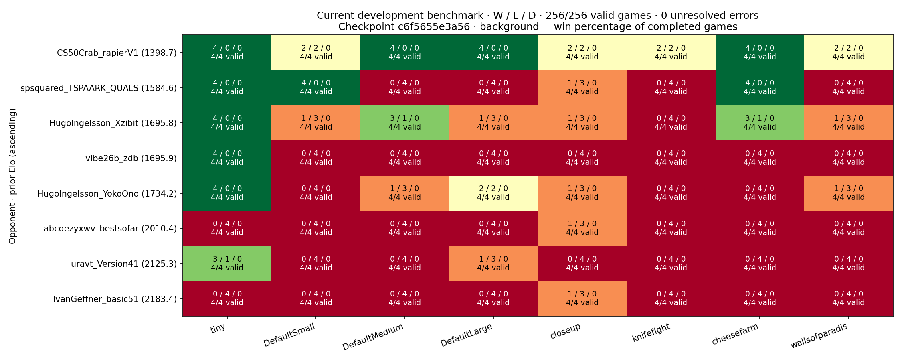
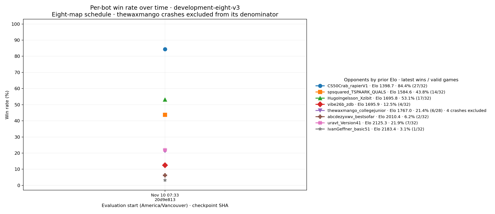
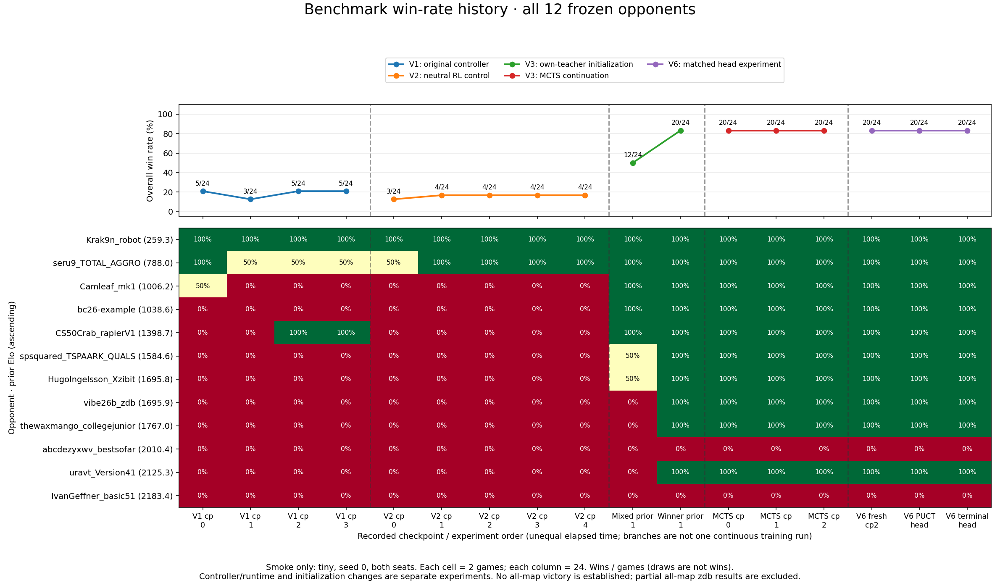

# Battlecode 2026 Alpha0: progress

Status, results and charts of the experiments. For what this repository is and how to run it, see the [README](README.md).

## Current work: bootstrap from zdb by imitation, then RL

<!-- CURRENT_WORK_START -->
**Goal.** Train a network to imitate `zdb` (the current best bot from [battlecode26b-vibe](https://github.com/terryvanbelle/battlecode26b-vibe)) well enough to be a competent starting point, then improve it with self-play RL. Exact imitation isn't required.

**Approach.**
- **Recording:** zdb plays ordinary full games, and a hook around every controller call records what the acting robot could see together with the action it took.
- **Student:** a per-robot network chooses one primitive action at a time (move, turn, attack, build, ratnap, traps, cheese…) from that robot's own observations and memory.
- **Runtime:** the network runs inside the Java engine, so games run at engine speed and the bot can later become an all-Java tournament player.

Details: [lean imitation pipeline](docs/lean-imitation.md).

**Status (November 15, 2026, 19:10 PDT).**
- student-v4 (observation v1) nearly matches zdb on long maps but **fails the frozen gate** on the held-out field: 0.15 against a bar of 0.20, where zdb scores 0.33.
- Two missing pieces of information explain the early king deaths. First, zdb's babies act on the kings' shared array (threat alerts, king positions); observation v2 adds a team board for that. Second, zdb turns to face enemies it remembers but can't currently see, to avoid being grabbed and thrown. Per-round death traces showed this is how the student's babies die. Observation v3 adds a short-term memory of enemies.
- **Design principle:** the model that starts RL must be able, at least in principle, to do anything a hand-coded bot can. The audit found missing capabilities: cheese-boosted bites, squeaks and shared-array writes, cheese amounts, writable memory, and full sensing. The next student (actions v2 / observation v4) will close these gaps. [Capability audit and plan](docs/capability-principle.md).
- student-v7 (observation v3) scored 1/32 against zdb and still loses the small maps, so enemy memory alone isn't enough. The obs-v3 DAgger round was stopped to free the VM for the capability-complete student.
- **Implemented: actions v2 / observation v4.** It adds squeaks, shared-array writes, cheese-boosted bites, pickup and transfer amounts, private registers, the raw shared array, heard squeaks, full RobotInfo, and a 60×60 map memory. Every zdb call is now a training label. [Details](docs/capability-principle.md#implemented-november-13-2026-student-actions-v2--student-obs-v4--student-mlp-v2).
- `resign()` removed from the action space (actions v3, 664 actions): it only forfeits the game. Records already collected still load.
- **Second worker:** a Windows 11 desktop (WSL2 over Tailscale) now plays 3/4 of each run's games; it is about 4x as fast as the VM and plays identical games. The VM fills in anything it doesn't finish. [box_split.sh](scripts/box_split.sh), [box_helper.sh](scripts/box_helper.sh).
- **student-v9 (capability-complete): 1/32 against zdb.** Diagnosis: its king writes its own position into the shared array correctly only 2–17% of the time, so babies can't find it to deliver cheese and the king starves. Fix: the parameter head now gets binary copies of the integers it usually writes (student-mlp-v3). [Details](docs/imitation-results.md#student-v9-obs-v4-capability-complete-132-against-zdb-the-king-starves-november-13-2026).
- **student-v10 (mlp-v3): 1/32 against zdb.** The shared-array writes are now 94–100% correct, but the student still loses every robot fight and delivers a fraction of zdb's cheese. Gate: untrained 0.81, simple bots 0.75, held-out field 0.18 (fails the 0.20 bar; zdb 0.33). [Details](docs/imitation-results.md#student-v10-mlp-v3-writes-fixed-still-132-against-zdb-november-13-2026).
- **Decision-point imitation works.** A copy of zdb (`java/bots/zdp`) routes its control choices through 11 decision points (baby move, actions, facing, role, comms, mine pick; king move, spawn, action, formation) and replays zdb's games exactly. A small MLP per point, trained on zdb's choices, then makes those choices. Bytecode limits are off for now. [Design and results](docs/decision-points.md).
- **Pass 2 cleanup done.**
  - 10.4k → 5.9k lines, still replaying zdb exactly.
  - 16 zdb bug fixes, each first behind a flag for bisecting. With the fixes on: **40/64 against zdb**, and the held-out field score is unchanged. The flags were removed on November 15, 2026, keeping the fixed code; it replays the flagged build identically, both hand-coded (16/16) and in net mode (8/8). [Details](docs/decision-points.md#pass-2-cleanup-checked-against-zdb).
  - Net-mode executor fixes, plus facing/comms control.
- **zdpn2** (1000 games of the fixed zdp): **33/64 against zdb** (zdpn1: 26/64); held-out field **113/192**, against 114/192 for the zdb copy.
- **Self-play RL** ([plan](docs/rl-plan.md)): PPO-lite over the decision points, using outcome reward only and a KL leash to zdpn2. Field bots are used only to benchmark.
  - Plumbing is done: the RL build replays the normal build exactly; recorded log-probabilities match the Python mirror to quantisation; an lr-0 update exports a byte-identical net.
  - **M0 passed:** floor 0.005; BABY_ROLE softened (tau 5) for exploration.
  - **M1 failed**, the known-answer test ([report](docs/rl-m1-report.md)):
    - A KING_SPAWN sabotage scoring 0.16 against zdpn2 was not undone in 8×128 self-play games.
    - The outcome-only gradient is too noisy (pooled t −0.8, so about 6,000 games per iteration would be needed). The plumbing checks out.
  - **Critic + GAE (November 14, 2026; offline):** `rl_train.py --critic rich --gae-lambda 0.8` (config `train.critic`, `train.gae_lambda`; the default is unchanged). It is a cross-fitted, antisymmetric critic on the team trace history, with GAE over 10-round bins.
    - On the M1 data, the pooled t on the sabotaged bias goes from −0.8 to −5.3 (−6.4 with the old logistic V), and point 11's split-half gradient cosine goes from 0.00 to 0.17-0.21.
    - On live rl-m2 data, no estimator shows a consistent gradient. [Results](docs/rl-plan.md#critic-and-gae-november-14-2026-offline-on-rl-m2-iterations-0-2-and-the-m1-data).
  - **Self-play PPO run `rl-m2`** (November 14–15, 2026, on the Windows box; **stopped at the 05:00 PDT November 15 deadline after 39 iterations, flat**):
    - Starts from the capability-complete net (zdpn2 widened, with BABY_ROLE softened). The KL leash pulls toward zdpn2.
    - Trainable points: role, mine pick, king move/spawn/act/formation, king turn. King comms is frozen for now: its KL to the anchor jumped from 0.06 to 0.59 between iterations 1 and 2, and training refused the update.
    - Since iteration 3 it trains with the rich critic and GAE λ 0.9.
    - 128 games per iteration; every 3 iterations it plays 32 anchor games against zdpf005 (zdpn2 at floor 0.005), and from v12 on, the same 32 against zdb (for tracking only).
    - Anchor gates (32 games each) against zdpf005 / against zdb: v0 17/16, v9 17/17, v12 20/15, v15 15/21, v18 16/16, v21 14/14, v24 17/18, v27 12/12, v30 10/13, v33 19/11, v36 17/16, v39 17/16. The start v0 scores 33/64.
    - Needle check at the deadline: the last three gated versions (v33, v36, v39) pooled **96/192 = 0.50** (95% CI 0.43–0.57), short of the agreed bar (lower bound above 0.52). GAE λ 0.8 from iteration 18; an entropy bonus of 0.01 for iterations 18–28 coincided with the low v21–v30 gates and was reverted to 0.003.
    - Learning rate 1e-3 until iteration 14 (each update moved the policy by KL 0.001–0.03, far under target_kl 0.1). At 3e-3, one step on points 10/11 gave KL 0.21/0.44, so it is 1.5e-3 from iteration 16.
    - Since iteration 14 the VM plays 1/6 of each iteration's games ([vm_helper.sh](scripts/vm_helper.sh), run on the driver); collect time 27-31 → 24 min.
    - Learner score by version (`scripts/plot_rl_vs.py`). Blue: against the start net v0, from each iteration's pool games (iteration 1's learner plays the same policy as v0). Orange: against zdb, on the anchor gate's 32 games; v0 and v9 were measured on the VM, and gates track zdb from v12 on. On the same 32 games, zdpf005 scores 14/32 against zdb.

      
    - Status: `scripts/rl_status.py`.
  - **ES run `es-m2`** (November 15, 2026, 05:14–11:50 PDT; the user allowed ES if rl-m2 had not moved the needle by 05:00; **stopped after 12 updates: no signal**). Antithetic head-to-head ES ([plan](docs/rl-es-plan.md)) on per-point output-bias offsets and log-temperature of the same 7 points, starting from rl-m2 v39. 32 directions × 2 units per iteration (160 games, a quarter against the pool zdpg0/zdpg39); gate against zdpf005 every 3 iterations. Config: [configs/es-m2.json](configs/es-m2.json); same box + VM split.
    - Score by ES version (`scripts/es_progress.py`, then `scripts/plot_rl_vs.py`). Blue: against the start net (rl-m2 v39), from each iteration's pool games, 64 per iteration; these are played by the candidates θ ± σε, whose average estimates the centre. Orange: the 32-game gate against zdpf005; version 0 is rl-m2 v39's own gate on the same games.
    - Final: gates against zdpf005 v0 (rl-m2 v39) 17/32, v3 14/32, v6 18/32, v9 17/32, v12 13/32; pool games against the start net, iterations 0–11, pooled 263/576 = 0.46.
    - Fixed November 15, 2026 (from iteration 6): the pool games of iterations 0–5 were all against zdpg39, because the pool units fall on odd unit numbers; they now alternate between zdpg0 and zdpg39.

      
    - Why it stopped: each coordinate was estimated from only 4–5 directions per iteration, because each of the 32 directions perturbed one point's block of 7. Its t statistic had 3–4 degrees of freedom, so 43% of the coordinates moved every iteration on pure noise. That matches chance for |t| > 1, and the |t| > 2 share (0.07) was no higher than chance. The split-half gradient cosine was about 0. Also, the start net is nearly deterministic: a fixed σ of 5 logits changed most options' probability by less than 0.05. [Details](docs/rl-es-plan.md#9-es-m2-result-and-es-m3-november-15-2026).
  - **ES run `es-m3`** (November 15, 2026, 11:50–16:34 PDT; **stopped after 9 updates: no signal**): the same ES from rl-m2 v39 (φ = 0), with two fixes. Each direction now perturbs all 168 coordinates, so every coordinate's t runs over all 32 directions. σ is calibrated on the start net's own rl-m2 records. Iteration 0's σ (median 14 logits) changed the candidates' top choice in 30–70% of decisions, and they scored only 8/32 against the start net, so from iteration 1 σ is scaled by 0.35 (median 5; 1–16% of decisions per point). Only |t| > 2 moves the centre. The budget (160 games per iteration), pool and gates are the same as es-m2.
    - Fitness (the user's suggestion): win/loss blended half and half with a round margin, so a quick win beats a slow one and a long loss beats a short one. On a known handicap (zdpk40, 17% wins against zdpf005) this raised the paired t from 6.17 to 6.59, worth about 14% more games (t grows with the square root of the games). Win/loss and a points-margin variant are logged on the same games, to see which finds the more consistent gradient. The gates stay pure win/loss. [Details](docs/rl-es-plan.md#9-es-m2-result-and-es-m3-november-15-2026). Config: [configs/es-m3.json](configs/es-m3.json).
    - Stop rule, set in advance: if the last 3 gates pooled are not above 0.52 (Wilson lower bound) against zdpf005 by iteration 18 (about 2.9k games, the plan's stage-A budget), bias space counts as exhausted and the next step is the plan's stage B, state-dependent policy-improvement steps judged by game outcome.
    - Final: gates against zdpf005 v0 (rl-m2 v39) 17/32, v3 15/32, v6 16/32, v9 15/32; pool games against the start net, iterations 0–8, pooled 116/288 = 0.40. The |t| > 2 share and the split-half cosine stayed at chance every iteration. Stopped early: the stop rule needed the gates at 12, 15 and 18 to pool to at least 60/96, about a 0.2% chance at the measured 0.47, so the remaining ~1.4k games went to stage B's deciding test. [Details](docs/rl-es-plan.md#10-es-m3-stopped-c0-and-the-stage-b-exploration-probe-november-15-2026).

      
  - **Stage B check C0** (November 15, 2026; offline, `scripts/td_check.py`): is there per-decision signal in recorded self-play games? On rl-m2's last two recorded iterations (256 games), a natural deviation from the policy's top choice has no measurable effect on the critic's value 100 rounds later at any of the 7 points. The Phase-A median |t| is 0.97, about the same as a placebo that cannot carry signal (0.95). A state-dependent advantage model fits in sample (t 4–10) but predicts nothing on held-out games (−2.3 to 1.3). So, at floor 0.005, the recorded decisions hold too few alternative choices for PPO or for CPI steps to learn from. [Details](docs/rl-es-plan.md#10-es-m3-stopped-c0-and-the-stage-b-exploration-probe-november-15-2026).
  - **Exploration probe `cpi-x0` and CPI step 0** (November 15, 2026, 16:37–19:06 PDT; **no signal**): 256 mirror games of rl-m2 v39 with exploration floors 0.1 on the king points, 0.05 on mine pick and 0.03 on baby role, giving 1.7–12× C0's alternative choices. [Details](docs/rl-es-plan.md#12-cpi-x0-probe-result-the-out-of-fold-t-was-miscalibrated-november-15-2026).
    - The held-out advantage test first passed the pre-set bar at king move and king spawn (t 2.76 and 2.08). A placebo (options redrawn at random from the policy) then showed that test's t was about √2 too large: the two cross-fitted halves give nearly the same number but were treated as independent. Corrected, no point reaches 2 (1.97 and 1.52), about what chance gives over 7 points. Fixed in `td_check.py`.
    - The step had already been built and judged. θ+Δ beat θ−Δ 75/128 (t 2.10), but scored only 61/128 against the start net, and the smaller steps (α 0.5, 0.25) scored 66/128 and 64/128 against their mirrors. Discarded: 512 games, consistent with no effect.
  - **Now: low-rank ES `es-lr0`**, the plan's stage-B fallback: ES on each option's bias plus 3 state-dependent coordinates (the top 3 principal components of the last hidden layer), 651 coordinates in one block, from rl-m2 v39. Pre-set futility check after 6 updates. Config: [configs/es-lr0.json](configs/es-lr0.json).
    - <!-- ES_STATUS_START -->Updated automatically after each iteration ([es_chart_sync.sh](scripts/es_chart_sync.sh)); last November 15, 22:01 PDT, after iteration 5. Gates against zdpf005: v0 (rl-m2 v39) 17/32, v3 16/32, v6 13/32. Pool games against the start net, iterations 0–5: pooled 79/192 = 0.41.<!-- ES_STATUS_END -->

      
- **zdp pass 3, capability completion (November 14, 2026).** The RL start net can now do anything zdb's code can.
  - New decision points: BABY_FREE (pickup and trap removal), KING_COMMS (shared-array edits), KING_TURN (facing), and the value-digit points BABY_VAL/KING_VAL (free squeaks and slot writes).
  - New options on existing points: strafe and risky steps, bite amounts, drops, transfers, R_KEEP role reviews, raw/relay squeaks.
  - The recording build still replays zdb 24/24. net-v2, widened with zdb-hard new points, still replays zdpn2 16/16.
  - [Pass 3](docs/decision-points.md#pass-3-capability-completion).

**Most recent result (November 13, 2026, 23:07 PDT).** zdpn2: **33/64 against zdb** (95% CI 0.40–0.63); held-out field **113/192 (0.59)**, the same as the zdb copy (114/192). [Results](docs/decision-points.md#zdpn2-november-13-2026-2307-pdt).

The earlier macro-action line's checkpoint `c6f5655e3a56` scored 83W / 173L (32.4%) on the development-v4 panel.
<!-- CURRENT_WORK_END -->

## Previous line: macro-action AlphaZero (V1–V11)

## Current benchmark performance

**Next phase:** at **70% overall wins** on the complete benchmark suite, prioritize [tournament compatibility](docs/tournament-transition.md) before further win-rate optimization: Java throughout the deployed bot, standard bytecode, memory, compile and wall-clock limits, and standard API calls only.

<!-- CURRENT_BENCHMARK_START -->


**256/256 valid games; 0 unresolved errors.** Each cell shows wins / losses / draws from our player's perspective; missing games are not losses. Checkpoint `c6f5655e3a56`. [Dashboard data](progress/overview/development-current.json) · [Raw evaluation](progress/development-v4/v11-terminal_head/evaluations.jsonl).



All bots share one graph, ordered by prior Elo in the legend. The bold black series shows overall wins divided by all valid games (not an unweighted average of bot percentages). Each point aggregates the eight-map schedule (32 games per bot).  Incomplete bot panels remain pending. Only this frozen development suite is included; historical tiny-only results are separate. History begins with the first broader-map baseline; subsequent checkpoint evaluations add time points. [History data](progress/overview/development-history.json).
<!-- CURRENT_BENCHMARK_END -->

**Revised baseline complete:** **83 wins / 173 losses / 0 draws (32.4%)**, all 256 games valid with zero errors. The graphs above show the current v4 panel, including qualified replacement YokoOno. [Verified baseline](progress/development-v4/baseline/README.md). The V8 terminal candidate completed **81 wins / 175 losses / 0 draws (31.6%)** across256 valid games; it failed the improvement rule against both original and fresh cp2 controls. The PUCT control also completed at **79 wins / 177 losses (30.9%)**. V8 is complete with no promoted model. The next [target-reliability diagnostic](progress/target-recheck-v9r2/README.md) completed its 184-game mechanism test and passed its target-reliability rule, without training or benchmark improvement. The next [V10 source phase](progress/expanded-corpus-v10r2/README.md) completed all 64 self-play sources, but its strict combat-root rule yielded only 59/64 required roots; no training started. [Coverage audit and graph](progress/expanded-corpus-v10r2/reviews/independent-source-audit.json) · [Completed eligibility replay](progress/v10-eligibility-probe/RESULTS.md) · [Completed V11 input extraction](progress/general-roots-v11/README.md) · [Completed validation discovery](progress/validation-v11/README.md) · [Active V11 learning experiment](progress/expanded-terminal-v11/README.md). [Candidate review](docs/v8-candidate-review.md). Independent first-action validation also showed no gain. [Follow V8 progress](progress/terminal-target-head-v8/INDEX.md). No V8 playing-strength improvement is established yet.

**Why some versions have no benchmark score:** V9 and V10 did not produce trained candidate checkpoints. Their research outcomes are retained below; “not run” is not a zero-win result.

| Version | Work completed / outcome | Full development benchmark |
| --- | --- | --- |
| [V8](progress/terminal-target-head-v8/INDEX.md) | Trained both heads; no verified improvement | Terminal candidate **81W / 175L / 0D**, 256/256 valid; PUCT control 79W / 177L; fresh cp2 82W / 174L |
| [V9r2](progress/target-recheck-v9r2/README.md) | 184/184 action-continuation diagnostic games; target-reliability rule passed; no training | **Not run — no new candidate** |
| [V10](progress/expanded-corpus-v10r2/README.md) | 64/64 self-play sources; required combat-position coverage failed at 59/64; training withheld | **Not run — no new candidate** |
| [V11](progress/expanded-terminal-v11/README.md) | Complete, independently audited benchmark panels | V11 benchmarks complete: terminal 70W / 186L / 0D; fresh cp2 81W / 175L / 0D; PUCT 71W / 185L / 0D, all 256/256 valid. Terminal development rule failed. No promotion. |

[Active benchmark and improvement rules](docs/development-benchmarks-v4.md) · [Benchmark configuration](configs/benchmarks-development-v4.json) · [Latest completed game research](docs/terminal-v6-results.md)

The goal is verified improvement, not winning against every bot or on every map.
The initial development threshold is a 5-percentage-point gain in mean game score,
a positive paired map-bootstrap lower bound, and no aggregate regression against
`vibe26b_zdb`; promotion additionally requires fresh-seed confirmation.

**Important:** the old 20/24 (83.3%) result was on `tiny` only. The user-stopped
broader-map `zdb` test yielded **0 wins / 60 losses / 0 draws**; it was incomplete
and alphabetically scheduled, not a representative all-map estimate.
[Partial results](progress/zdb-allmaps-cp2/README.md).

<details>
<summary>Historical tiny-only benchmark win rates (17 complete panels)</summary>



Each column tests 12 historical opponents on tiny/seed 0/both seats. These are
not measurements on the new broader-map suite. Experiment boundaries separate
controller, initialization and learning changes.
[Data and interpretation](progress/overview/README.md).

</details>

Search-guided self-play in MIT Battlecode 2026's **official Java engine 1.2.6**. This is an initial CPU research experiment: an AlphaZero-style policy/value network, PUCT search, terminal game outcomes, replay training, and a frozen **12-bot panel**: ten external competitors from `battlecode26b-vibe`'s downloaded pool, the official example player, and that project's current accepted champion.

The active v2 experiment uses an **87,973-parameter dual-scale policy/value network**, 40 turn-level macros, and privileged local plus full-map observations. Search guides self-play; evaluation uses the greedy network. It is **not tournament compatible**. The original 17-action experiment remains available for reproducibility.

## Active autonomous campaign

[Neutral v2 results](progress/campaign-v2/README.md) · [Warmstart results](progress/warmstart-v3/README.md) · [Future-game value calibration](docs/v2-value-calibration.md) · [All-map victory criteria](docs/all-maps-victory.md) · [Resume and stop instructions](docs/autonomy.md)

The strongest measured initialization so far wins **20/24 smoke games**: [winner-only own-teacher prior](progress/bootstrap-v3-winners/README.md). It beats ten opponents in both seats on `tiny`, but still loses to `bestsofar` and `basic51`. Its first two [search-guided checkpoints](progress/warmstart-v3/README.md) also scored **20/24**, so these measurements have not shown improvement on that prior. The warmstart experiment and neutral v2 control have separate checkpoints and progress records; consult their status files for current execution state.

The completed [terminal root-ranking experiment](docs/root-ranking-v4.md) passed its precommitted mechanism rule: 418 valid continuations, eight roots, and a mean paired validation advantage of **0.21875** over shallow PUCT. Its [graphs and audited evidence](progress/root-ranking-v4/README.md) separate selection from independent validation. No weights changed and no benchmark games were played. The [policy-head learning pilot](docs/terminal-target-head-v5.md) stopped at its preregistered coverage check: 20 complete source games supplied 24 of 32 required roots, with all eight missing slots on `closeup`. [The coverage evidence and graphs](progress/terminal-target-head-v5/README.md) preserve this no-SGD result; the 20/24 benchmark score above remains unchanged. The [completed v6 pilot](docs/terminal-v6-results.md) filled all required inputs, ran 1,458 terminal target games, trained both heads and completed 72 fresh benchmark games. Both learned heads still scored **20/24**, with zero validation advantage. [Audited results and learning curves](progress/terminal-target-head-v6/README.md) preserve the negative result. The completed [v7 training-only diagnostic](docs/cached-head-constraint-v7.md) fitted all 32 selected actions at 2,048 updates with anchoring retained. Its six fixed snapshots establish fitting-budget evidence, not stronger play. The fresh-data [V8 experiment](progress/terminal-target-head-v8/INDEX.md) has completed training and is evaluating the broader development panel.

The previous all-opponent/all-map victory gate is retained as historical protocol
in `configs/victory_gate.json`. It was superseded by the user's improvement-based
objective; no checkpoint passed it. The four original excluded training maps and
benchmark-data isolation remain unchanged. See the [active rules](docs/development-benchmarks-v4.md).

Detailed [search-mechanism graphs](progress/root-ranking-v4/README.md) and [neutral control graphs](progress/campaign-v2/README.md) remain available separately.

```bash
bash scripts/bootstrap.sh
bash scripts/run_campaign.sh --hours 3
# Graceful stop; a later restart requires intentionally removing this marker.
touch runs/campaign/STOP
```

The campaign resumes model, optimizer, RNG, complete-game replay and evaluation cells. Each cycle has a time budget and a review boundary. Verified archives provide recovery through GitHub release assets or the separate `campaign-checkpoints` branch; the current credentials require the Git fallback. `nohup` alone cannot survive a cloud environment being reclaimed. See the [operating instructions](docs/autonomy.md) for current continuation setup and persistence limits.

## Initial v1 measurements

Initial run: **6 self-play games, 43,779 retained positions, 3 training iterations**. All four checkpoints completed the final 12-bot smoke panel: **96 evaluation games, no unresolved failures**. Final score is **5/24 wins (20.8%)**, matching the untrained baseline; this run does not demonstrate an overall strength improvement.

[Initial experiment report](docs/initial-results.md) · [Latest results and sample counts](progress/README.md) · [Benchmark provenance](docs/benchmarks.md) · [Model and experiment design](DESIGN.md) · [Engine changes](docs/engine.md)

The original graphs remain in [the initial progress report](progress/README.md). Every point comes from committed JSONL measurements; v2 has its own series. Evaluation uses the greedy network without search because legacy Java bots contain live threads that cannot be snapshotted. Search remains active in self-play. Graphs refresh after each iteration and evaluation stage; GitHub updates when those files are pushed.

## Run locally

Linux x86-64, Python 3.11+, and a JDK 21 are supported. The setup script downloads hash-pinned official engine assets and a local JDK if needed.

```bash
bash scripts/bootstrap.sh
.venv/bin/python -m pytest -q
.venv/bin/python -m alpha0.train train --config configs/smoke.json --run-dir runs/initial
```

The legacy v1 smoke experiment is deliberately small: 49,242 parameters, four search simulations per decision, two full games and 32 gradient updates per iteration. The active v2 configuration is [`configs/campaign-v2.json`](configs/campaign-v2.json); its architecture, corrected footprint attacks, sparse search and game-balanced replay are documented in [DESIGN.md](DESIGN.md).

```bash
# Continue the same run with its original configuration.
.venv/bin/python -m alpha0.train train --config configs/smoke.json --run-dir runs/initial --resume --iterations 20

# A larger, separate experiment (use a separate progress directory too).
.venv/bin/python -m alpha0.train train --config configs/train.json --run-dir runs/main --progress-dir runs/main/progress

# Evaluate a saved checkpoint against all 12 frozen bots, both seats.
.venv/bin/python -m alpha0.train evaluate runs/initial/latest.pt --suite smoke

# Rebuild the committed plots from measured logs.
.venv/bin/python scripts/plot_progress.py
```

Checkpoints, complete action histories, and bounded replay buffers live under ignored `runs/`. The first experiment's four checkpoints, six complete action transcripts and provenance are published under [`artifacts/initial`](artifacts/initial). To verify a published game transcript, run `.venv/bin/python scripts/replay_game.py artifacts/initial/games/iter-0003-game-001.json`. Do not load untrusted checkpoints. The engine and JDK downloads are excluded from Git; their URLs and hashes are recorded by the setup.

## Compute limits and portability

Learned turns bypass bytecode instrumentation. Legacy bots receive a one-billion-bytecode per-turn allowance, and the engine's cumulative team execution timeout is disabled. Java/Python retain ordinary process/host memory limits; no tournament-sized JVM heap cap is imposed. Per-request and per-game wall-clock watchdogs prevent stalled experiments from hanging indefinitely. [Exact changes and remaining limits](docs/engine.md).

Training currently runs on the attached CPU machine. **`battlecode-dev` is not being used.** Its historical configuration and the missing access prerequisites are in [compute notes](docs/compute.md). Existing VM workloads have not been changed.

## Sources

- [Official Battlecode 2026 repository](https://github.com/battlecode/battlecode26), engine, and [downloaded rules](docs/rules/specs.txt).
- [battlecode26b-vibe](https://github.com/terryvanbelle/battlecode26b-vibe), pinned at `f4d6ec971b13a20f7f38fb56d249f62c0251ed05`, supplies the benchmark roster, historical skill evidence, and map collection.
- External opponents are pinned individually in [the manifest](configs/benchmarks.json). Historical ratings are selection evidence, not ratings from this experiment.

See [third-party notices](THIRD_PARTY.md) for engine, map, and bot source attribution.
