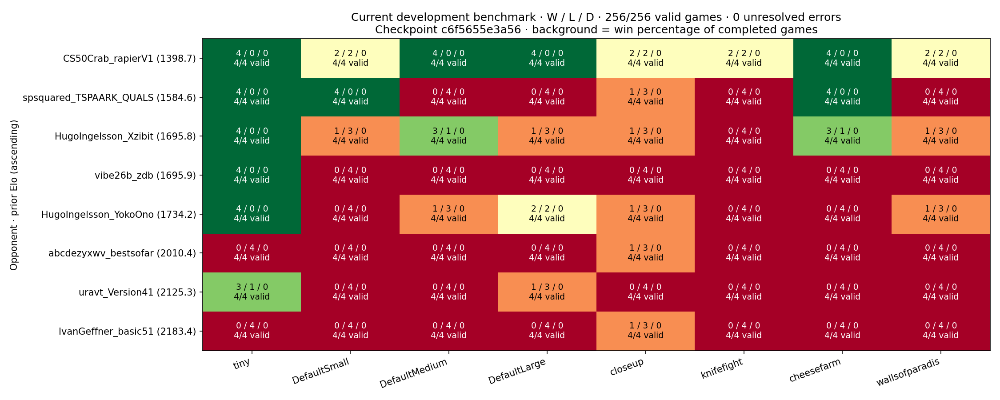
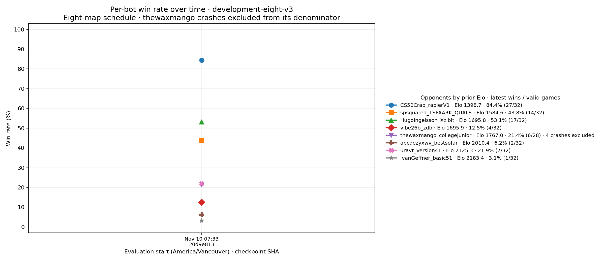
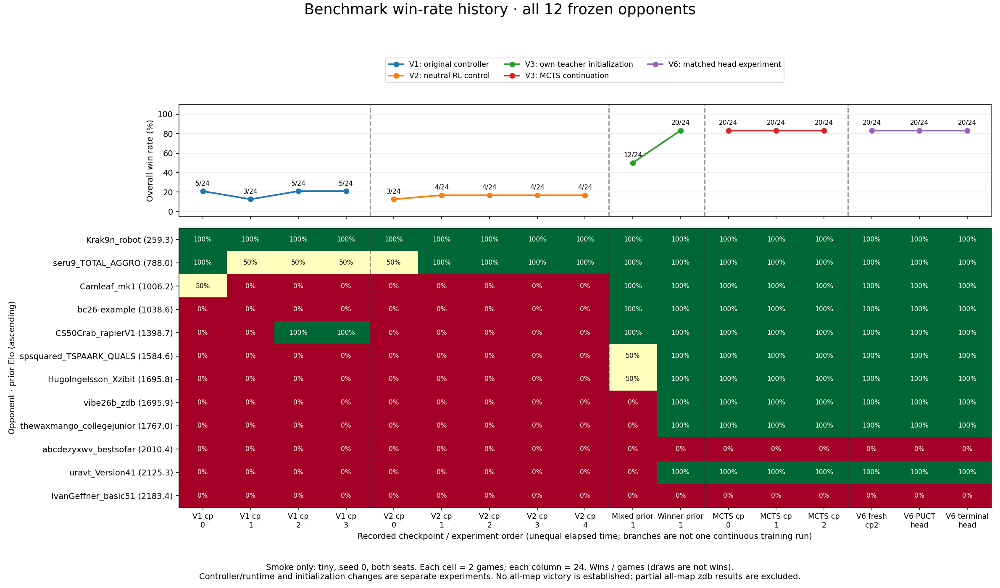

# Battlecode 2026 Alpha0

## Current work: bootstrap from zdb by imitation, then RL

<!-- CURRENT_WORK_START -->
**Goal.** Train a network to imitate `zdb` (the current best bot from [battlecode26b-vibe](https://github.com/terryvanbelle/battlecode26b-vibe)) well enough to be a competent starting point, then improve it with self-play RL. Exact imitation isn't required.

**Approach.**
- **Recording:** zdb plays ordinary full games, and a hook around every controller call records what the acting robot could see together with the action it took.
- **Student:** a per-robot network chooses one primitive action at a time (move, turn, attack, build, ratnap, traps, cheese…) from that robot's own observations and memory.
- **Runtime:** the network runs inside the Java engine, so games run at engine speed and the bot can later become an all-Java tournament player.

Details: [lean imitation pipeline](docs/lean-imitation.md).

**Status (November 13, 2026, 04:45 PDT).**
- student-v4 (observation v1) nearly matches zdb on long maps but **fails the frozen gate** on the held-out field: 0.15 against a bar of 0.20, where zdb scores 0.33.
- Two missing pieces of information explain the early king deaths. First, zdb's babies act on the kings' shared array (threat alerts, king positions); observation v2 adds a team board for that. Second, zdb turns to face enemies it remembers but can't currently see, to avoid being grabbed and thrown. Per-round death traces showed this is how the student's babies die. Observation v3 adds a short-term memory of enemies.
- Running: the full obs-v3 pipeline (fresh zdb data, student-v7, a DAgger round, student-v8, then the zdb check and the gate), expected around 11:30 PDT.

**Most recent result.** student-v4: 0/32 vs zdb (sampling temperature 1.0); student-v5 (observation v2): also 0/32. Gate: untrained 0.97, simple bots 0.91, held-out field 0.15 (zdb 0.33). [Results log](docs/imitation-results.md).

The earlier macro-action line's checkpoint `c6f5655e3a56` scored 83W / 173L (32.4%) on the development-v4 panel.
<!-- CURRENT_WORK_END -->

## Previous line: macro-action AlphaZero (V1–V11)

## Current benchmark performance

**Next phase:** at **70% overall wins** on the complete benchmark suite, prioritize [tournament compatibility](docs/tournament-transition.md) before further win-rate optimization: Java throughout the deployed bot, standard bytecode, memory, compile and wall-clock limits, and standard API calls only.

<!-- CURRENT_BENCHMARK_START -->


**256/256 valid games; 0 unresolved errors.** Each cell shows wins / losses / draws from our player's perspective; missing games are not losses. Checkpoint `c6f5655e3a56`. [Dashboard data](progress/overview/development-current.json) · [Raw evaluation](progress/development-v4/v11-terminal_head/evaluations.jsonl).



All bots share one graph, ordered by prior Elo in the legend. The bold black series shows overall wins divided by all valid games (not an unweighted average of bot percentages). Each point aggregates the eight-map schedule (32 games per bot).  Incomplete bot panels remain pending. Only this frozen development suite is included; historical tiny-only results are separate. History begins with the first broader-map baseline; subsequent checkpoint evaluations add time points. [History data](progress/overview/development-history.json).
<!-- CURRENT_BENCHMARK_END -->

**Revised baseline complete:** **83 wins / 173 losses / 0 draws (32.4%)**, all 256 games valid with zero errors. The graphs above show the current v4 panel, including qualified replacement YokoOno. [Verified baseline](progress/development-v4/baseline/README.md). The V8 terminal candidate completed **81 wins / 175 losses / 0 draws (31.6%)** across256 valid games; it failed the improvement rule against both original and fresh cp2 controls. The PUCT control also completed at **79 wins / 177 losses (30.9%)**. V8 is complete with no promoted model. The next [target-reliability diagnostic](progress/target-recheck-v9r2/README.md) completed its 184-game mechanism test and passed its target-reliability rule, without training or benchmark improvement. The next [V10 source phase](progress/expanded-corpus-v10r2/README.md) completed all 64 self-play sources, but its strict combat-root rule yielded only 59/64 required roots; no training started. [Coverage audit and graph](progress/expanded-corpus-v10r2/reviews/independent-source-audit.json) · [Completed eligibility replay](progress/v10-eligibility-probe/RESULTS.md) · [Completed V11 input extraction](progress/general-roots-v11/README.md) · [Completed validation discovery](progress/validation-v11/README.md) · [Active V11 learning experiment](progress/expanded-terminal-v11/README.md). [Candidate review](docs/v8-candidate-review.md). Independent first-action validation also showed no gain. [Follow V8 progress](progress/terminal-target-head-v8/INDEX.md). No V8 playing-strength improvement is established yet.

**Why some versions have no benchmark score:** V9 and V10 did not produce trained candidate checkpoints. Their research outcomes are retained below; “not run” is not a zero-win result.

| Version | Work completed / outcome | Full development benchmark |
| --- | --- | --- |
| [V8](progress/terminal-target-head-v8/INDEX.md) | Trained both heads; no verified improvement | Terminal candidate **81W / 175L / 0D**, 256/256 valid; PUCT control 79W / 177L; fresh cp2 82W / 174L |
| [V9r2](progress/target-recheck-v9r2/README.md) | 184/184 action-continuation diagnostic games; target-reliability rule passed; no training | **Not run — no new candidate** |
| [V10](progress/expanded-corpus-v10r2/README.md) | 64/64 self-play sources; required combat-position coverage failed at 59/64; training withheld | **Not run — no new candidate** |
| [V11](progress/expanded-terminal-v11/README.md) | Complete, independently audited benchmark panels | V11 benchmarks complete: terminal 70W / 186L / 0D; fresh cp2 81W / 175L / 0D; PUCT 71W / 185L / 0D, all 256/256 valid. Terminal development rule failed. No promotion. |

[Active benchmark and improvement rules](docs/development-benchmarks-v4.md) · [Benchmark configuration](configs/benchmarks-development-v4.json) · [Latest completed game research](docs/terminal-v6-results.md)

The goal is verified improvement, not winning against every bot or on every map.
The initial development threshold is a 5-percentage-point gain in mean game score,
a positive paired map-bootstrap lower bound, and no aggregate regression against
`vibe26b_zdb`; promotion additionally requires fresh-seed confirmation.

**Important:** the old 20/24 (83.3%) result was on `tiny` only. The user-stopped
broader-map `zdb` test yielded **0 wins / 60 losses / 0 draws**; it was incomplete
and alphabetically scheduled, not a representative all-map estimate.
[Partial results](progress/zdb-allmaps-cp2/README.md).

<details>
<summary>Historical tiny-only benchmark win rates (17 complete panels)</summary>



Each column tests 12 historical opponents on tiny/seed 0/both seats. These are
not measurements on the new broader-map suite. Experiment boundaries separate
controller, initialization and learning changes.
[Data and interpretation](progress/overview/README.md).

</details>

Search-guided self-play in MIT Battlecode 2026's **official Java engine 1.2.6**. This is an initial CPU research experiment: an AlphaZero-style policy/value network, PUCT search, terminal game outcomes, replay training, and a frozen **12-bot panel**: ten external competitors from `battlecode26b-vibe`'s downloaded pool, the official example player, and that project's current accepted champion.

The active v2 experiment uses an **87,973-parameter dual-scale policy/value network**, 40 turn-level macros, and privileged local plus full-map observations. Search guides self-play; evaluation uses the greedy network. It is **not tournament compatible**. The original 17-action experiment remains available for reproducibility.

## Active autonomous campaign

[Neutral v2 results](progress/campaign-v2/README.md) · [Warmstart results](progress/warmstart-v3/README.md) · [Future-game value calibration](docs/v2-value-calibration.md) · [All-map victory criteria](docs/all-maps-victory.md) · [Resume and stop instructions](docs/autonomy.md)

The strongest measured initialization so far wins **20/24 smoke games**: [winner-only own-teacher prior](progress/bootstrap-v3-winners/README.md). It beats ten opponents in both seats on `tiny`, but still loses to `bestsofar` and `basic51`. Its first two [search-guided checkpoints](progress/warmstart-v3/README.md) also scored **20/24**, so these measurements have not shown improvement on that prior. The warmstart experiment and neutral v2 control have separate checkpoints and progress records; consult their status files for current execution state.

The completed [terminal root-ranking experiment](docs/root-ranking-v4.md) passed its precommitted mechanism rule: 418 valid continuations, eight roots, and a mean paired validation advantage of **0.21875** over shallow PUCT. Its [graphs and audited evidence](progress/root-ranking-v4/README.md) separate selection from independent validation. No weights changed and no benchmark games were played. The [policy-head learning pilot](docs/terminal-target-head-v5.md) stopped at its preregistered coverage check: 20 complete source games supplied 24 of 32 required roots, with all eight missing slots on `closeup`. [The coverage evidence and graphs](progress/terminal-target-head-v5/README.md) preserve this no-SGD result; the 20/24 benchmark score above remains unchanged. The [completed v6 pilot](docs/terminal-v6-results.md) filled all required inputs, ran 1,458 terminal target games, trained both heads and completed 72 fresh benchmark games. Both learned heads still scored **20/24**, with zero validation advantage. [Audited results and learning curves](progress/terminal-target-head-v6/README.md) preserve the negative result. The completed [v7 training-only diagnostic](docs/cached-head-constraint-v7.md) fitted all 32 selected actions at 2,048 updates with anchoring retained. Its six fixed snapshots establish fitting-budget evidence, not stronger play. The fresh-data [V8 experiment](progress/terminal-target-head-v8/INDEX.md) has completed training and is evaluating the broader development panel.

The previous all-opponent/all-map victory gate is retained as historical protocol
in `configs/victory_gate.json`. It was superseded by the user's improvement-based
objective; no checkpoint passed it. The four original excluded training maps and
benchmark-data isolation remain unchanged. See the [active rules](docs/development-benchmarks-v4.md).

Detailed [search-mechanism graphs](progress/root-ranking-v4/README.md) and [neutral control graphs](progress/campaign-v2/README.md) remain available separately.

```bash
bash scripts/bootstrap.sh
bash scripts/run_campaign.sh --hours 3
# Graceful stop; a later restart requires intentionally removing this marker.
touch runs/campaign/STOP
```

The campaign resumes model, optimizer, RNG, complete-game replay and evaluation cells. Each cycle has a time budget and a review boundary. Verified archives provide recovery through GitHub release assets or the separate `campaign-checkpoints` branch; the current credentials require the Git fallback. `nohup` alone cannot survive a cloud environment being reclaimed. See the [operating instructions](docs/autonomy.md) for current continuation setup and persistence limits.

## Initial v1 measurements

Initial run: **6 self-play games, 43,779 retained positions, 3 training iterations**. All four checkpoints completed the final 12-bot smoke panel: **96 evaluation games, no unresolved failures**. Final score is **5/24 wins (20.8%)**, matching the untrained baseline; this run does not demonstrate an overall strength improvement.

[Initial experiment report](docs/initial-results.md) · [Latest results and sample counts](progress/README.md) · [Benchmark provenance](docs/benchmarks.md) · [Model and experiment design](DESIGN.md) · [Engine changes](docs/engine.md)

The original graphs remain in [the initial progress report](progress/README.md). Every point comes from committed JSONL measurements; v2 has its own series. Evaluation uses the greedy network without search because legacy Java bots contain live threads that cannot be snapshotted. Search remains active in self-play. Graphs refresh after each iteration and evaluation stage; GitHub updates when those files are pushed.

## Run locally

Linux x86-64, Python 3.11+, and a JDK 21 are supported. The setup script downloads hash-pinned official engine assets and a local JDK if needed.

```bash
bash scripts/bootstrap.sh
.venv/bin/python -m pytest -q
.venv/bin/python -m alpha0.train train --config configs/smoke.json --run-dir runs/initial
```

The legacy v1 smoke experiment is deliberately small: 49,242 parameters, four search simulations per decision, two full games and 32 gradient updates per iteration. The active v2 configuration is [`configs/campaign-v2.json`](configs/campaign-v2.json); its architecture, corrected footprint attacks, sparse search and game-balanced replay are documented in [DESIGN.md](DESIGN.md).

```bash
# Continue the same run with its original configuration.
.venv/bin/python -m alpha0.train train --config configs/smoke.json --run-dir runs/initial --resume --iterations 20

# A larger, separate experiment (use a separate progress directory too).
.venv/bin/python -m alpha0.train train --config configs/train.json --run-dir runs/main --progress-dir runs/main/progress

# Evaluate a saved checkpoint against all 12 frozen bots, both seats.
.venv/bin/python -m alpha0.train evaluate runs/initial/latest.pt --suite smoke

# Rebuild the committed plots from measured logs.
.venv/bin/python scripts/plot_progress.py
```

Checkpoints, complete action histories, and bounded replay buffers live under ignored `runs/`. The first experiment's four checkpoints, six complete action transcripts and provenance are published under [`artifacts/initial`](artifacts/initial). To verify a published game transcript, run `.venv/bin/python scripts/replay_game.py artifacts/initial/games/iter-0003-game-001.json`. Do not load untrusted checkpoints. The engine and JDK downloads are excluded from Git; their URLs and hashes are recorded by the setup.

## Compute limits and portability

Learned turns bypass bytecode instrumentation. Legacy bots receive a one-billion-bytecode per-turn allowance, and the engine's cumulative team execution timeout is disabled. Java/Python retain ordinary process/host memory limits; no tournament-sized JVM heap cap is imposed. Per-request and per-game wall-clock watchdogs prevent stalled experiments from hanging indefinitely. [Exact changes and remaining limits](docs/engine.md).

Training currently runs on the attached CPU machine. **`battlecode-dev` is not being used.** Its historical configuration and the missing access prerequisites are in [compute notes](docs/compute.md). Existing VM workloads have not been changed.

## Sources

- [Official Battlecode 2026 repository](https://github.com/battlecode/battlecode26), engine, and [downloaded rules](docs/rules/specs.txt).
- [battlecode26b-vibe](https://github.com/terryvanbelle/battlecode26b-vibe), pinned at `f4d6ec971b13a20f7f38fb56d249f62c0251ed05`, supplies the benchmark roster, historical skill evidence, and map collection.
- External opponents are pinned individually in [the manifest](configs/benchmarks.json). Historical ratings are selection evidence, not ratings from this experiment.

See [third-party notices](THIRD_PARTY.md) for engine, map, and bot source attribution.
