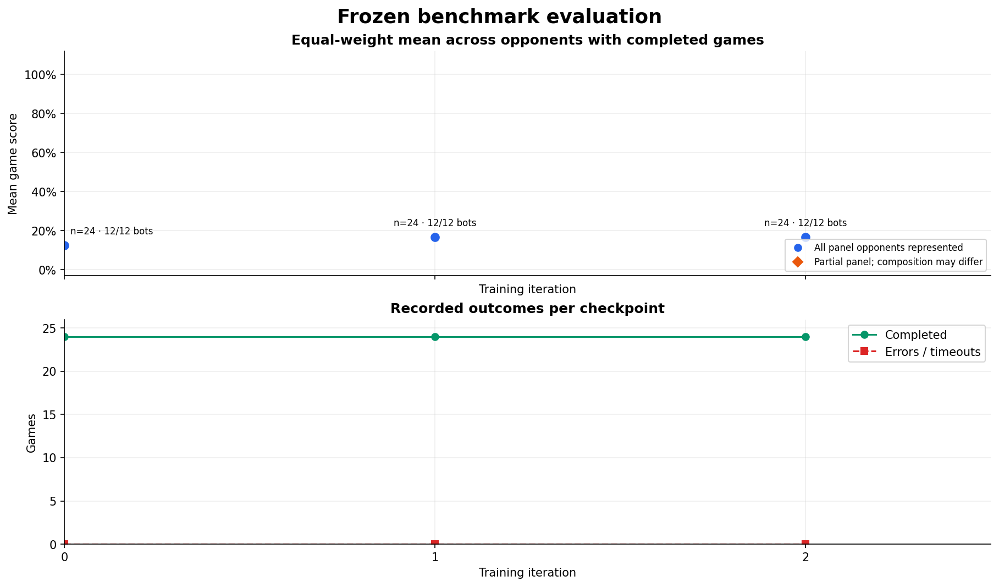
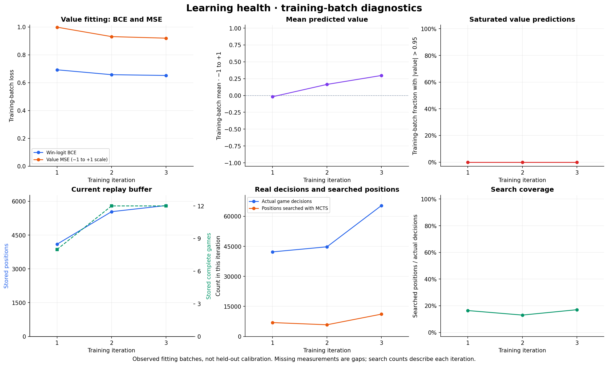

# Battlecode 2026 Alpha0

Search-guided self-play in MIT Battlecode 2026's **official Java engine 1.2.6**. This is an initial CPU research experiment: an AlphaZero-style policy/value network, PUCT search, terminal game outcomes, replay training, and a frozen **12-bot panel**: ten external competitors from `battlecode26b-vibe`'s downloaded pool, the official example player, and that project's current accepted champion.

The active v2 experiment uses an **87,973-parameter dual-scale policy/value network**, 40 turn-level macros, and privileged local plus full-map observations. Search guides self-play; evaluation uses the greedy network. It is **not tournament compatible**. The original 17-action experiment remains available for reproducibility.

## Active autonomous campaign

[Current v2 results and graphs](progress/campaign-v2/README.md) · [Future-game value calibration](docs/v2-value-calibration.md) · [Live published status](progress/campaign-v2/status.json) · [Research plan and victory criteria](docs/RESEARCH_PLAN.md) · [Resume and stop instructions](docs/autonomy.md)

The strongest measured initialization so far wins **20/24 smoke games**: [winner-only own-teacher prior](progress/bootstrap-v3-winners/README.md). It beats ten opponents in both seats on `tiny`, but still loses to `bestsofar` and `basic51`. This is a separately labeled warmstart; search-guided continuation is tested against that baseline, and the neutral v2 run remains a control.

The goal is one frozen learned checkpoint that beats **each** of the twelve opponents: at least 60% score per opponent over 192 development games, followed by 384 games on reserved maps, with both seats covered and no unresolved errors. A smoke win, a scripted controller result, or falling training loss does not satisfy this gate. Results from different model/action versions are kept separate.




```bash
bash scripts/bootstrap.sh
bash scripts/run_campaign.sh --hours 3
# Graceful stop; a later restart requires intentionally removing this marker.
touch runs/campaign/STOP
```

The campaign resumes model, optimizer, RNG, complete-game replay and evaluation cells. Each cycle has a time budget and a review boundary. Verified archives provide recovery through GitHub release assets or the separate `campaign-checkpoints` branch; the current credentials require the Git fallback. `nohup` alone cannot survive a cloud environment being reclaimed. See the [operating instructions](docs/autonomy.md) for current continuation setup and persistence limits.

## Initial v1 measurements

Initial run: **6 self-play games, 43,779 retained positions, 3 training iterations**. All four checkpoints completed the final 12-bot smoke panel: **96 evaluation games, no unresolved failures**. Final score is **5/24 wins (20.8%)**, matching the untrained baseline; this run does not demonstrate an overall strength improvement.

[Initial experiment report](docs/initial-results.md) · [Latest results and sample counts](progress/README.md) · [Benchmark provenance](docs/benchmarks.md) · [Model and experiment design](DESIGN.md) · [Engine changes](docs/engine.md)

The original graphs remain in [the initial progress report](progress/README.md). Every point comes from committed JSONL measurements; v2 has its own series. Evaluation uses the greedy network without search because legacy Java bots contain live threads that cannot be snapshotted. Search remains active in self-play. Graphs refresh after each iteration and evaluation stage; GitHub updates when those files are pushed.

## Run locally

Linux x86-64, Python 3.11+, and a JDK 21 are supported. The setup script downloads hash-pinned official engine assets and a local JDK if needed.

```bash
bash scripts/bootstrap.sh
.venv/bin/python -m pytest -q
.venv/bin/python -m alpha0.train train --config configs/smoke.json --run-dir runs/initial
```

The legacy v1 smoke experiment is deliberately small: 49,242 parameters, four search simulations per decision, two full games and 32 gradient updates per iteration. The active v2 configuration is [`configs/campaign-v2.json`](configs/campaign-v2.json); its architecture, corrected footprint attacks, sparse search and game-balanced replay are documented in [DESIGN.md](DESIGN.md).

```bash
# Continue the same run with its original configuration.
.venv/bin/python -m alpha0.train train --config configs/smoke.json --run-dir runs/initial --resume --iterations 20

# A larger, separate experiment (use a separate progress directory too).
.venv/bin/python -m alpha0.train train --config configs/train.json --run-dir runs/main --progress-dir runs/main/progress

# Evaluate a saved checkpoint against all 12 frozen bots, both seats.
.venv/bin/python -m alpha0.train evaluate runs/initial/latest.pt --suite smoke

# Rebuild the committed plots from measured logs.
.venv/bin/python scripts/plot_progress.py
```

Checkpoints, complete action histories, and bounded replay buffers live under ignored `runs/`. The first experiment's four checkpoints, six complete action transcripts and provenance are published under [`artifacts/initial`](artifacts/initial). To verify a published game transcript, run `.venv/bin/python scripts/replay_game.py artifacts/initial/games/iter-0003-game-001.json`. Do not load untrusted checkpoints. The engine and JDK downloads are excluded from Git; their URLs and hashes are recorded by the setup.

## Compute limits and portability

Learned turns bypass bytecode instrumentation. Legacy bots receive a one-billion-bytecode per-turn allowance, and the engine's cumulative team execution timeout is disabled. Java/Python retain ordinary process/host memory limits; no tournament-sized JVM heap cap is imposed. Per-request and per-game wall-clock watchdogs prevent stalled experiments from hanging indefinitely. [Exact changes and remaining limits](docs/engine.md).

Training currently runs on the attached CPU machine. **`battlecode-dev` is not being used.** Its historical configuration and the missing access prerequisites are in [compute notes](docs/compute.md). Existing VM workloads have not been changed.

## Sources

- [Official Battlecode 2026 repository](https://github.com/battlecode/battlecode26), engine, and [downloaded rules](docs/rules/specs.txt).
- [battlecode26b-vibe](https://github.com/terryvanbelle/battlecode26b-vibe), pinned at `f4d6ec971b13a20f7f38fb56d249f62c0251ed05`, supplies the benchmark roster, historical skill evidence, and map collection.
- External opponents are pinned individually in [the manifest](configs/benchmarks.json). Historical ratings are selection evidence, not ratings from this experiment.

See [third-party notices](THIRD_PARTY.md) for engine, map, and bot source attribution.
