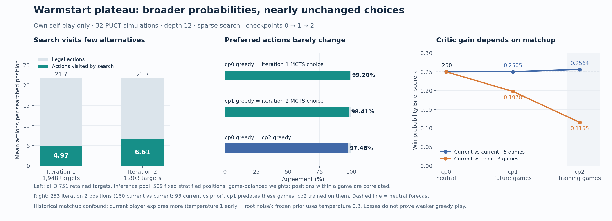
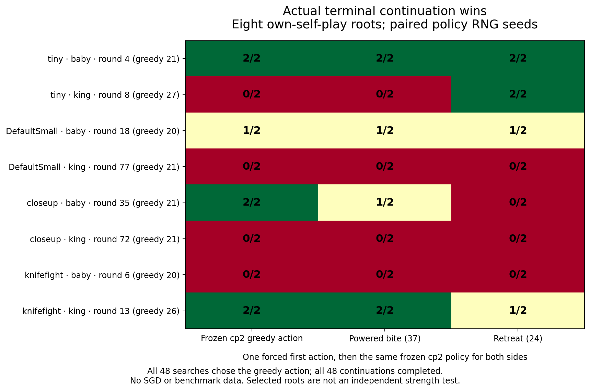

# Why the warmstart stalled, and the next measured experiment

Checkpoint 0, checkpoint 1 and checkpoint 2 each won **20/24** valid smoke
games. Two genuine MCTS iterations produced 37,771 robot decisions and 3,751
searched positions across 16 completed games, but the four losses to
`bestsofar` and `basic51` remained unchanged. The evidence supports changing
how useful policy targets are produced before spending another identical
training iteration. Checkpoint 2 and the original prior remain preserved;
no new SGD run was started for this investigation.

The benchmark loss diagnostics are narrow but consistent: enemy king HP stayed
470/590 against `bestsofar` and 600/600 against `basic51`, at rounds 42/54 and
94/60 respectively. Three of those four terminal states still had 697–986
cheese in the learned team's bank. These observations do not establish a
particular opponent strategy or a universal economy failure. No benchmark
trajectory, action or outcome was used as a training example.

## Recorded search targets mostly repeat the prior

The reproducible [target audit](../diagnostics/warmstart-plateau/targets.json)
counts all 3,751 retained targets and evaluates a fixed, game/role-stratified
509-position sample with one Torch thread. Its inference summaries are weighted
back to game-balanced replay; they are not a fresh benchmark.

| Measurement | Iteration 1 | Iteration 2 |
| --- | ---: | ---: |
| Real decisions | 17,531 | 20,240 |
| Searched positions | 1,948 | 1,803 |
| Search fraction of all turns | 11.11% | 8.91% |
| Mean actions visited at a root | 4.97 | 6.61 |
| Mean legal actions | 21.66 | 21.74 |
| Source policy agrees with visit argmax, sampled | 99.20% | 98.41% |
| Mean highest-action target mass | 79.96% | 66.70% |

Checkpoint 0 and checkpoint 2 still choose the same greedy action on **97.46%**
of sampled states. Their mean policy entropy increased from 0.655 to 1.275 nats.
Training largely increased probability on less-preferred actions while leaving
the preferred action intact. It was fitting genuine visit targets, but those
targets supplied little new action-ranking information.

The depth limit was twelve **robot turns**, not twelve rounds. Mean roster size
was about 37/41, and approximately 97% of retained positions had more than
twelve robots. Roster size includes carried/thrown robots and is only a rough
proxy for active turn count; the direct probe below measures actual rounds.



## The critic's aggregate gain is confounded by league collection

Iteration 2 contained five same-policy games and three historical-opponent
games. The current side lost all three historical games. The two sides did not
use the same exploration policy: current play used temperature 1 through round
80 plus occasional noisy MCTS, while the historical policy used temperature
0.3 and never searched. About 80% of retained states were before round 80.
Those losses therefore do not establish that greedy checkpoint 1 was weaker
than greedy checkpoint 0.

Same-policy games retain searched positions from both sides; historical games
retain only the current learner's searched positions. The latter three games
thus supplied only losing labels. Game-balanced replay gives each game equal
weight but does not balance players or outcomes. The network sees physical
state and has no explicit opponent-checkpoint identifier.

On iteration-2 **same-policy** states, neutral checkpoint 0 has Brier score
0.2500. Checkpoint 1, frozen before those games, scores **0.2505**: no measured
future-game forecast gain. Checkpoint 2 scores **0.2564** on those same states,
but this is an **in-sample, retrospective** measurement because it trained on
iteration 2. Its improved error on the three historical games chiefly reflects
fitting their negative labels; it is not evidence of a generally useful critic.

## Direct own-self-play counterfactual probe

The probe reconstructed the first four archived own-self-play games, one per
training map, and selected the first baby and king turn where powered bite was
legal. These are eight tactical states from training trajectories, not randomly
sampled independent test states. It used the exact official engine snapshots,
unchanged checkpoint 2 and three search settings: **32/12**, **128/12**, and
**128/96** simulations/robot-turn depth cap. Root noise was identical across
settings for each state. A second control kept the policy identical and replaced
only the diagnostic value callback with zero.

All **48 searches**—eight states, three settings, two critic choices—selected
the original greedy action. None created a terminal leaf. With the learned
critic, the twelve-turn configurations reached only zero or one additional
round; the deeper configuration reached zero to three rounds. The zero-critic
deep control reached at most five rounds and still changed no chosen action.
Increasing this search budget or depth alone did not produce better decisions
on these roots.

For each root, three legal first actions were then forced separately: the greedy
choice, powered bite, and retreat. Each used two paired, fixed policy RNG seeds,
then frozen checkpoint 2 played both teams at temperature 0.35 until the actual
terminal result. **All 48 continuations completed**. These newly generated
continuations are future outcomes relative to frozen checkpoint 2, but their
selected starting states were part of its training distribution.



The clearest missed opportunity was the `tiny` king at round 8: spawning toward
the enemy lost both continuations, whereas one retreat followed by the same
policy won both. Every search chose spawning. This demonstrates a useful local
alternative under these fixed continuations; two seeds do not establish a
general retreat rule. Indeed, retreat lost both continuations for the `closeup`
baby where the original action won both. Context matters, and blanket powered
bites or retreats are not supported by these results.

The terminal probe took 415.0 seconds and the zero-critic control 35.3 seconds:
**7.5 minutes combined**, within the predeclared fifteen-minute bound. Runtime
and checkpoint hashes stayed unchanged. There were no gradient updates, no
benchmark games and no partial games assigned terminal labels. Both the probe
lock and warmstart training lock were held. Exact executed sources are retained
in `counterfactual-v1/source/`; future invocations additionally honor campaign
and warmstart STOP files.

## Precommitted next step: terminal-rollout root ranking, version 4 diagnostic

Do **not** start an identical target-3 SGD iteration. The next proposed cycle is
`terminal-root-ranking-v4`, a bounded test of whether broader root action
coverage and actual terminal rollouts supply better rankings than the critic.
It changes no engine rules, observations, network or production checkpoint.

1. Freeze checkpoint 2. Select up to eight new roots using the same role and
   legality rule from own-self-play games `iter-0001-game-004` through `007`.
   They cover the same four development maps with different recorded seeds and
   seat assignments. Do not choose roots by benchmark results or by the outcomes
   of the previous probe. Preserve the root list and state hashes before scoring.
2. Evaluate **every legal first action** with two paired frozen-policy terminal
   continuations, RNG seeds `103003` and `103013`. Both teams use the same
   temperature 0.35; there is no historical-opponent mixture. Select the action
   with greatest mean terminal score (win 1, draw 0.5, loss 0), breaking ties by the original network
   prior. Compare with unchanged 32-simulation/depth-12 PUCT on the same root.
3. Validate those two selected actions using four separate paired continuation
   seeds: `103021`, `103043`, `103067`, `103091`. Selection outcomes never count
   as validation. Record every candidate and result, including failures and
   incomplete games. None of these seeds is a reserved confirmation seed.
4. Bound the cycle to two hours, one actor and one Torch thread, with immutable
   per-root/action/seed cells, the same STOP/lock behavior, and no SGD. Reuse
   completed identical cells if a later authorized cycle must finish the probe.
   With roughly 22 legal actions per root, about 416 terminal continuations are
   planned; the observed first probe suggests roughly one hour, not a guarantee.
5. Continue toward a separately configured rollout-guided self-play pilot only
   if validation is complete, its equal-root mean score advantage over PUCT is
   at least **0.10**, at least **two distinct roots** improve, and no root loses
   more than **0.25** mean score. Otherwise record the failed hypothesis and
   inspect action coverage or continuation-policy limits before more training.
   This small diagnostic gate is a research decision rule, not a strength claim.

If that mechanism test succeeds, a subsequent reviewed training pilot should
keep a matched control, use symmetric current-policy exploration before adding
league opponents, preserve terminal/visit-target provenance, and compare the
result with checkpoint 2 on a small predeclared development subset. Full-map
checks are occasional. Final success still requires the same candidate to pass
all **888 opponent–map pairs** in the all-74-map standard and fresh-seed
confirmation stages. No smoke or counterfactual result substitutes for that gate.

## Reproduce the evidence

From the repository root, with the archived run restored and local dependencies
available:

```bash
.venv/bin/python diagnostics/warmstart-plateau/analyze_targets.py
.venv/bin/python diagnostics/warmstart-plateau/plot_targets.py
.venv/bin/python diagnostics/warmstart-plateau/plot_probe.py
```

The JSON audit contains checkpoint/game hashes, exact sample indices and
weighting. The target audit prefers checksum-verified original game shards;
when the compact archive omits them, it reads the pinned checkpoint-2 replay.
`inputs.json` records all original-array fingerprints, replay/index hashes and
game provenance. The fallback verifies complete counts, matching metadata and
terminal labels, and byte-exact source-equivalent arrays (widening replay's
int8 player field to the original int64). Use `--replay-only --output /tmp/targets-replay.json`
to explicitly verify this recovery route; no Java engine is needed for the audit.
The counterfactual directory contains its frozen configuration,
individual root/search/continuation results, combined summary, zero-critic
control and exact executed source snapshots. Probe scripts reject an existing
output directory; do not overwrite this evidence to rerun a favorable result.
