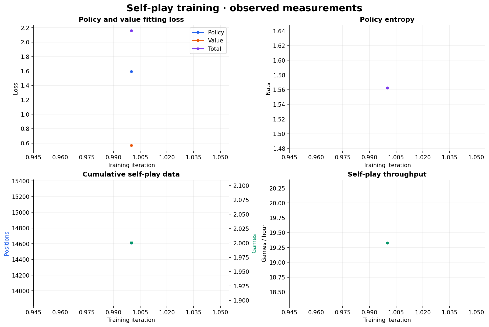
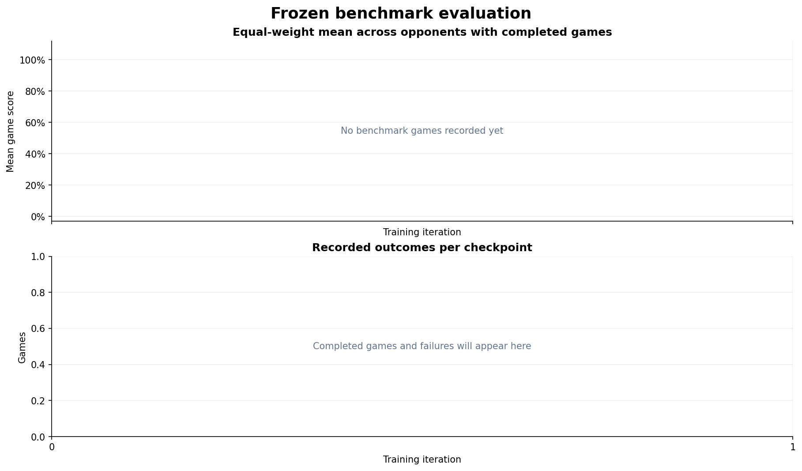
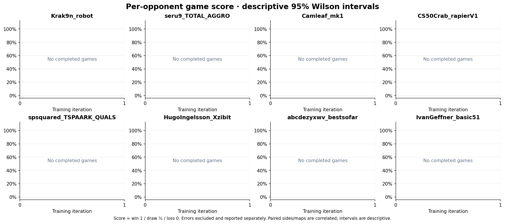

# Training progress

Generated from repository JSONL measurements at `2026-11-10T01:59:55+00:00`.

Run `python scripts/plot_progress.py` to regenerate these figures and this report.

## Latest training measurements

| Measurement | Observed value |
|---|---:|
| `iteration` | 1 |
| `games_total` | 2 |
| `positions_total` | 14610 |
| `policy_loss` | 1.59189 |
| `value_loss` | 0.568617 |
| `total_loss` | 2.16051 |
| `entropy` | 1.56233 |
| `games_per_hour` | 19.3268 |
| `wall_seconds` | 372.545 |

## Latest benchmark checkpoint

No benchmark games have been recorded. Historical opponent ratings are selection evidence, not results for this agent.

## Interpretation

- Game score is win = 1, draw = 0.5, loss = 0. Errors/timeouts are excluded from the completed-game score and listed separately; inspect completion counts before comparing checkpoints.
- The panel mean weights opponents equally. A partial panel is labelled and is not comparable to a full panel. Different map/seed or side coverage can also change the score.
- Wilson intervals are descriptive per-game intervals. With draws they use fractional successes. Mirrored sides and repeated maps are correlated, so these are not paired-map uncertainty estimates or evidence of a statistically significant improvement.
- The panel bootstrap resamples complete shared map–seed cells, keeping both sides and every opponent together (2,000 resamples, fixed RNG seed). It uses the balanced intersection of completed cells; this can differ from the all-completed-game mean. Four cells is the calculation minimum, not a guarantee of adequate power. Bootstrap intervals can collapse when every observed cell has the same outcome.
- Distinct checkpoints are never pooled. Duplicate checkpoint/opponent/map/seed/side cells keep their final recorded outcome and do not increase sample size.
- Loss reductions describe fitting to self-play targets; benchmark outcomes measure playing performance. Neither a small smoke suite nor self-play win balance establishes strength against the wider field.
