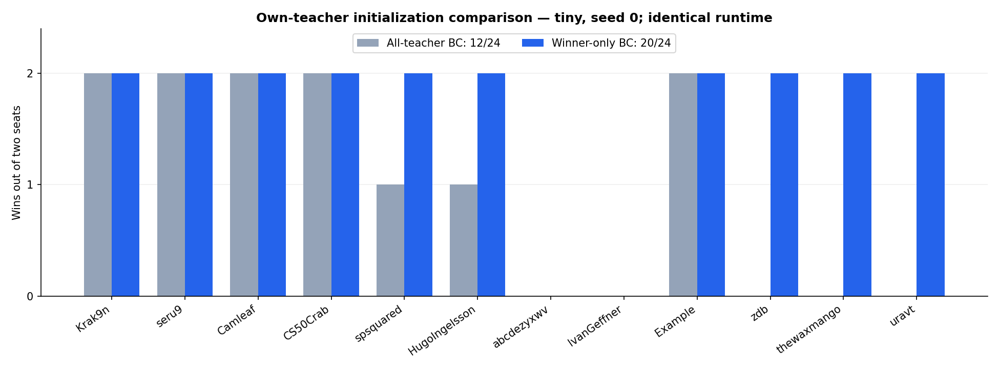
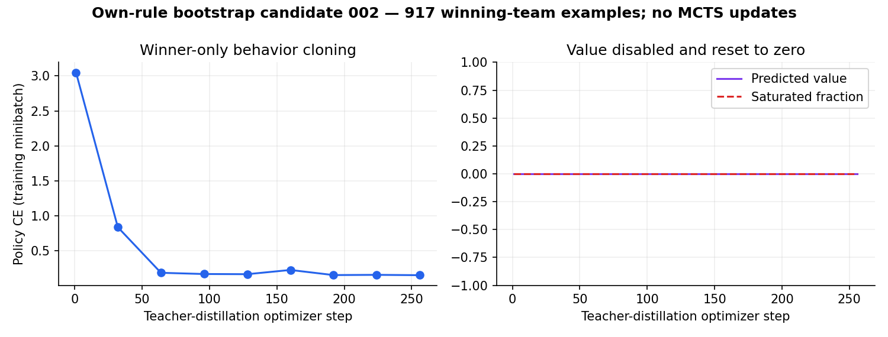

# Winner-only bootstrap v3 candidate 002

**20/24 smoke wins (83.3%); all 24 cells valid, no errors.** The policy wins both seats against 10/12 frozen opponents. It loses both seats against `abcdezyxwv_bestsofar` and `IvanGeffner_basic51`. This is winner-only behavior cloning from our own teacher self-play, not an AlphaZero victory.

The same six teacher games supplied 917 winning-team positions out of 1,536 examples. A fresh student with tensor-identical initial weights received 256 policy updates in 18.9 seconds. Value loss was disabled and the final value head is exactly zero. Evaluation used one worker and took 165.1 seconds from first request to final report. No holdout was used; production v2 remains unchanged.

The previous all-teacher candidate won 12/24 under the same runtime/evaluation configuration. The changed recipe reversed eight losses with no regressions on these cells. This comparison changes both the policy-example filter and the value objective: disabling value loss changes shared-trunk gradients even though greedy play ignores the value head. It does not isolate the causal contribution of winner filtering. These are development comparisons on one training-overlapping map, not generalization or statistical superiority across Battlecode. Selection used only own-game terminal winners, never benchmark actions or outcomes.

| Opponent | Side A | A rounds | Side B | B rounds |
| --- | --- | ---: | --- | ---: |
| Krak9n_robot | Win | 19 | Win | 18 |
| seru9_TOTAL_AGGRO | Win | 23 | Win | 18 |
| Camleaf_mk1 | Win | 17 | Win | 18 |
| CS50Crab_rapierV1 | Win | 17 | Win | 17 |
| spsquared_TSPAARK_QUALS | Win | 34 | Win | 24 |
| HugoIngelsson_Xzibit | Win | 47 | Win | 29 |
| abcdezyxwv_bestsofar | Loss | 42 | Loss | 54 |
| IvanGeffner_basic51 | Loss | 94 | Loss | 60 |
| bc26-example | Win | 17 | Win | 19 |
| vibe26b_zdb | Win | 34 | Win | 23 |
| thewaxmango_collegejunior | Win | 65 | Win | 61 |
| uravt_Version41 | Win | 49 | Win | 30 |

Evidence: [all cells](cells.csv), [raw JSONL](evaluations.jsonl), [experiment metadata](experiment.json), [configuration](bootstrap_config.json), [selected own-data indices](bootstrap_source_dataset.json). Checkpoints and source snapshots are exported under [artifacts/bootstrap-v3/candidate-002-winners](../../artifacts/bootstrap-v3/candidate-002-winners), referencing the preserved candidate-001 teacher shards. Seven positive teacher/data-boundary tests pass.

This checkpoint has not entered MCTS continuation and has not replaced production. Future continuation should start a fresh optimizer and empty search-target replay while retaining the teacher lineage. Candidate identity and policy must remain frozen for any subsequent evaluation gate.
