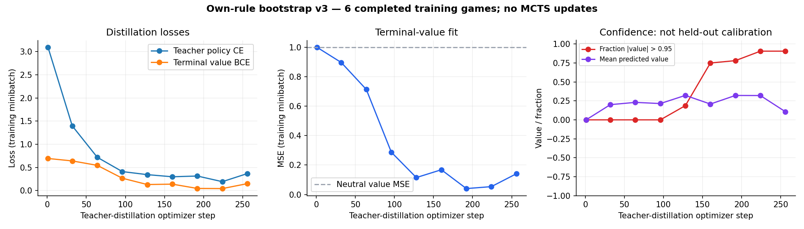
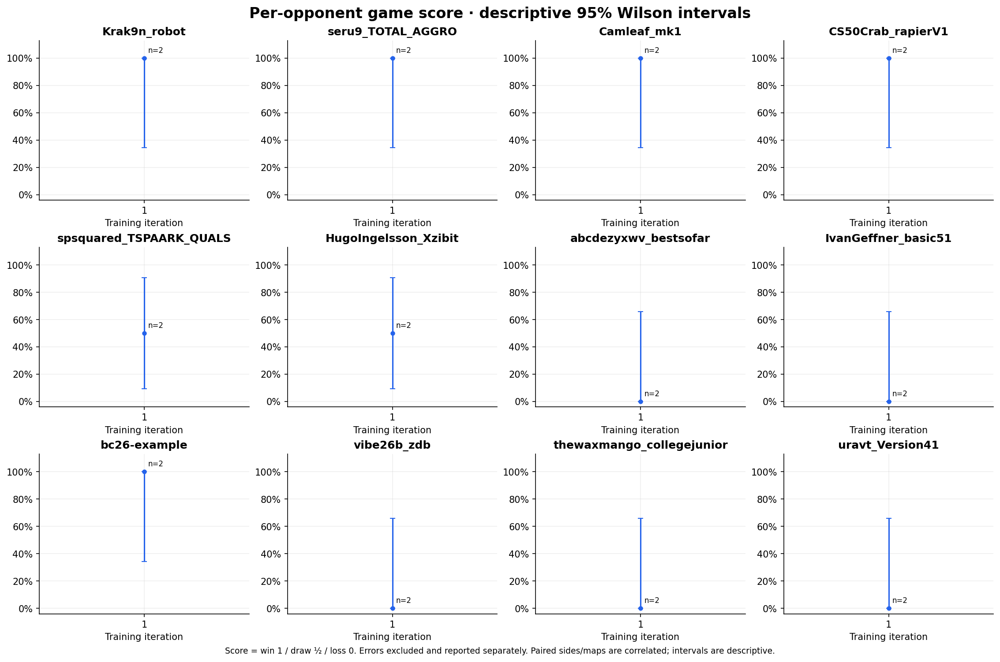

# Bootstrap v3 candidate 001

**12/24 smoke wins (50%); all 24 cells valid, no errors.** This is an optional own-rule teacher initialization, not an AlphaZero learning result or an all-opponent victory. No holdout was used and production v2 is unchanged.

Six own-rule self-play games produced 9,257 decisions and 1,536 retained examples. Fitting took 256 updates; generation plus fitting took 56.7 seconds. Single-worker evaluation took 240.0 seconds from first request to final report. All evaluation games used `tiny`, seed 0, with both seats. The same map was present in teacher training at a different seed.

The plot measures teacher fitting on training minibatches. Fixed training-sample teacher agreement reached 98.8%, but 90.6% of value predictions were saturated; this is not held-out calibration. The value head should be reset or independently validated before search continuation.

| Opponent | Side A | A rounds | Side B | B rounds |
| --- | --- | ---: | --- | ---: |
| Krak9n_robot | Win | 19 | Win | 25 |
| seru9_TOTAL_AGGRO | Win | 23 | Win | 19 |
| Camleaf_mk1 | Win | 17 | Win | 34 |
| CS50Crab_rapierV1 | Win | 18 | Win | 61 |
| spsquared_TSPAARK_QUALS | Win | 34 | Loss | 70 |
| HugoIngelsson_Xzibit | Win | 51 | Loss | 65 |
| abcdezyxwv_bestsofar | Loss | 42 | Loss | 68 |
| IvanGeffner_basic51 | Loss | 48 | Loss | 67 |
| bc26-example | Win | 18 | Win | 53 |
| vibe26b_zdb | Loss | 33 | Loss | 30 |
| thewaxmango_collegejunior | Loss | 77 | Loss | 95 |
| uravt_Version41 | Loss | 95 | Loss | 54 |

Raw results: [all 24 cells](cells.csv), [JSONL](evaluations.jsonl), [experiment metadata](experiment.json), [teacher fit records](bootstrap_fit.jsonl). Complete configuration, own-game data, source hashes and both checkpoints are exported under [artifacts/bootstrap-v3/candidate-001](../../artifacts/bootstrap-v3/candidate-001). Six positive boundary/teacher tests pass.

Candidate weights were frozen before evaluation. Benchmark games and outcomes did not train or select teacher examples. Different source/runtime identities must remain separately labeled; the result does not establish superiority over the unchanged neutral v2 control.
