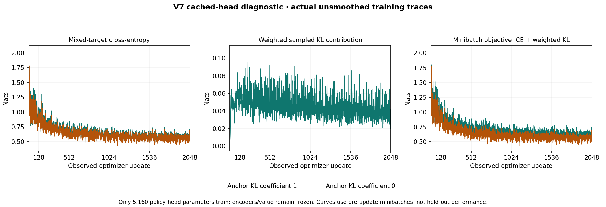
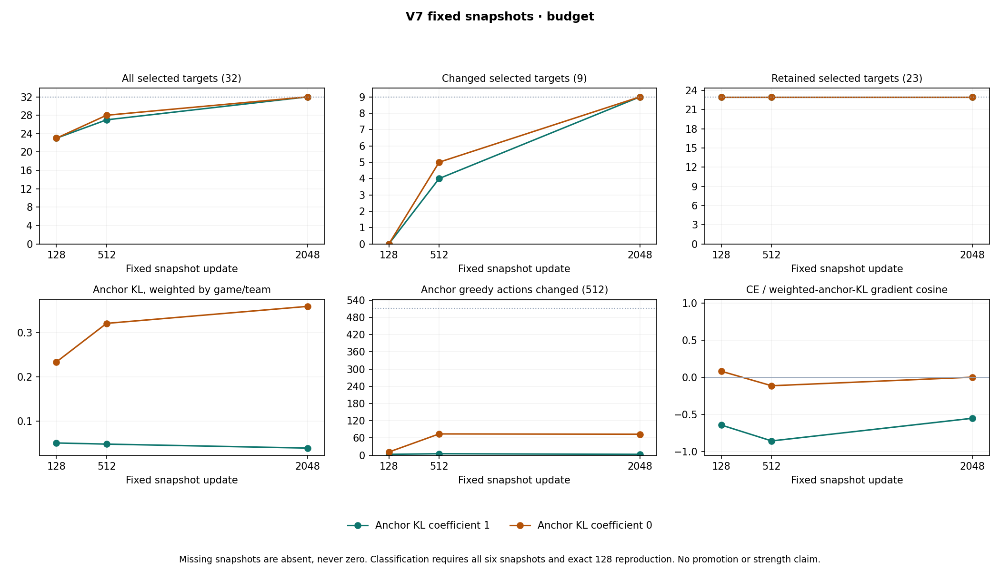

# Cached-head-constraint-v7

**Classification: budget. Training-only diagnostic; no automatic promotion or victory claim.**

Exact plotted [report snapshot](report-snapshots/ab8586a773a2f6ef1060b5d55db40b0b44e81c88538136dc38a4ce3a8ee1ab86.json). Reproduction verified: **True**. Final integrity verified: **True**.

Both arms retain all 32 terminal labels, including 9 changed and 23 retained labels, and all 512 anchors. Only 5,160 policy-head parameters train. The sole arm difference is the anchor-KL coefficient; sampled batch order, targets, optimizer and frozen features are shared.

Curves are actual pre-update minibatch observations. Fixed-snapshot KL and objective below use the declared uniform-game, uniform-team, within-stratum anchor weighting. The raw KL remains reported for KL=0 even though its objective contribution is zero. Different aggregation means a curve endpoint need not equal a full-set snapshot metric.

| Arm | Update | All 32 | Changed 9 | Retained 23 | CE | Game/team KL | Weighted KL contribution | Objective | Anchor changes/512 | Parameter L2 | Gradient cosine |
|---|---:|---:|---:|---:|---:|---:|---:|---:|---:|---:|---:|
| kl_1 | 128 | 23/32 | 0/9 | 23/23 | 0.915429 | 0.050726 | 0.050726 | 0.966155 | 3/512 | 0.713560 | -0.644636 |
| kl_1 | 512 | 27/32 | 4/9 | 23/23 | 0.688904 | 0.048142 | 0.048142 | 0.737046 | 5/512 | 1.860963 | -0.857957 |
| kl_1 | 2048 | 32/32 | 9/9 | 23/23 | 0.578616 | 0.039149 | 0.039149 | 0.617766 | 3/512 | 4.000231 | -0.552662 |
| kl_0 | 128 | 23/32 | 0/9 | 23/23 | 0.873434 | 0.233461 | 0.000000 | 0.873434 | 11/512 | 0.657221 | 0.080434 |
| kl_0 | 512 | 28/32 | 5/9 | 23/23 | 0.658068 | 0.320618 | 0.000000 | 0.658068 | 74/512 | 1.625167 | -0.114739 |
| kl_0 | 2048 | 32/32 | 9/9 | 23/23 | 0.565166 | 0.358944 | 0.000000 | 0.565166 | 73/512 | 3.585865 | 0.001057 |

The ordered rule first assigns budget evidence if KL=1 fits all 32 at 512 or 2048 after exact 128 reproduction, even if it later regresses. Otherwise it assigns anchoring evidence within the tested budget only when KL=0 fits all 32 and KL=1 never does. If neither succeeds, classification is neither. Incomplete evidence permits no completed classification.

Regression after a full match: `{"kl_0": false, "kl_1": false}`. First full-match snapshots: `{"kl_0": 2048, "kl_1": 2048}`.

All 32 greedy actions, complete observed losses, displacement and gradient diagnostics are retained in the linked JSON. These results establish neither label correctness, generalization, playing strength nor a stationary regularized optimum. No old validation or benchmark data was read for this report.

[Independent final audit](independent-final-audit.json) verified all 529 fitting
files, 256 recovery generations, six fixed snapshots, exact v6 reproduction,
frozen tensors and cached critic predictions. It confirmed the budget
classification with zero auditor optimizer steps. Launch and quiescence
observations are retained separately. [Research interpretation](../../docs/cached-head-v7-results.md).
