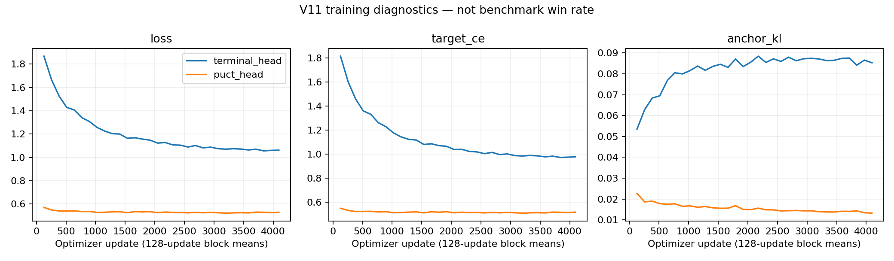

# V11 expanded terminal-head learning experiment

**Current stage: candidate panel complete; PUCT deadline recovery reviewed.** Terminal candidate **70W / 186L / 0D, 256/256**, fresh cp2 **81W / 175L / 0D, 256/256**. The candidate fails the unchanged improvement rule against fresh and original cp2. [Fresh-control comparison](reviews/terminal-vs-fresh-cp2-20261111.json) · [Original-baseline comparison](reviews/terminal-vs-original-cp2-20261111.json). No confirmation or promotion. PUCT has 234 valid games; its remaining 22 cells include two unscored SIGTERM interruptions at the three-hour invocation deadline. [746-job boundary audit](reviews/benchmark-deadline-audit-20261111.json) · [Recovery review](reviews/benchmark-deadline-recovery-20261111.json). Original errors and all successful outcomes remain unchanged. Separate recovery runs only these 22 cells, permits one explicit attempt 2 for the two pinned interruptions, and stops on any new failure. Current recovery status will be `runs/expanded-terminal-v11/benchmark-deadline/status.json`.

Pre-recovery archive SHA `aad039eb32ee7bd466a567deb8e70362c7b16daf3768dbadfab28a14bdd551a1` verified 12,347 files through isolated restore. The frozen identity, checkpoints, game schedule and limits are unchanged.

All 2,974 targets, both 4,096-update fits and all 156 shared validation continuations are complete. First-action terminal-minus-cp2 mean is +0.0078125 (diagnostic only). The [saved-fit audit](reviews/fit-audit-20261111.json) verified frozen tensors, shared batches/RNG, optimizer steps and checkpoint/snapshot hashes. Candidate `c6f5655e3a56` and PUCT `2462f2610264` remain frozen. The [benchmark snapshot audit](reviews/benchmark-progress-audit-20261111T2126.json) verifies 380 completed job markers, single-attempt terminal records and output hashes; it includes newer cells than the dashboard snapshot. Owner 202396 holds all 15 locks with unchanged identity and no STOP. Live status is `runs/expanded-terminal-v11/benchmark-recovery/status.json`; original pipeline status is historical. No duplicate, retry, training or checkpoint change was launched in this review.

Active bounded research cycle. Frozen identity `94d03e8b4bfa3582dd2129aa1723c541e8b48fbe5c5c0112417d5e732284e200`. All64 training roots/1024 anchors and32 disjoint validation roots were audited; all96 physical roots reconstructed exactly before launch.

[Derived progress](derived-progress.json) · [Frozen protocol](../../docs/expanded-terminal-v11.md) · [Identity](identity.json) · [Input audit](../validation-v11/reviews/independent-input-audit.json)

Sequence:64 PUCT comparators,2974 selection continuations, two4096-update head fits, independently shared validation continuations, then768 fresh development-v4 benchmark games. The terminal head is the fixed candidate; no post-hoc arm choice. No incomplete data fitting. Every job has immutable output hashes; failed/unclosed jobs require review.

The chart measures work completed, not strength. Latest completed benchmark remains V8 terminal81W175L/256; original cp2 baseline83W173L. No V11 playing-strength result yet. At complete valid180/256 wins, prioritize tournament compatibility.

Review snapshot (2026-11-11 08:45 UTC):524/2974 target continuations valid; selection remains active. This timestamped coverage is not a final integrity certification. The separate dashboard adapter `scripts/publish_v11_development_views.py` is ready for eventual canonical benchmark cells; it does not launch games or change the pinned runtime. At benchmark review boundaries, run it, then `scripts/report_development.py progress/development-v4/v11-terminal_head --manifest configs/benchmarks-development-v4.json` once candidate cells exist.

Independent live audit (2026-11-11 09:54 UTC): [saved-record proof](reviews/selection-audit-20261111T0955.json) checked all64 comparators,1168/2974 valid selection continuations and2320 completed-job output hashes. All captured checks passed; seven audit tests include transcript, score, seed, root, terminal-state and failed-status corruption rejection. This is a partial saved-record audit, not independent engine replay or a verified recovery archive. Training remains gated on all2974 valid targets. Use a new output filename for each later audit; preserve every snapshot.

First cycle boundary (2026-11-11 11:13 UTC):1716 valid selection continuations; two unscored deadline interruptions retained. [Independent boundary audit](reviews/deadline-audit-20261111.json) · [Hash-pinned recovery decision](reviews/deadline-recovery-20261111.json) · [Verified recovery pointer](recovery.json). The two interrupted cells completed validly on reviewed attempt2; their unfinished root jobs are completing under the original workers. A real guarded handoff (`scripts/continue_expanded_v11_after_recovery.py`) will audit, export, verify an isolated restore and publish before one further10800-second cycle. Its live status is `runs/expanded-terminal-v11/recovery-handoff-status.json`; failure stops for review. Successful original cells are never rerun, and all original logs/journals remain preserved. No training on incomplete targets and no new benchmark strength claim.

Verified continuation (2026-11-11 12:12 UTC): recovery completed and was published at `b0684a6`; archive SHA `7cf6291ae86de200c7f11e4a1ad65481f2339a237dde2fca5b63a92a188cec53`. The unchanged second cycle started11:28UTC. [Latest independent snapshot](reviews/selection-audit-20261111T1213.json) verifies2033/2974 target continuations and all64comparators, preserving both reviewed interrupted records. The separate `scripts/audit_expanded_v11_fits.py` is prepared for the complete pair; it has not certified actual fits yet.

Snapshot (2026-11-11 12:57 UTC): [independent audit](reviews/selection-audit-20261111T1258.json) passed2382/2974 valid targets,64comparators and4720 completed-job output hashes. The second cycle remains healthy. Training is still gated on complete targets; no V11 benchmark result. The prepared fit auditor will also report any conflicting target labels among identical inputs while retaining all64 original slots and their weighting.

Morning review (November11, 06:47 Vancouver /13:47 UTC): [independent snapshot](reviews/selection-audit-20261111T1350.json) passed2629/2974 selection continuations (88.4%), all64comparators and5220 completed-job hashes. Two healthy workers continue under the unchanged second-cycle deadline. Both reviewed interruption originals remain preserved; no new unresolved errors, fitting or benchmark result. Current overall strength evidence remains originalcp2 83W173L and V8terminal81W175L per256games.

Watchdog review (November11, 07:18 Vancouver /14:18 UTC): the one-hour root-job cap stopped the second cycle at2683 valid targets. Individual slow-map games remained below their180-second limits. [Boundary audit](reviews/watchdog-audit-20261111.json) · [Pinned recovery review](reviews/watchdog-recovery-20261111.json). Verified partial archive SHA `0f44ee810729fae837d1f239fc6423611eaff36a12da004b7693c049a6aa308e` preserves5853files. Reviewed unchanged workers are finishing roots057/058, retaining every successful cell and original interrupted record. The live `watchdog-handoff-status.json` under runs/expanded-terminal-v11 tracks guarded audit/export/publication before one further bounded cycle. No targets are pruned and no training has started on incomplete data.

Verified continuation (November11,08:34 Vancouver /15:34 UTC): the watchdog recovery finished and was published at `868214d`, including archive SHA `fea7aa40714604b12695d09ee642ec18ac0fe2c9c5bc1e87f722053a2777f453` with5933files verified by isolated restore. The unchanged next cycle began08:24 Vancouver /15:24 UTC. [Current independent snapshot](reviews/selection-audit-20261111T1535.json) passes2731/2974 targets (91.8%) and all64comparators. Only wallsofparadis target collection remains; training and benchmarks are pending. All prior interrupted attempts remain preserved.

Scheduling recovery (November11,09:55 Vancouver /16:55 UTC): after another one-hour root-job cap,2812/2974 targets are valid. [Reviewed remaining schedule](reviews/chunk-recovery-20261111.json) fixes exactly162 unfinished cells into22 chunks of at most8, with unchanged workers, actions, seeds and all time limits. [Boundary audit](reviews/chunk-boundary-audit-20261111.json) and separate archive SHA `3f777e4ba7229499256e8957e550ec8228384a5fb05791c3e96049c5c4c814e5` preserve6131verified files. Two chunk workers are active; original successful outcomes are skipped and every interrupted record retained. Live status: `runs/expanded-terminal-v11/chunk-recovery-20261111/status.json`; guarded handoff: `runs/expanded-terminal-v11/chunk-handoff-status.json`. Full target completion, independent audit, export and verified publication are required before the unchanged pipeline advances to training.

### Reviewed benchmark adapter continuation — November 11, 2026

All 156 physical validation continuations are complete over 32 roots. Terminal minus cp2 mean is 0.0078125; this first-action diagnostic is not a playing-strength result. Both benchmark startup workers rejected `max_attempts=1` before game launch because the inherited recording helper requires its historical cap argument to equal two. No benchmark attempts were recorded. The separate `alpha0.expanded_v11_benchmark_recovery` adapter supplies that API argument while enforcing attempt 1 only and stopping on failure. Frozen source/config/protocol/checkpoints and all 768 scheduled games remain unchanged. Original failed logs and descriptors are hash-pinned in [review](reviews/benchmark-adapter-recovery-20261111.json). All prior stage markers and output hashes passed inspection. Three adapter tests passed. The post-fit archive `fffab06e7418a5ffa925a3f6150853fed63633470e5b7b52cb4f5026d58afd91` verified 7,837 files through isolated restore; all earlier archives remain preserved. No fits or target games are repeated.

Benchmark integrity review (November 11): [new saved-record audit](reviews/benchmark-progress-audit-20261111T2148.json) verified 431 completed jobs, including 175 terminal-candidate games, with all output hashes and single-attempt records intact. The dashboard snapshot precedes this audit by two games. The separate `scripts/audit_expanded_v11_benchmarks.py --require-complete --output NEWFILE` refuses incomplete panels and, only after all 768 jobs are valid, calculates both fixed-arm comparisons against fresh and original cp2 using the unchanged improvement implementation. No incomplete-panel inference, promotion, runtime edit or additional game worker was introduced.
