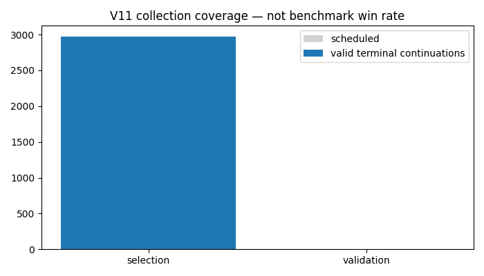

# V11 expanded terminal-head learning experiment

Active bounded research cycle. Frozen identity `94d03e8b4bfa3582dd2129aa1723c541e8b48fbe5c5c0112417d5e732284e200`. All64 training roots/1024 anchors and32 disjoint validation roots were audited; all96 physical roots reconstructed exactly before launch.

[Derived progress](derived-progress.json) · [Frozen protocol](../../docs/expanded-terminal-v11.md) · [Identity](identity.json) · [Input audit](../validation-v11/reviews/independent-input-audit.json)

Sequence:64 PUCT comparators,2974 selection continuations, two4096-update head fits, independently shared validation continuations, then768 fresh development-v4 benchmark games. The terminal head is the fixed candidate; no post-hoc arm choice. No incomplete data fitting. Every job has immutable output hashes; failed/unclosed jobs require review.

The chart measures work completed, not strength. Latest completed benchmark remains V8 terminal81W175L/256; original cp2 baseline83W173L. No V11 playing-strength result yet. At complete valid180/256 wins, prioritize tournament compatibility.

Review snapshot (2026-11-11 08:45 UTC):524/2974 target continuations valid; selection remains active. This timestamped coverage is not a final integrity certification. The separate dashboard adapter `scripts/publish_v11_development_views.py` is ready for eventual canonical benchmark cells; it does not launch games or change the pinned runtime. At benchmark review boundaries, run it, then `scripts/report_development.py progress/development-v4/v11-terminal_head --manifest configs/benchmarks-development-v4.json` once candidate cells exist.

Independent live audit (2026-11-11 09:54 UTC): [saved-record proof](reviews/selection-audit-20261111T0955.json) checked all64 comparators,1168/2974 valid selection continuations and2320 completed-job output hashes. All captured checks passed; seven audit tests include transcript, score, seed, root, terminal-state and failed-status corruption rejection. This is a partial saved-record audit, not independent engine replay or a verified recovery archive. Training remains gated on all2974 valid targets. Use a new output filename for each later audit; preserve every snapshot.

First cycle boundary (2026-11-11 11:13 UTC):1716 valid selection continuations; two unscored deadline interruptions retained. [Independent boundary audit](reviews/deadline-audit-20261111.json) · [Hash-pinned recovery decision](reviews/deadline-recovery-20261111.json) · [Verified recovery pointer](recovery.json). The two interrupted cells completed validly on reviewed attempt2; their unfinished root jobs are completing under the original workers. A real guarded handoff (`scripts/continue_expanded_v11_after_recovery.py`) will audit, export, verify an isolated restore and publish before one further10800-second cycle. Its live status is `runs/expanded-terminal-v11/recovery-handoff-status.json`; failure stops for review. Successful original cells are never rerun, and all original logs/journals remain preserved. No training on incomplete targets and no new benchmark strength claim.
