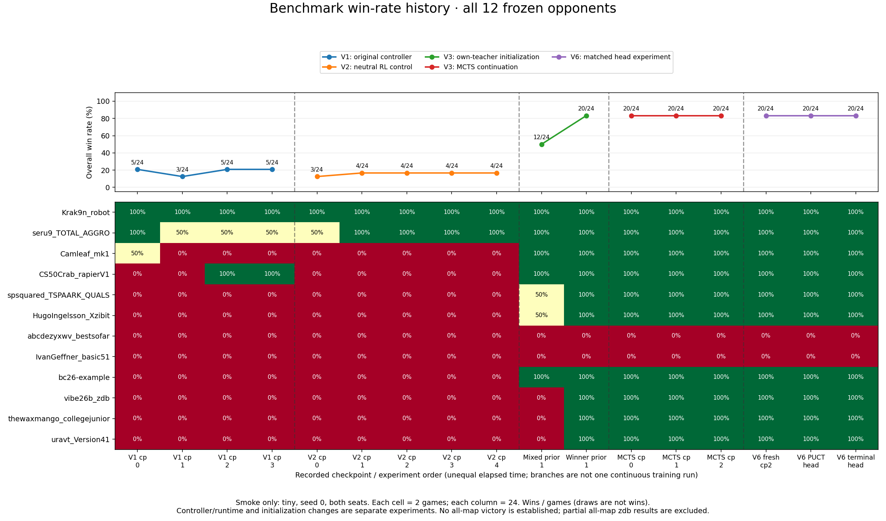

# Benchmark history

Each column is a complete 24-game smoke panel: 12 opponents, `tiny`, seed 0, both seats. The upper plot counts wins divided by games; the lower plot shows every opponent separately. Draws are not wins. Missing or partial panels are excluded rather than filled with zero. Dashed boundaries separate experiments; lines connect checkpoints only within a research branch. The x-axis is checkpoint order, not elapsed time.

The original V1 controller, corrected V2 controller, V3 own-teacher initialization, MCTS continuation and V6 matched head fits are separate experiments. Their differences must not all be attributed to reinforcement learning. Runtime/evaluation configuration identities and source checksums are retained in [the chart data](benchmark-history.json). Two games per opponent provide little statistical precision. Repeated deterministic smoke games are regression checks, not independent holdout replications.

The best measured smoke score remains 20/24. V7 is a training-only diagnostic and has no benchmark point; V8 has not run. The separate, user-stopped all-map zdb test is not pooled into this tiny-only history.

Regenerate with `.venv/bin/python scripts/plot_benchmark_history.py`.
