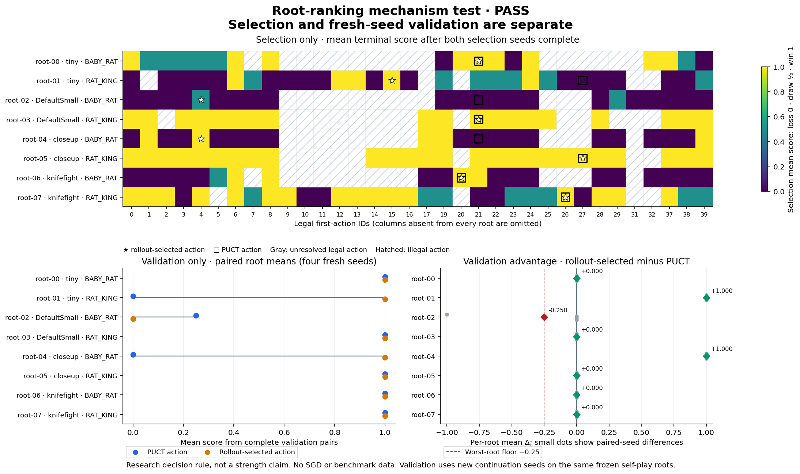
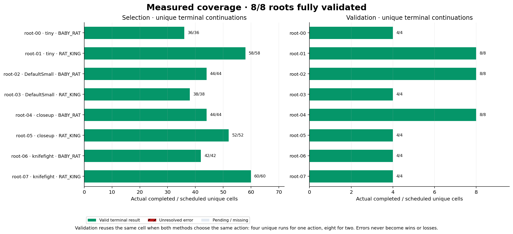

# Root-ranking mechanism test

**Research decision: PASS.** Phase: `complete_review_required`.

This is a bounded test of first-action ranking on frozen own-self-play roots. **No SGD updates and no benchmark data are used. It does not establish benchmark strength or authorize an automatic training promotion.**

**8/8 roots have complete paired validation.** Selection: 374/374 valid cells. Validation: 44/44 valid scheduled unique cells.

Selection uses seeds `103003, 103013` for every legal first action. The rollout action is chosen by mean terminal score, with the frozen original network prior breaking ties. The comparator is unchanged 32-simulation/depth-12 PUCT.

Validation uses separate continuation seeds `103021, 103043, 103067, 103091`, with temperature 0.35 for both teams. These are fresh continuation seeds on the same roots, not new held-out roots. Selection scores never count as validation.

## Precommitted decision rule

The conjunction below is evaluated only after every frozen root has complete valid paired validation. Each root has equal weight, regardless of its legal-action count. A delta is rollout-selected score minus PUCT-selected score.

| Requirement | Observed | Outcome |
|---|---:|---|
| Every root complete | 8/8 | Met |
| Equal-root mean Δ ≥ +0.10 | +0.219 | Met |
| At least two distinct roots improve (Δ > 0) | 2 | Met |
| No root has mean Δ < −0.25 | -0.250 | Met |

Final evidence-integrity verification: **verified**. Complete score criteria alone cannot establish a pass; the runner must first stop its worker and verify the frozen experiment identity.

The +0.10 threshold applies to the equal-root aggregate, not each individual root. The same four validation seeds are reused across roots, and source games are correlated. This is a small mechanism diagnostic, not a calibrated confidence interval or proof of general playing strength.

## Validation by root

| Root | Map / role / round | Rollout / PUCT action | Source cells | Unique valid / scheduled | Rollout mean | PUCT mean | Paired mean Δ | Status |
|---|---|---|---|---:|---:|---:|---:|---|
| `root-00` | tiny / BABY_RAT / 4 | 21 / 21 | Shared four cells | 4/4 | 1.000 | 1.000 | +0.000 | Complete |
| `root-01` | tiny / RAT_KING / 8 | 15 / 27 | Two actions × four cells | 8/8 | 1.000 | 0.000 | +1.000 | Complete |
| `root-02` | DefaultSmall / BABY_RAT / 20 | 4 / 21 | Two actions × four cells | 8/8 | 0.000 | 0.250 | -0.250 | Complete |
| `root-03` | DefaultSmall / RAT_KING / 63 | 21 / 21 | Shared four cells | 4/4 | 1.000 | 1.000 | +0.000 | Complete |
| `root-04` | closeup / BABY_RAT / 49 | 4 / 21 | Two actions × four cells | 8/8 | 1.000 | 0.000 | +1.000 | Complete |
| `root-05` | closeup / RAT_KING / 107 | 27 / 27 | Shared four cells | 4/4 | 1.000 | 1.000 | +0.000 | Complete |
| `root-06` | knifefight / BABY_RAT / 6 | 20 / 20 | Shared four cells | 4/4 | 1.000 | 1.000 | +0.000 | Complete |
| `root-07` | knifefight / RAT_KING / 8 | 26 / 26 | Shared four cells | 4/4 | 1.000 | 1.000 | +0.000 | Complete |

## Paired validation outcomes

Values below are root-player scores, in the fixed validation-seed order. The same-action case reuses identical results and adds no extra evidence.

| Root | Seed | Rollout-selected score | PUCT-selected score | Δ |
|---|---:|---:|---:|---:|
| `root-00` | 103021 | 1 | 1 | +0 |
| `root-00` | 103043 | 1 | 1 | +0 |
| `root-00` | 103067 | 1 | 1 | +0 |
| `root-00` | 103091 | 1 | 1 | +0 |
| `root-01` | 103021 | 1 | 0 | +1 |
| `root-01` | 103043 | 1 | 0 | +1 |
| `root-01` | 103067 | 1 | 0 | +1 |
| `root-01` | 103091 | 1 | 0 | +1 |
| `root-02` | 103021 | 0 | 1 | -1 |
| `root-02` | 103043 | 0 | 0 | +0 |
| `root-02` | 103067 | 0 | 0 | +0 |
| `root-02` | 103091 | 0 | 0 | +0 |
| `root-03` | 103021 | 1 | 1 | +0 |
| `root-03` | 103043 | 1 | 1 | +0 |
| `root-03` | 103067 | 1 | 1 | +0 |
| `root-03` | 103091 | 1 | 1 | +0 |
| `root-04` | 103021 | 1 | 0 | +1 |
| `root-04` | 103043 | 1 | 0 | +1 |
| `root-04` | 103067 | 1 | 0 | +1 |
| `root-04` | 103091 | 1 | 0 | +1 |
| `root-05` | 103021 | 1 | 1 | +0 |
| `root-05` | 103043 | 1 | 1 | +0 |
| `root-05` | 103067 | 1 | 1 | +0 |
| `root-05` | 103091 | 1 | 1 | +0 |
| `root-06` | 103021 | 1 | 1 | +0 |
| `root-06` | 103043 | 1 | 1 | +0 |
| `root-06` | 103067 | 1 | 1 | +0 |
| `root-06` | 103091 | 1 | 1 | +0 |
| `root-07` | 103021 | 1 | 1 | +0 |
| `root-07` | 103043 | 1 | 1 | +0 |
| `root-07` | 103067 | 1 | 1 | +0 |
| `root-07` | 103091 | 1 | 1 | +0 |

Gray denotes missing or incomplete evidence, never score zero. Measured zeroes from completed losses remain colored score zeroes. Red coverage bars mark unresolved errors; successful retries remain valid while earlier error attempts remain in the source evidence.

Cumulative recorded error attempts: **0**.

## Source snapshot

- Exact input report: [`5ff24a569500dd7f791f596ffc34f26ed88ab52fdc36e76bad8163d2eb924f45.json`](report-snapshots/5ff24a569500dd7f791f596ffc34f26ed88ab52fdc36e76bad8163d2eb924f45.json)
- Report SHA-256: `5ff24a569500dd7f791f596ffc34f26ed88ab52fdc36e76bad8163d2eb924f45`
- Experiment identity SHA-256: `35a940123eff29b1a4f01704c2f3e35a2540f2373232d0b16bd296dbf4929162`
- Generated at: `2026-11-10T06:21:11+00:00`

Regenerate from the repository root with `.venv/bin/python scripts/plot_root_ranking.py`. The renderer performs no engine runs or parameter updates; it recomputes the reported research decision from complete paired validation scores.
