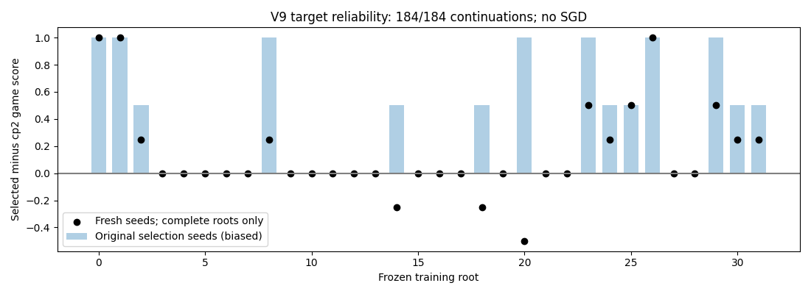

# V9r2 complete — target reliability only

All **184/184** planned continuations are valid, covering all32 roots. Eight inherited games were preserved and independently reverified without reruns. No SGD or benchmark games.

- Fresh-seed mean paired advantage: **0.148438**.
- Source-game-cluster bootstrap95% interval: **[0.016129032258064516, 0.296875]**.
- Precommitted expansion rule: **PASSED**.

This is a training-target mechanism result, not stronger playing performance, model promotion or benchmark confirmation. Review the full per-root/source evidence before choosing a new learning experiment.

[Summary](summary.json) · [Independent final audit](independent-final-audit.json) · [Verified recovery](recovery.json) · [Frozen protocol](../../docs/target-recheck-v9r2.md)
