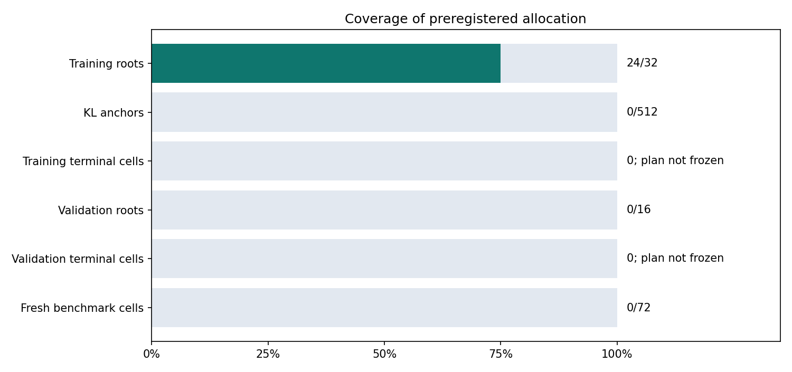
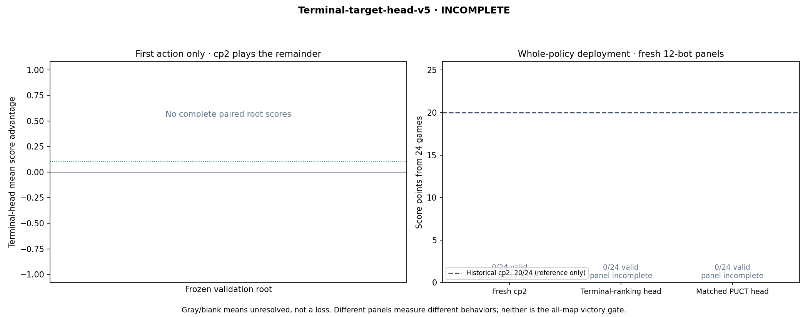

# Terminal-target-head-v5 progress

**INCOMPLETE. No automatic promotion or all-map victory claim.**

Frozen experiment identity: `f28ce105ff9c6e9da536aef14e1686ef70c401739c5bdceb24a5d596928d1313`. Exact plotted [report snapshot](report-snapshots/8a87aac03279b54f38bd2c86571906c7eea48105441d56725683d606fd5f5e98.json).

## What these panels measure

- **First-action validation:** a fitted head chooses one action; unchanged cp2 controls both teams afterward. Four paired continuation seeds per root; roots, not cells, receive equal weight.
- **Whole-policy benchmark:** fresh cp2 and both fixed candidate policies each play all twelve bots on tiny/seed0/both seats. Every action uses that deployed policy. Historical 20/24 is a labeled reference and supplies no missing fresh results.
- Incomplete/error games have no score. Earlier failed attempts remain recorded even when a valid retry resolves the cell. No benchmark data enters targets or gradients.

## Coverage

| Stage | Observed | Planned |
|---|---:|---:|
| Training roots | 24 | 32 |
| KL anchors | 0 | 512 |
| Training terminal cells | 0 | Not yet frozen |
| Validation roots | 0 | 16 |
| Validation terminal cells | 0 | Not yet frozen |
| Fresh benchmark cells | 0 | 72 |

Unresolved errors: training cells **0**, validation cells **0**, benchmark cells **0**.

| Source split | Games attempted | Games completed | Games represented by roots | Skipped exact gradient-input duplicates | Start-only attempts |
|---|---:|---:|---:|---:|---:|
| training | 20 | 20 | 12 | 0 | 0 |
| validation | 0 | 0 | 0 | 0 | 0 |

Validation has **0** distinct represented source games and **0** distinct model inputs. Continuation count is not an independent training-state or scenario count.

## Paired first-action validation

| Root | Map / role / team | cp2 | Terminal head | PUCT head | Terminal − PUCT | Terminal − cp2 |
|---|---|---:|---:|---:|---:|---:|

Complete equal-root mean advantages: versus PUCT **—**, versus cp2 **—**. Missing roots are not dropped from these means.

## Every whole-policy benchmark comparison

| Opponent | Fresh cp2 A/B | Terminal head A/B | PUCT head A/B | Terminal vs cp2 |
|---|---|---|---|---|

The research rule requires complete independent validation, mean terminal-head advantage ≥0.10 over PUCT, at least two improved roots, no root worse than −0.25, nonnegative mean versus cp2, all 72 fresh benchmark games without unresolved errors, and no regression against **any** individual benchmark opponent. Final input/runtime integrity must also be verified. Passing only permits a recorded review of expansion.
