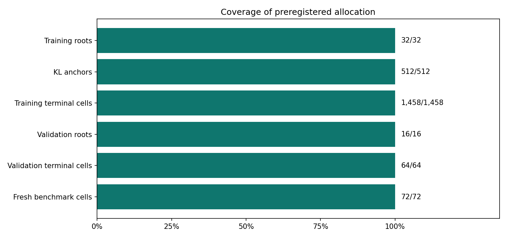
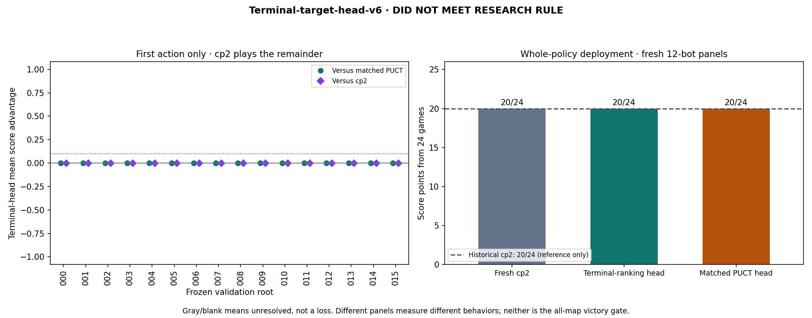
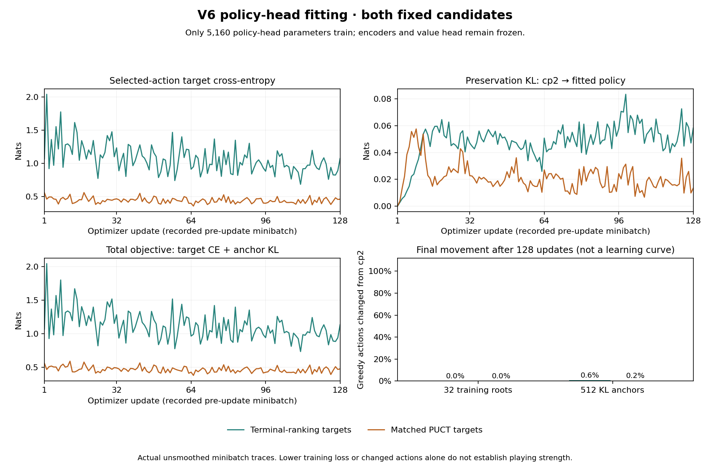
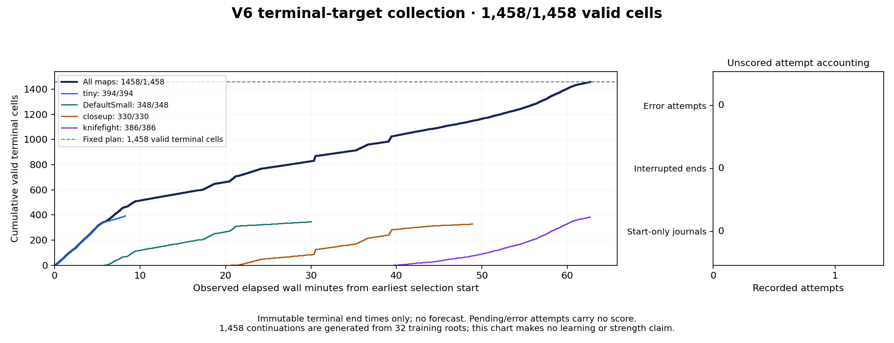

# Terminal-target-head-v6 progress

**DID NOT MEET RESEARCH RULE. No automatic promotion or all-map victory claim.**

Frozen experiment identity: `8ca3b86522d9c7a4d794bb8ab62a1f1173f4fd780350a244fda1f78b4e8a5a26`. Exact plotted [report snapshot](report-snapshots/af3f080d9ed3b27ddbd13c75e10749a2120b6d75d24e4d6c9bfce203e36932c1.json).

## What these panels measure

- **Preregistered source sampling:** frozen cp2 on both teams at temperature **1.0** on all four development maps. Continuations remain at **0.35**. The complete source/reserve and continuation seed inventory is paired with v5; every v6 source game and cache is regenerated. No v5 trajectory is reused.
- **First-action validation:** a fitted head chooses one action; unchanged cp2 controls both teams afterward. Four paired continuation seeds per root; roots, not cells, receive equal weight.
- **Whole-policy benchmark:** fresh cp2 and both fixed candidate policies each play all twelve bots on tiny/seed0/both seats. Every action uses that deployed policy. Historical 20/24 is a labeled reference and supplies no missing fresh results.
- Incomplete/error games have no score. Earlier failed attempts remain recorded even when a valid retry resolves the cell. No benchmark data enters targets or gradients.

## Coverage

| Stage | Observed | Planned |
|---|---:|---:|
| Training roots | 32 | 32 |
| KL anchors | 512 | 512 |
| Training terminal cells | 1,458 | 1458 |
| Validation roots | 16 | 16 |
| Validation terminal cells | 64 | 64 |
| Fresh benchmark cells | 72 | 72 |

Unresolved errors: training cells **0**, validation cells **0**, benchmark cells **0**.

| Source split | Games attempted | Games completed | Games represented by roots | Skipped exact gradient-input duplicates | Start-only attempts |
|---|---:|---:|---:|---:|---:|
| training | 19 | 19 | 18 | 0 | 0 |
| validation | 9 | 9 | 9 | 0 | 0 |

Validation has **9** distinct represented source games and **16** distinct model inputs. Continuation count is not an independent training-state or scenario count.

## Paired first-action validation

| Root | Map / role / team | cp2 | Terminal head | PUCT head | Terminal − PUCT | Terminal − cp2 |
|---|---|---:|---:|---:|---:|---:|
| validation-000 | tiny / BABY_RAT / 0 | 1.000 | 1.000 | 1.000 | 0.000 | 0.000 |
| validation-001 | tiny / RAT_KING / 1 | 0.000 | 0.000 | 0.000 | 0.000 | 0.000 |
| validation-002 | tiny / BABY_RAT / 1 | 0.000 | 0.000 | 0.000 | 0.000 | 0.000 |
| validation-003 | tiny / RAT_KING / 0 | 1.000 | 1.000 | 1.000 | 0.000 | 0.000 |
| validation-004 | DefaultSmall / BABY_RAT / 0 | 0.750 | 0.750 | 0.750 | 0.000 | 0.000 |
| validation-005 | DefaultSmall / RAT_KING / 1 | 1.000 | 1.000 | 1.000 | 0.000 | 0.000 |
| validation-006 | DefaultSmall / BABY_RAT / 1 | 0.250 | 0.250 | 0.250 | 0.000 | 0.000 |
| validation-007 | DefaultSmall / RAT_KING / 0 | 1.000 | 1.000 | 1.000 | 0.000 | 0.000 |
| validation-008 | closeup / BABY_RAT / 0 | 0.000 | 0.000 | 0.000 | 0.000 | 0.000 |
| validation-009 | closeup / RAT_KING / 1 | 1.000 | 1.000 | 1.000 | 0.000 | 0.000 |
| validation-010 | closeup / BABY_RAT / 1 | 0.750 | 0.750 | 0.750 | 0.000 | 0.000 |
| validation-011 | closeup / RAT_KING / 0 | 0.000 | 0.000 | 0.000 | 0.000 | 0.000 |
| validation-012 | knifefight / BABY_RAT / 0 | 0.000 | 0.000 | 0.000 | 0.000 | 0.000 |
| validation-013 | knifefight / RAT_KING / 1 | 1.000 | 1.000 | 1.000 | 0.000 | 0.000 |
| validation-014 | knifefight / BABY_RAT / 1 | 1.000 | 1.000 | 1.000 | 0.000 | 0.000 |
| validation-015 | knifefight / RAT_KING / 0 | 0.000 | 0.000 | 0.000 | 0.000 | 0.000 |

Complete equal-root mean advantages: versus PUCT **0.000**, versus cp2 **0.000**. Missing roots are not dropped from these means.

## Every whole-policy benchmark comparison

| Opponent | Fresh cp2 A/B | Terminal head A/B | PUCT head A/B | Terminal vs cp2 |
|---|---|---|---|---|
| `CS50Crab_rapierV1` | W / W | W / W | W / W | No regression |
| `Camleaf_mk1` | W / W | W / W | W / W | No regression |
| `HugoIngelsson_Xzibit` | W / W | W / W | W / W | No regression |
| `IvanGeffner_basic51` | L / L | L / L | L / L | No regression |
| `Krak9n_robot` | W / W | W / W | W / W | No regression |
| `abcdezyxwv_bestsofar` | L / L | L / L | L / L | No regression |
| `bc26-example` | W / W | W / W | W / W | No regression |
| `seru9_TOTAL_AGGRO` | W / W | W / W | W / W | No regression |
| `spsquared_TSPAARK_QUALS` | W / W | W / W | W / W | No regression |
| `thewaxmango_collegejunior` | W / W | W / W | W / W | No regression |
| `uravt_Version41` | W / W | W / W | W / W | No regression |
| `vibe26b_zdb` | W / W | W / W | W / W | No regression |

The research rule requires complete independent validation, mean terminal-head advantage ≥0.10 over PUCT, at least two improved roots, no root worse than −0.25, nonnegative mean versus cp2, all 72 fresh benchmark games without unresolved errors, and no regression against **any** individual benchmark opponent. Final input/runtime integrity must also be verified. Passing only permits a recorded review of expansion.

## Audits, learning and recovery

The completed pilot produced no measured gain: all three policies scored **20/24**
with the same four losses; the independent validation advantage was **0**. The
research expansion rule failed. [Full interpretation and measured runtime](../../docs/terminal-v6-results.md).

[Independent final audit](independent-final-audit.json) ·
[Independent fit audit](independent-fit-audit.json) ·
[Training-only fitting diagnosis](../../docs/v6-training-underfit.md) ·
[Source coverage comparison](source-coverage-comparison.md) ·
[Verified recovery archive and raw journals](../../artifacts/terminal-target-head-v6/README.md).

The next selected experiment is a [training-only constraint diagnostic](../../docs/cached-head-constraint-v7.md),
not automatic extra v6 SGD, model promotion or all-map qualification.
