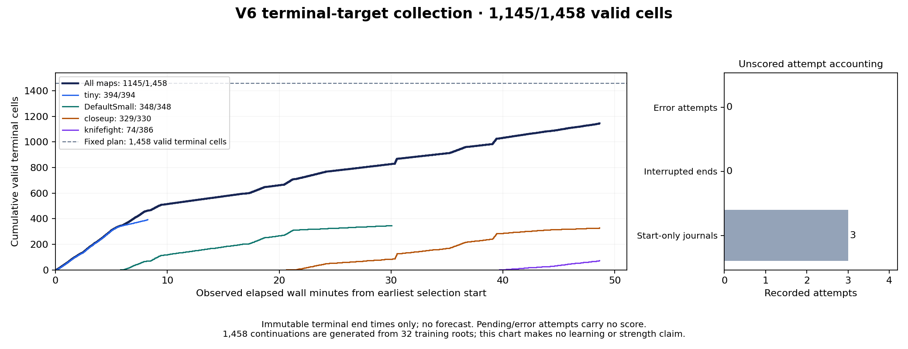

# Observed terminal-target collection

Snapshot read began **2026-11-10T08:43:59.899205+00:00**. It contains **1,145/1,458 valid terminal selection cells** from the fixed 32-root training plan.

Elapsed wall time from the earliest immutable selection-start record to the latest included valid terminal end: **48.63 minutes**. Observed average: **1412.6 valid cells/hour**. This is neither an ETA nor a forecast.

Error attempts: **0**; interrupted end records: **0**; start-only journals: **3**. Start-only records can be in flight or paused and receive no score. Errors remain counted even if a later valid retry resolves their cell.

Only immutable successful attempt-end records with valid identity, terminal state, root-relative result, and action-transcript checks count. Each physical cell counts once; repeated successful attempts are rejected. Every x-coordinate is an observed end time relative to the observed first start. New publications after the snapshot are intentionally absent.

This measures continuation collection, not independent training states, SGD updates, playing strength, or benchmark performance. [Exact event table and SHA-256 provenance](collection-throughput.json). [Standalone helper](source/collection_throughput_plot.py).
