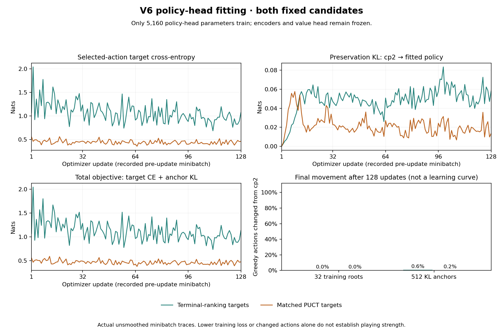

# Observed v6 policy-head fitting

Both fixed candidate heads completed exactly 128 AdamW updates with the same minibatches and optimizer settings. Only 5,160 policy-head parameters trained; encoders and the value head stayed frozen.

Curves show every recorded pre-update minibatch target cross-entropy, cp2-preservation KL, and their summed objective. There is no synthetic step-zero point, smoothing, or extrapolation. Target selectors differ between arms; losses measure each arm’s own target objective.

Changed greedy-action rates are measured once after fitting over all 32 training roots and 512 anchors. They are final policy-movement measurements, not invented per-update trajectories.

| Arm | Final full-set CE | Final full-set KL | Final full-set objective | Root actions changed | Anchor actions changed |
|---|---:|---:|---:|---:|---:|
| Terminal-ranking targets | 0.915429 | 0.050669 | 0.966098 | 0.00% | 0.59% |
| Matched PUCT targets | 0.436549 | 0.015039 | 0.451588 | 0.00% | 0.20% |

The final full-set metrics use a different aggregation than the minibatch trace, so the last curve point need not equal the table. Neither objective reduction nor policy movement establishes validation improvement, benchmark strength, promotion eligibility, or all-map victory.

[Exact observed traces and checksum provenance](learning-curves.json). [Standalone helper](source/learning_curve_plot.py); it verifies complete manifests and checkpoint hashes and reads the two checkpoints with `weights_only=True`, without model inference or actors.
