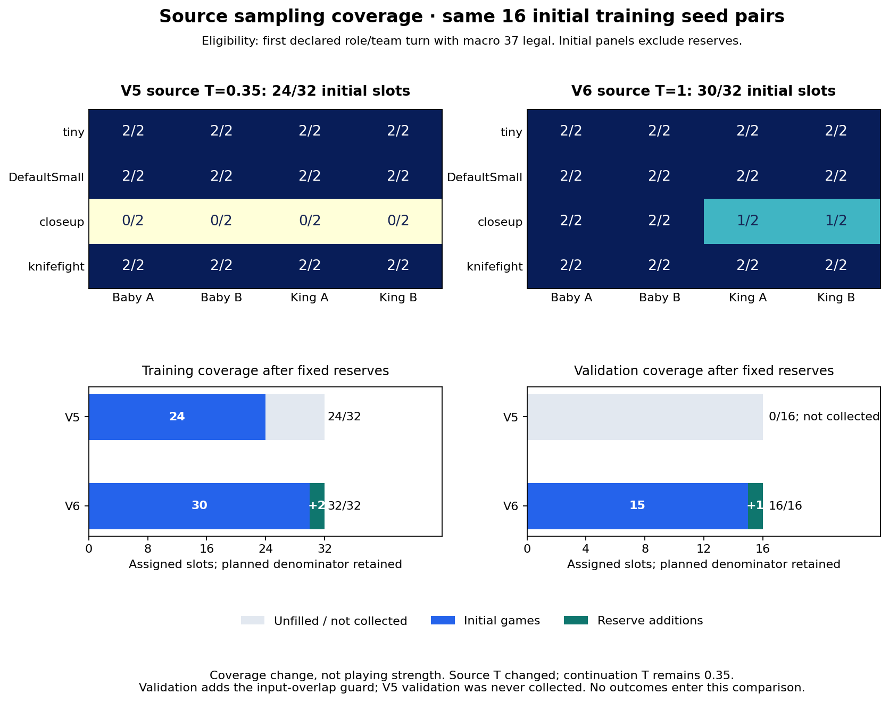

# Paired source-slot coverage

This compares the same 16 initial training engine/policy seed pairs. V5 source temperature was 0.35; v6 source temperature is 1.0 on both teams and all four development maps. Every source game was regenerated. Continuation temperature remains 0.35.

| Version | Initial training slots | Reserve games / slots added | Final training slots | Initial validation slots | Reserve games / slots added | Final validation slots |
|---|---:|---:|---:|---:|---:|---:|
| v5 | 24/32 | 4 / +0 | 24/32 | 0/16 (not collected) | 0 / +0 | 0/16 |
| v6 | 30/32 | 3 / +2 | 32/32 | 15/16 | 1 / +1 | 16/16 |

The initial-training comparison is paired; reserve schedules and contributions are reported separately. V5 validation was not attempted, so 0/16 denotes missing coverage, not 16 failed games. Validation eligibility additionally excludes exact training/anchor inputs.

This is evidence about source-slot availability under the temperature amendment. It does not measure playing strength or establish policy-transfer or victory criteria. Source winners, terminal scores and benchmark outcomes are neither selected nor compared.

Reporting note: the pinned generic v6 coverage graph labels fully scored validation roots as ‘Validation roots’. This source-only figure instead shows all 16 collected validation roots. The generic label should be clarified after actors are quiescent; no pinned file was changed here.

[Machine-readable audit and source SHA-256 inventory](source-coverage-comparison.json). The standalone [helper](source/source_coverage_plot.py) reads frozen source records/manifests only; it does not import actors or modify their pinned runtime.
