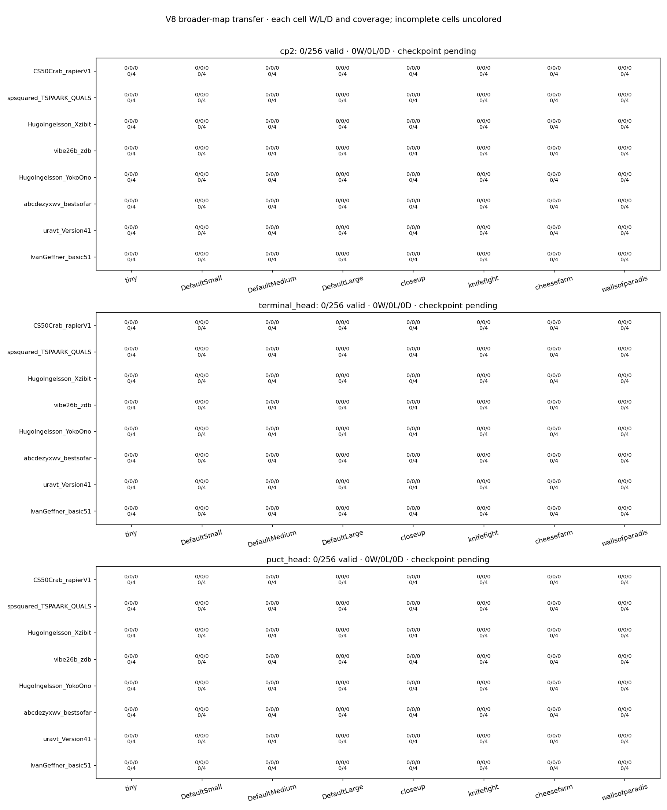
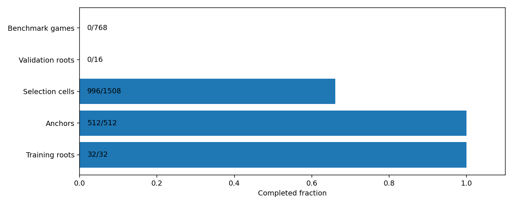

> Live inspection during active collection. Not final cycle evidence or a verified recovery export.

# V8 development transfer

Valid benchmark games: 0/768. No automatic promotion.





The terminal head is the preregistered candidate; the PUCT head is a matched control. Complete-panel improvement uses ≥5 percentage points score gain, positive paired-map bootstrap lower bound and aggregate zdb nonregression. Fresh-seed confirmation is required for promotion. First-action validation is a separately reported mechanism diagnostic, not a substitute for benchmark improvement.

## Comparisons

```json
{}
```

## Independent first-action validation

```json
{
  "complete": false,
  "mean_delta_vs_puct": null,
  "mean_delta_vs_cp2": null,
  "criteria_pass": false
}
```

## Research decision

```json
{
  "complete": false,
  "criteria_pass": false,
  "integrity_verified": false,
  "review_for_expansion": false,
  "automatic_promotion": false,
  "all_map_victory": false,
  "scope": "Precommitted research review rule; no model promotion or all-map victory claim."
}
```
