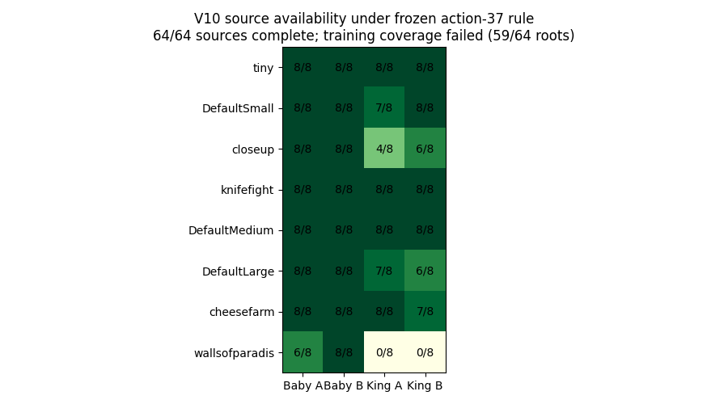

# V10 root-eligibility replay diagnostic

The 64-game source corpus completed, but the frozen combat-only root requirement produced 59/64 roots. No training began.

This active diagnostic replays all 64 saved source prefixes with their recorded actions, checking availability of ordinary decisions for both roles and teams. It generates no fresh self-play, target scores or gradients. [Protocol](../../docs/v10-eligibility-probe.md) · [Identity](identity.json) · [Per-source records](sources)

[Independent original-source proof audit](../expanded-corpus-v10r2/reviews/independent-source-audit.json) · [Verified full source recovery](../expanded-corpus-v10r2/recovery.json)
