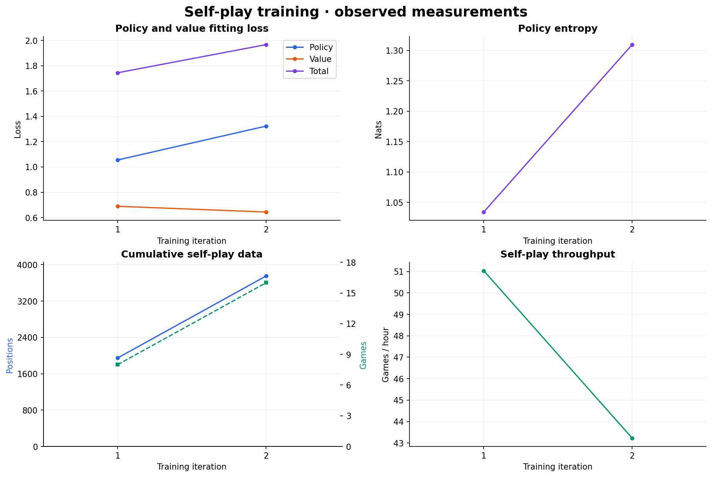
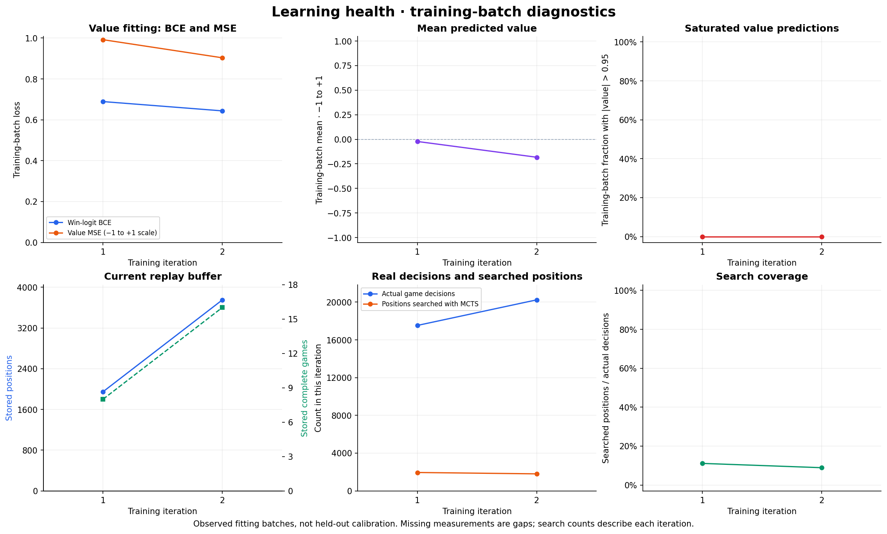
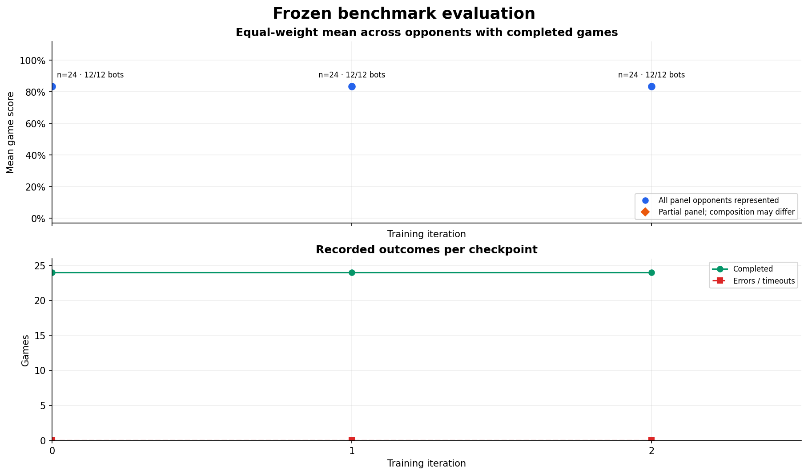
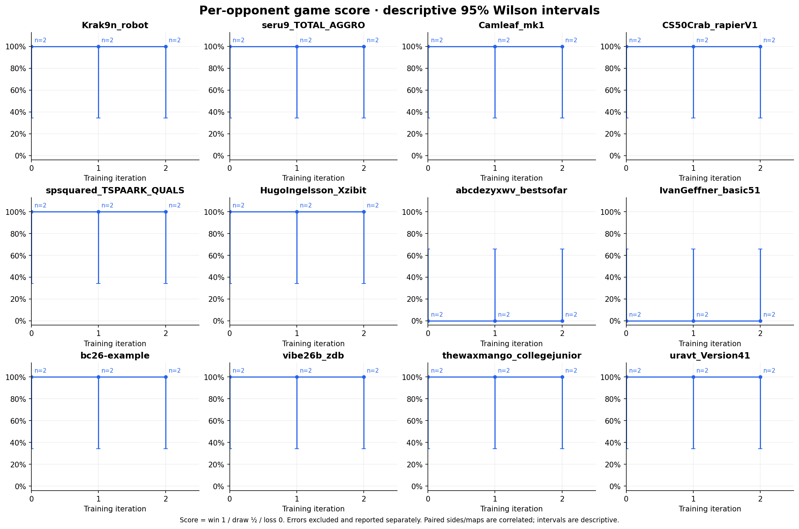

# Training progress

Generated from repository JSONL measurements at `2026-11-10T04:20:45+00:00`.

Run `python scripts/plot_progress.py --progress-dir progress/warmstart-v3` from the repository root to regenerate these figures and this report.

## Latest training measurements

| Measurement | Observed value |
|---|---:|
| `iteration` | 2 |
| `games_total` | 16 |
| `positions_total` | 3751 |
| `policy_loss` | 1.32276 |
| `value_loss` | 0.643679 |
| `total_loss` | 1.96644 |
| `entropy` | 1.30968 |
| `games_per_hour` | 43.2279 |
| `wall_seconds` | 1230.5 |

## Learning health

These are **training-batch diagnostics, not held-out calibration**. Value BCE fits win logits; value MSE and mean use predictions on the −1 to +1 scale. Saturation is the fraction with |value| > 0.95.

Replay counts describe the current buffer, not cumulative data. Searched positions and actual decisions describe each training iteration; their ratio shows search coverage. Missing measurements remain gaps and are not filled with zero.

## Latest benchmark checkpoint

Iteration **2**, checkpoint `checkpoint-0002.pt [20d9e813/macro_v2/greedy/ef6f893e]`.

Evaluation series: `smoke [ef6f893e]`. Stages and evaluation configurations are reported separately.

**24 completed games; 0 errors; 12/12 panel opponents represented.**

Equal-weight mean game score: **83.3%** across all frozen panel opponents. This is not an Elo estimate.

Paired-map bootstrap interval unavailable: 1 shared map–seed cells have both sides completed against every panel opponent; at least 4 are required. A small smoke suite is insufficient for a strength claim.

| Opponent | Completed | W–D–L | Mean score | Descriptive 95% Wilson interval | Errors | Sides A/B |
|---|---:|---:|---:|---:|---:|---:|
| `Krak9n_robot` | 2 | 2–0–0 | 100.0% | 34.2%–100.0% | 0 | 1/1 |
| `seru9_TOTAL_AGGRO` | 2 | 2–0–0 | 100.0% | 34.2%–100.0% | 0 | 1/1 |
| `Camleaf_mk1` | 2 | 2–0–0 | 100.0% | 34.2%–100.0% | 0 | 1/1 |
| `CS50Crab_rapierV1` | 2 | 2–0–0 | 100.0% | 34.2%–100.0% | 0 | 1/1 |
| `spsquared_TSPAARK_QUALS` | 2 | 2–0–0 | 100.0% | 34.2%–100.0% | 0 | 1/1 |
| `HugoIngelsson_Xzibit` | 2 | 2–0–0 | 100.0% | 34.2%–100.0% | 0 | 1/1 |
| `abcdezyxwv_bestsofar` | 2 | 0–0–2 | 0.0% | 0.0%–65.8% | 0 | 1/1 |
| `IvanGeffner_basic51` | 2 | 0–0–2 | 0.0% | 0.0%–65.8% | 0 | 1/1 |
| `bc26-example` | 2 | 2–0–0 | 100.0% | 34.2%–100.0% | 0 | 1/1 |
| `vibe26b_zdb` | 2 | 2–0–0 | 100.0% | 34.2%–100.0% | 0 | 1/1 |
| `thewaxmango_collegejunior` | 2 | 2–0–0 | 100.0% | 34.2%–100.0% | 0 | 1/1 |
| `uravt_Version41` | 2 | 2–0–0 | 100.0% | 34.2%–100.0% | 0 | 1/1 |

## Interpretation

- Game score is win = 1, draw = 0.5, loss = 0. Errors/timeouts are excluded from the completed-game score and listed separately; inspect completion counts before comparing checkpoints.
- The panel mean weights opponents equally. A partial panel is labelled and is not comparable to a full panel. Different map/seed or side coverage can also change the score.
- Wilson intervals are descriptive per-game intervals. With draws they use fractional successes. Mirrored sides and repeated maps are correlated, so these are not paired-map uncertainty estimates or evidence of a statistically significant improvement.
- The panel bootstrap resamples complete shared map–seed cells, keeping both sides and every opponent together (2,000 resamples, fixed RNG seed). It uses the balanced intersection of completed cells; this can differ from the all-completed-game mean. Four cells is the calculation minimum, not a guarantee of adequate power. Bootstrap intervals can collapse when every observed cell has the same outcome.
- Distinct checkpoints, stages, panels and evaluation configurations are never pooled. Missing legacy identity is not treated as the current gate. Duplicate cells within the same identity keep their final recorded outcome and do not increase sample size.
- These descriptive panel averages do not establish the all-map victory gate. That gate separately requires every opponent–map pair and both seats to satisfy its standard and confirmation thresholds; averages across opponents or maps cannot substitute.
- Loss reductions describe fitting to self-play targets; benchmark outcomes measure playing performance. Neither a small smoke suite nor self-play win balance establishes strength against the wider field.
