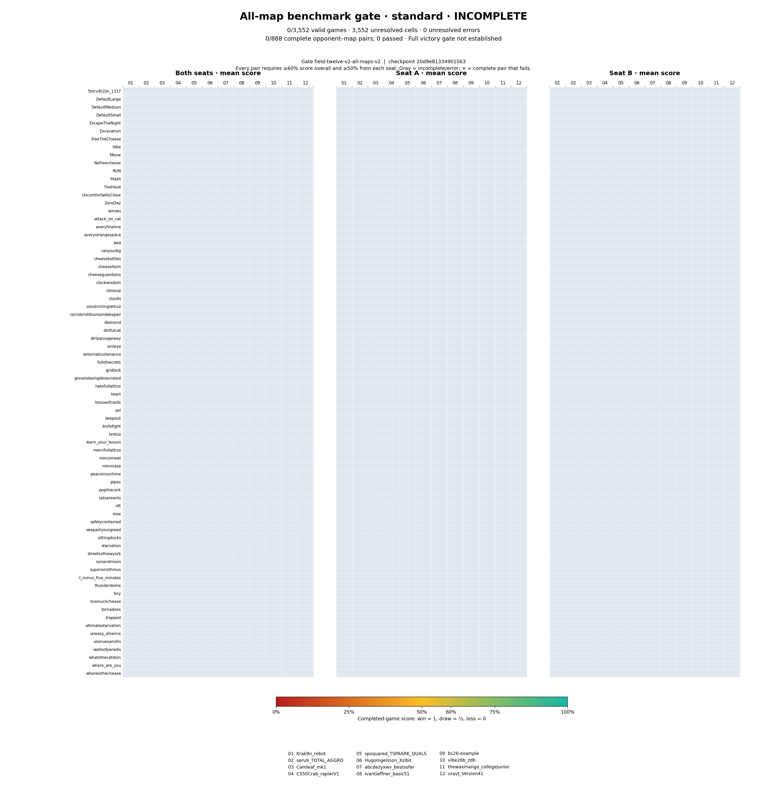

# All-map gate: standard

**Stage: INCOMPLETE. Full victory gate not established.**

Gate: `field-twelve-v2-all-maps-v2`. Checkpoint: `20d9e813349010630940e1cdfbaee5206490c7d323997688d26f47508bbeee7c`.

**0/3,552 valid games; 3,552 unresolved cells; 0 unresolved errors.**

Displayed complete opponent–map pairs: **0/888**; passed pairs: **0**.

## How to read the chart

- Every opponent–map pair must independently reach **60%** overall score and **50%** from **each** seat. Panel averages and averages across maps cannot substitute.
- Only fully completed, error-free opponent–map pairs have colored score cells in any of the three matrices. Gray means incomplete, missing, or errored evidence; it is not a zero or a loss.
- A colored zero is a measured score of zero from completed games. A × marks a completed pair that failed its threshold; the seat matrices show side-specific weaknesses.
- Scores count wins as 1, draws as 0.5, and losses as 0. Game failures stay separate. The report records unresolved errors; earlier recovered infrastructure attempts do not become losses.
- Standard and confirmation require the same checkpoint and evaluation configuration. A passing standard stage alone does not establish full victory. This plot reproduces the supplied report's verdict and is not an independent gate verifier.
- Confirmation uses fresh seeds on the same maps; those maps are not claimed to be unseen. The small number of seed pairs per map does not establish simultaneous statistical superiority across all comparisons.

## Opponent key and coverage

| Key | Opponent | Complete pairs | Passed pairs | Recorded valid games | Unresolved errors |
|---:|---|---:|---:|---:|---:|
| 01 | `Krak9n_robot` | 0/74 | 0/74 | 0 | 0 |
| 02 | `seru9_TOTAL_AGGRO` | 0/74 | 0/74 | 0 | 0 |
| 03 | `Camleaf_mk1` | 0/74 | 0/74 | 0 | 0 |
| 04 | `CS50Crab_rapierV1` | 0/74 | 0/74 | 0 | 0 |
| 05 | `spsquared_TSPAARK_QUALS` | 0/74 | 0/74 | 0 | 0 |
| 06 | `HugoIngelsson_Xzibit` | 0/74 | 0/74 | 0 | 0 |
| 07 | `abcdezyxwv_bestsofar` | 0/74 | 0/74 | 0 | 0 |
| 08 | `IvanGeffner_basic51` | 0/74 | 0/74 | 0 | 0 |
| 09 | `bc26-example` | 0/74 | 0/74 | 0 | 0 |
| 10 | `vibe26b_zdb` | 0/74 | 0/74 | 0 | 0 |
| 11 | `thewaxmango_collegejunior` | 0/74 | 0/74 | 0 | 0 |
| 12 | `uravt_Version41` | 0/74 | 0/74 | 0 | 0 |

## Every opponent–map pair

### Krak9n_robot

| Map | Valid / expected | Score | Seat A score (valid/expected) | Seat B score (valid/expected) | Errors | Status |
|---|---:|---:|---:|---:|---:|---|
| `5t4rv4t10n_1337` | 0/4 | — | — (0/2) | — (0/2) | 0 | Incomplete |
| `DefaultLarge` | 0/4 | — | — (0/2) | — (0/2) | 0 | Incomplete |
| `DefaultMedium` | 0/4 | — | — (0/2) | — (0/2) | 0 | Incomplete |
| `DefaultSmall` | 0/4 | — | — (0/2) | — (0/2) | 0 | Incomplete |
| `EscapeTheNight` | 0/4 | — | — (0/2) | — (0/2) | 0 | Incomplete |
| `Excavation` | 0/4 | — | — (0/2) | — (0/2) | 0 | Incomplete |
| `FreeTheCheese` | 0/4 | — | — (0/2) | — (0/2) | 0 | Incomplete |
| `Hike` | 0/4 | — | — (0/2) | — (0/2) | 0 | Incomplete |
| `Meow` | 0/4 | — | — (0/2) | — (0/2) | 0 | Incomplete |
| `Nofreecheese` | 0/4 | — | — (0/2) | — (0/2) | 0 | Incomplete |
| `RUN` | 0/4 | — | — (0/2) | — (0/2) | 0 | Incomplete |
| `Stash` | 0/4 | — | — (0/2) | — (0/2) | 0 | Incomplete |
| `TheHeist` | 0/4 | — | — (0/2) | — (0/2) | 0 | Incomplete |
| `UncomfortablyClose` | 0/4 | — | — (0/2) | — (0/2) | 0 | Incomplete |
| `ZeroDay` | 0/4 | — | — (0/2) | — (0/2) | 0 | Incomplete |
| `arrows` | 0/4 | — | — (0/2) | — (0/2) | 0 | Incomplete |
| `attack_on_cat` | 0/4 | — | — (0/2) | — (0/2) | 0 | Incomplete |
| `averyfineline` | 0/4 | — | — (0/2) | — (0/2) | 0 | Incomplete |
| `averystrangespace` | 0/4 | — | — (0/2) | — (0/2) | 0 | Incomplete |
| `bed` | 0/4 | — | — (0/2) | — (0/2) | 0 | Incomplete |
| `canyoudig` | 0/4 | — | — (0/2) | — (0/2) | 0 | Incomplete |
| `cheesebottles` | 0/4 | — | — (0/2) | — (0/2) | 0 | Incomplete |
| `cheesefarm` | 0/4 | — | — (0/2) | — (0/2) | 0 | Incomplete |
| `cheeseguardians` | 0/4 | — | — (0/2) | — (0/2) | 0 | Incomplete |
| `clockwisdom` | 0/4 | — | — (0/2) | — (0/2) | 0 | Incomplete |
| `closeup` | 0/4 | — | — (0/2) | — (0/2) | 0 | Incomplete |
| `clouds` | 0/4 | — | — (0/2) | — (0/2) | 0 | Incomplete |
| `constrictinglattice` | 0/4 | — | — (0/2) | — (0/2) | 0 | Incomplete |
| `corridorofdoomanddespair` | 0/4 | — | — (0/2) | — (0/2) | 0 | Incomplete |
| `diamond` | 0/4 | — | — (0/2) | — (0/2) | 0 | Incomplete |
| `dirtfulcat` | 0/4 | — | — (0/2) | — (0/2) | 0 | Incomplete |
| `dirtpassageway` | 0/4 | — | — (0/2) | — (0/2) | 0 | Incomplete |
| `evileye` | 0/4 | — | — (0/2) | — (0/2) | 0 | Incomplete |
| `externalsustenance` | 0/4 | — | — (0/2) | — (0/2) | 0 | Incomplete |
| `fullofsecrets` | 0/4 | — | — (0/2) | — (0/2) | 0 | Incomplete |
| `gridlock` | 0/4 | — | — (0/2) | — (0/2) | 0 | Incomplete |
| `groveisbeingdesecrated` | 0/4 | — | — (0/2) | — (0/2) | 0 | Incomplete |
| `hatefullattice` | 0/4 | — | — (0/2) | — (0/2) | 0 | Incomplete |
| `heart` | 0/4 | — | — (0/2) | — (0/2) | 0 | Incomplete |
| `houseofcards` | 0/4 | — | — (0/2) | — (0/2) | 0 | Incomplete |
| `jail` | 0/4 | — | — (0/2) | — (0/2) | 0 | Incomplete |
| `keepout` | 0/4 | — | — (0/2) | — (0/2) | 0 | Incomplete |
| `knifefight` | 0/4 | — | — (0/2) | — (0/2) | 0 | Incomplete |
| `krotus` | 0/4 | — | — (0/2) | — (0/2) | 0 | Incomplete |
| `learn_your_lesson` | 0/4 | — | — (0/2) | — (0/2) | 0 | Incomplete |
| `mercifullattice` | 0/4 | — | — (0/2) | — (0/2) | 0 | Incomplete |
| `mincemeat` | 0/4 | — | — (0/2) | — (0/2) | 0 | Incomplete |
| `minimaze` | 0/4 | — | — (0/2) | — (0/2) | 0 | Incomplete |
| `peaceinourtime` | 0/4 | — | — (0/2) | — (0/2) | 0 | Incomplete |
| `pipes` | 0/4 | — | — (0/2) | — (0/2) | 0 | Incomplete |
| `popthecork` | 0/4 | — | — (0/2) | — (0/2) | 0 | Incomplete |
| `ratsareants` | 0/4 | — | — (0/2) | — (0/2) | 0 | Incomplete |
| `rift` | 0/4 | — | — (0/2) | — (0/2) | 0 | Incomplete |
| `rose` | 0/4 | — | — (0/2) | — (0/2) | 0 | Incomplete |
| `safelycontained` | 0/4 | — | — (0/2) | — (0/2) | 0 | Incomplete |
| `seepastyourgreed` | 0/4 | — | — (0/2) | — (0/2) | 0 | Incomplete |
| `sittingducks` | 0/4 | — | — (0/2) | — (0/2) | 0 | Incomplete |
| `starvation` | 0/4 | — | — (0/2) | — (0/2) | 0 | Incomplete |
| `streetsofnewyork` | 0/4 | — | — (0/2) | — (0/2) | 0 | Incomplete |
| `sunandmoon` | 0/4 | — | — (0/2) | — (0/2) | 0 | Incomplete |
| `superioristhmus` | 0/4 | — | — (0/2) | — (0/2) | 0 | Incomplete |
| `t_minus_five_minutes` | 0/4 | — | — (0/2) | — (0/2) | 0 | Incomplete |
| `thunderdome` | 0/4 | — | — (0/2) | — (0/2) | 0 | Incomplete |
| `tiny` | 0/4 | — | — (0/2) | — (0/2) | 0 | Incomplete |
| `toomuchcheese` | 0/4 | — | — (0/2) | — (0/2) | 0 | Incomplete |
| `tornadoes` | 0/4 | — | — (0/2) | — (0/2) | 0 | Incomplete |
| `trapped` | 0/4 | — | — (0/2) | — (0/2) | 0 | Incomplete |
| `ultimatestarvation` | 0/4 | — | — (0/2) | — (0/2) | 0 | Incomplete |
| `uneasy_alliance` | 0/4 | — | — (0/2) | — (0/2) | 0 | Incomplete |
| `uneruesansfin` | 0/4 | — | — (0/2) | — (0/2) | 0 | Incomplete |
| `wallsofparadis` | 0/4 | — | — (0/2) | — (0/2) | 0 | Incomplete |
| `whatsthecatdoin` | 0/4 | — | — (0/2) | — (0/2) | 0 | Incomplete |
| `where_are_you` | 0/4 | — | — (0/2) | — (0/2) | 0 | Incomplete |
| `whereisthecheese` | 0/4 | — | — (0/2) | — (0/2) | 0 | Incomplete |

### seru9_TOTAL_AGGRO

| Map | Valid / expected | Score | Seat A score (valid/expected) | Seat B score (valid/expected) | Errors | Status |
|---|---:|---:|---:|---:|---:|---|
| `5t4rv4t10n_1337` | 0/4 | — | — (0/2) | — (0/2) | 0 | Incomplete |
| `DefaultLarge` | 0/4 | — | — (0/2) | — (0/2) | 0 | Incomplete |
| `DefaultMedium` | 0/4 | — | — (0/2) | — (0/2) | 0 | Incomplete |
| `DefaultSmall` | 0/4 | — | — (0/2) | — (0/2) | 0 | Incomplete |
| `EscapeTheNight` | 0/4 | — | — (0/2) | — (0/2) | 0 | Incomplete |
| `Excavation` | 0/4 | — | — (0/2) | — (0/2) | 0 | Incomplete |
| `FreeTheCheese` | 0/4 | — | — (0/2) | — (0/2) | 0 | Incomplete |
| `Hike` | 0/4 | — | — (0/2) | — (0/2) | 0 | Incomplete |
| `Meow` | 0/4 | — | — (0/2) | — (0/2) | 0 | Incomplete |
| `Nofreecheese` | 0/4 | — | — (0/2) | — (0/2) | 0 | Incomplete |
| `RUN` | 0/4 | — | — (0/2) | — (0/2) | 0 | Incomplete |
| `Stash` | 0/4 | — | — (0/2) | — (0/2) | 0 | Incomplete |
| `TheHeist` | 0/4 | — | — (0/2) | — (0/2) | 0 | Incomplete |
| `UncomfortablyClose` | 0/4 | — | — (0/2) | — (0/2) | 0 | Incomplete |
| `ZeroDay` | 0/4 | — | — (0/2) | — (0/2) | 0 | Incomplete |
| `arrows` | 0/4 | — | — (0/2) | — (0/2) | 0 | Incomplete |
| `attack_on_cat` | 0/4 | — | — (0/2) | — (0/2) | 0 | Incomplete |
| `averyfineline` | 0/4 | — | — (0/2) | — (0/2) | 0 | Incomplete |
| `averystrangespace` | 0/4 | — | — (0/2) | — (0/2) | 0 | Incomplete |
| `bed` | 0/4 | — | — (0/2) | — (0/2) | 0 | Incomplete |
| `canyoudig` | 0/4 | — | — (0/2) | — (0/2) | 0 | Incomplete |
| `cheesebottles` | 0/4 | — | — (0/2) | — (0/2) | 0 | Incomplete |
| `cheesefarm` | 0/4 | — | — (0/2) | — (0/2) | 0 | Incomplete |
| `cheeseguardians` | 0/4 | — | — (0/2) | — (0/2) | 0 | Incomplete |
| `clockwisdom` | 0/4 | — | — (0/2) | — (0/2) | 0 | Incomplete |
| `closeup` | 0/4 | — | — (0/2) | — (0/2) | 0 | Incomplete |
| `clouds` | 0/4 | — | — (0/2) | — (0/2) | 0 | Incomplete |
| `constrictinglattice` | 0/4 | — | — (0/2) | — (0/2) | 0 | Incomplete |
| `corridorofdoomanddespair` | 0/4 | — | — (0/2) | — (0/2) | 0 | Incomplete |
| `diamond` | 0/4 | — | — (0/2) | — (0/2) | 0 | Incomplete |
| `dirtfulcat` | 0/4 | — | — (0/2) | — (0/2) | 0 | Incomplete |
| `dirtpassageway` | 0/4 | — | — (0/2) | — (0/2) | 0 | Incomplete |
| `evileye` | 0/4 | — | — (0/2) | — (0/2) | 0 | Incomplete |
| `externalsustenance` | 0/4 | — | — (0/2) | — (0/2) | 0 | Incomplete |
| `fullofsecrets` | 0/4 | — | — (0/2) | — (0/2) | 0 | Incomplete |
| `gridlock` | 0/4 | — | — (0/2) | — (0/2) | 0 | Incomplete |
| `groveisbeingdesecrated` | 0/4 | — | — (0/2) | — (0/2) | 0 | Incomplete |
| `hatefullattice` | 0/4 | — | — (0/2) | — (0/2) | 0 | Incomplete |
| `heart` | 0/4 | — | — (0/2) | — (0/2) | 0 | Incomplete |
| `houseofcards` | 0/4 | — | — (0/2) | — (0/2) | 0 | Incomplete |
| `jail` | 0/4 | — | — (0/2) | — (0/2) | 0 | Incomplete |
| `keepout` | 0/4 | — | — (0/2) | — (0/2) | 0 | Incomplete |
| `knifefight` | 0/4 | — | — (0/2) | — (0/2) | 0 | Incomplete |
| `krotus` | 0/4 | — | — (0/2) | — (0/2) | 0 | Incomplete |
| `learn_your_lesson` | 0/4 | — | — (0/2) | — (0/2) | 0 | Incomplete |
| `mercifullattice` | 0/4 | — | — (0/2) | — (0/2) | 0 | Incomplete |
| `mincemeat` | 0/4 | — | — (0/2) | — (0/2) | 0 | Incomplete |
| `minimaze` | 0/4 | — | — (0/2) | — (0/2) | 0 | Incomplete |
| `peaceinourtime` | 0/4 | — | — (0/2) | — (0/2) | 0 | Incomplete |
| `pipes` | 0/4 | — | — (0/2) | — (0/2) | 0 | Incomplete |
| `popthecork` | 0/4 | — | — (0/2) | — (0/2) | 0 | Incomplete |
| `ratsareants` | 0/4 | — | — (0/2) | — (0/2) | 0 | Incomplete |
| `rift` | 0/4 | — | — (0/2) | — (0/2) | 0 | Incomplete |
| `rose` | 0/4 | — | — (0/2) | — (0/2) | 0 | Incomplete |
| `safelycontained` | 0/4 | — | — (0/2) | — (0/2) | 0 | Incomplete |
| `seepastyourgreed` | 0/4 | — | — (0/2) | — (0/2) | 0 | Incomplete |
| `sittingducks` | 0/4 | — | — (0/2) | — (0/2) | 0 | Incomplete |
| `starvation` | 0/4 | — | — (0/2) | — (0/2) | 0 | Incomplete |
| `streetsofnewyork` | 0/4 | — | — (0/2) | — (0/2) | 0 | Incomplete |
| `sunandmoon` | 0/4 | — | — (0/2) | — (0/2) | 0 | Incomplete |
| `superioristhmus` | 0/4 | — | — (0/2) | — (0/2) | 0 | Incomplete |
| `t_minus_five_minutes` | 0/4 | — | — (0/2) | — (0/2) | 0 | Incomplete |
| `thunderdome` | 0/4 | — | — (0/2) | — (0/2) | 0 | Incomplete |
| `tiny` | 0/4 | — | — (0/2) | — (0/2) | 0 | Incomplete |
| `toomuchcheese` | 0/4 | — | — (0/2) | — (0/2) | 0 | Incomplete |
| `tornadoes` | 0/4 | — | — (0/2) | — (0/2) | 0 | Incomplete |
| `trapped` | 0/4 | — | — (0/2) | — (0/2) | 0 | Incomplete |
| `ultimatestarvation` | 0/4 | — | — (0/2) | — (0/2) | 0 | Incomplete |
| `uneasy_alliance` | 0/4 | — | — (0/2) | — (0/2) | 0 | Incomplete |
| `uneruesansfin` | 0/4 | — | — (0/2) | — (0/2) | 0 | Incomplete |
| `wallsofparadis` | 0/4 | — | — (0/2) | — (0/2) | 0 | Incomplete |
| `whatsthecatdoin` | 0/4 | — | — (0/2) | — (0/2) | 0 | Incomplete |
| `where_are_you` | 0/4 | — | — (0/2) | — (0/2) | 0 | Incomplete |
| `whereisthecheese` | 0/4 | — | — (0/2) | — (0/2) | 0 | Incomplete |

### Camleaf_mk1

| Map | Valid / expected | Score | Seat A score (valid/expected) | Seat B score (valid/expected) | Errors | Status |
|---|---:|---:|---:|---:|---:|---|
| `5t4rv4t10n_1337` | 0/4 | — | — (0/2) | — (0/2) | 0 | Incomplete |
| `DefaultLarge` | 0/4 | — | — (0/2) | — (0/2) | 0 | Incomplete |
| `DefaultMedium` | 0/4 | — | — (0/2) | — (0/2) | 0 | Incomplete |
| `DefaultSmall` | 0/4 | — | — (0/2) | — (0/2) | 0 | Incomplete |
| `EscapeTheNight` | 0/4 | — | — (0/2) | — (0/2) | 0 | Incomplete |
| `Excavation` | 0/4 | — | — (0/2) | — (0/2) | 0 | Incomplete |
| `FreeTheCheese` | 0/4 | — | — (0/2) | — (0/2) | 0 | Incomplete |
| `Hike` | 0/4 | — | — (0/2) | — (0/2) | 0 | Incomplete |
| `Meow` | 0/4 | — | — (0/2) | — (0/2) | 0 | Incomplete |
| `Nofreecheese` | 0/4 | — | — (0/2) | — (0/2) | 0 | Incomplete |
| `RUN` | 0/4 | — | — (0/2) | — (0/2) | 0 | Incomplete |
| `Stash` | 0/4 | — | — (0/2) | — (0/2) | 0 | Incomplete |
| `TheHeist` | 0/4 | — | — (0/2) | — (0/2) | 0 | Incomplete |
| `UncomfortablyClose` | 0/4 | — | — (0/2) | — (0/2) | 0 | Incomplete |
| `ZeroDay` | 0/4 | — | — (0/2) | — (0/2) | 0 | Incomplete |
| `arrows` | 0/4 | — | — (0/2) | — (0/2) | 0 | Incomplete |
| `attack_on_cat` | 0/4 | — | — (0/2) | — (0/2) | 0 | Incomplete |
| `averyfineline` | 0/4 | — | — (0/2) | — (0/2) | 0 | Incomplete |
| `averystrangespace` | 0/4 | — | — (0/2) | — (0/2) | 0 | Incomplete |
| `bed` | 0/4 | — | — (0/2) | — (0/2) | 0 | Incomplete |
| `canyoudig` | 0/4 | — | — (0/2) | — (0/2) | 0 | Incomplete |
| `cheesebottles` | 0/4 | — | — (0/2) | — (0/2) | 0 | Incomplete |
| `cheesefarm` | 0/4 | — | — (0/2) | — (0/2) | 0 | Incomplete |
| `cheeseguardians` | 0/4 | — | — (0/2) | — (0/2) | 0 | Incomplete |
| `clockwisdom` | 0/4 | — | — (0/2) | — (0/2) | 0 | Incomplete |
| `closeup` | 0/4 | — | — (0/2) | — (0/2) | 0 | Incomplete |
| `clouds` | 0/4 | — | — (0/2) | — (0/2) | 0 | Incomplete |
| `constrictinglattice` | 0/4 | — | — (0/2) | — (0/2) | 0 | Incomplete |
| `corridorofdoomanddespair` | 0/4 | — | — (0/2) | — (0/2) | 0 | Incomplete |
| `diamond` | 0/4 | — | — (0/2) | — (0/2) | 0 | Incomplete |
| `dirtfulcat` | 0/4 | — | — (0/2) | — (0/2) | 0 | Incomplete |
| `dirtpassageway` | 0/4 | — | — (0/2) | — (0/2) | 0 | Incomplete |
| `evileye` | 0/4 | — | — (0/2) | — (0/2) | 0 | Incomplete |
| `externalsustenance` | 0/4 | — | — (0/2) | — (0/2) | 0 | Incomplete |
| `fullofsecrets` | 0/4 | — | — (0/2) | — (0/2) | 0 | Incomplete |
| `gridlock` | 0/4 | — | — (0/2) | — (0/2) | 0 | Incomplete |
| `groveisbeingdesecrated` | 0/4 | — | — (0/2) | — (0/2) | 0 | Incomplete |
| `hatefullattice` | 0/4 | — | — (0/2) | — (0/2) | 0 | Incomplete |
| `heart` | 0/4 | — | — (0/2) | — (0/2) | 0 | Incomplete |
| `houseofcards` | 0/4 | — | — (0/2) | — (0/2) | 0 | Incomplete |
| `jail` | 0/4 | — | — (0/2) | — (0/2) | 0 | Incomplete |
| `keepout` | 0/4 | — | — (0/2) | — (0/2) | 0 | Incomplete |
| `knifefight` | 0/4 | — | — (0/2) | — (0/2) | 0 | Incomplete |
| `krotus` | 0/4 | — | — (0/2) | — (0/2) | 0 | Incomplete |
| `learn_your_lesson` | 0/4 | — | — (0/2) | — (0/2) | 0 | Incomplete |
| `mercifullattice` | 0/4 | — | — (0/2) | — (0/2) | 0 | Incomplete |
| `mincemeat` | 0/4 | — | — (0/2) | — (0/2) | 0 | Incomplete |
| `minimaze` | 0/4 | — | — (0/2) | — (0/2) | 0 | Incomplete |
| `peaceinourtime` | 0/4 | — | — (0/2) | — (0/2) | 0 | Incomplete |
| `pipes` | 0/4 | — | — (0/2) | — (0/2) | 0 | Incomplete |
| `popthecork` | 0/4 | — | — (0/2) | — (0/2) | 0 | Incomplete |
| `ratsareants` | 0/4 | — | — (0/2) | — (0/2) | 0 | Incomplete |
| `rift` | 0/4 | — | — (0/2) | — (0/2) | 0 | Incomplete |
| `rose` | 0/4 | — | — (0/2) | — (0/2) | 0 | Incomplete |
| `safelycontained` | 0/4 | — | — (0/2) | — (0/2) | 0 | Incomplete |
| `seepastyourgreed` | 0/4 | — | — (0/2) | — (0/2) | 0 | Incomplete |
| `sittingducks` | 0/4 | — | — (0/2) | — (0/2) | 0 | Incomplete |
| `starvation` | 0/4 | — | — (0/2) | — (0/2) | 0 | Incomplete |
| `streetsofnewyork` | 0/4 | — | — (0/2) | — (0/2) | 0 | Incomplete |
| `sunandmoon` | 0/4 | — | — (0/2) | — (0/2) | 0 | Incomplete |
| `superioristhmus` | 0/4 | — | — (0/2) | — (0/2) | 0 | Incomplete |
| `t_minus_five_minutes` | 0/4 | — | — (0/2) | — (0/2) | 0 | Incomplete |
| `thunderdome` | 0/4 | — | — (0/2) | — (0/2) | 0 | Incomplete |
| `tiny` | 0/4 | — | — (0/2) | — (0/2) | 0 | Incomplete |
| `toomuchcheese` | 0/4 | — | — (0/2) | — (0/2) | 0 | Incomplete |
| `tornadoes` | 0/4 | — | — (0/2) | — (0/2) | 0 | Incomplete |
| `trapped` | 0/4 | — | — (0/2) | — (0/2) | 0 | Incomplete |
| `ultimatestarvation` | 0/4 | — | — (0/2) | — (0/2) | 0 | Incomplete |
| `uneasy_alliance` | 0/4 | — | — (0/2) | — (0/2) | 0 | Incomplete |
| `uneruesansfin` | 0/4 | — | — (0/2) | — (0/2) | 0 | Incomplete |
| `wallsofparadis` | 0/4 | — | — (0/2) | — (0/2) | 0 | Incomplete |
| `whatsthecatdoin` | 0/4 | — | — (0/2) | — (0/2) | 0 | Incomplete |
| `where_are_you` | 0/4 | — | — (0/2) | — (0/2) | 0 | Incomplete |
| `whereisthecheese` | 0/4 | — | — (0/2) | — (0/2) | 0 | Incomplete |

### CS50Crab_rapierV1

| Map | Valid / expected | Score | Seat A score (valid/expected) | Seat B score (valid/expected) | Errors | Status |
|---|---:|---:|---:|---:|---:|---|
| `5t4rv4t10n_1337` | 0/4 | — | — (0/2) | — (0/2) | 0 | Incomplete |
| `DefaultLarge` | 0/4 | — | — (0/2) | — (0/2) | 0 | Incomplete |
| `DefaultMedium` | 0/4 | — | — (0/2) | — (0/2) | 0 | Incomplete |
| `DefaultSmall` | 0/4 | — | — (0/2) | — (0/2) | 0 | Incomplete |
| `EscapeTheNight` | 0/4 | — | — (0/2) | — (0/2) | 0 | Incomplete |
| `Excavation` | 0/4 | — | — (0/2) | — (0/2) | 0 | Incomplete |
| `FreeTheCheese` | 0/4 | — | — (0/2) | — (0/2) | 0 | Incomplete |
| `Hike` | 0/4 | — | — (0/2) | — (0/2) | 0 | Incomplete |
| `Meow` | 0/4 | — | — (0/2) | — (0/2) | 0 | Incomplete |
| `Nofreecheese` | 0/4 | — | — (0/2) | — (0/2) | 0 | Incomplete |
| `RUN` | 0/4 | — | — (0/2) | — (0/2) | 0 | Incomplete |
| `Stash` | 0/4 | — | — (0/2) | — (0/2) | 0 | Incomplete |
| `TheHeist` | 0/4 | — | — (0/2) | — (0/2) | 0 | Incomplete |
| `UncomfortablyClose` | 0/4 | — | — (0/2) | — (0/2) | 0 | Incomplete |
| `ZeroDay` | 0/4 | — | — (0/2) | — (0/2) | 0 | Incomplete |
| `arrows` | 0/4 | — | — (0/2) | — (0/2) | 0 | Incomplete |
| `attack_on_cat` | 0/4 | — | — (0/2) | — (0/2) | 0 | Incomplete |
| `averyfineline` | 0/4 | — | — (0/2) | — (0/2) | 0 | Incomplete |
| `averystrangespace` | 0/4 | — | — (0/2) | — (0/2) | 0 | Incomplete |
| `bed` | 0/4 | — | — (0/2) | — (0/2) | 0 | Incomplete |
| `canyoudig` | 0/4 | — | — (0/2) | — (0/2) | 0 | Incomplete |
| `cheesebottles` | 0/4 | — | — (0/2) | — (0/2) | 0 | Incomplete |
| `cheesefarm` | 0/4 | — | — (0/2) | — (0/2) | 0 | Incomplete |
| `cheeseguardians` | 0/4 | — | — (0/2) | — (0/2) | 0 | Incomplete |
| `clockwisdom` | 0/4 | — | — (0/2) | — (0/2) | 0 | Incomplete |
| `closeup` | 0/4 | — | — (0/2) | — (0/2) | 0 | Incomplete |
| `clouds` | 0/4 | — | — (0/2) | — (0/2) | 0 | Incomplete |
| `constrictinglattice` | 0/4 | — | — (0/2) | — (0/2) | 0 | Incomplete |
| `corridorofdoomanddespair` | 0/4 | — | — (0/2) | — (0/2) | 0 | Incomplete |
| `diamond` | 0/4 | — | — (0/2) | — (0/2) | 0 | Incomplete |
| `dirtfulcat` | 0/4 | — | — (0/2) | — (0/2) | 0 | Incomplete |
| `dirtpassageway` | 0/4 | — | — (0/2) | — (0/2) | 0 | Incomplete |
| `evileye` | 0/4 | — | — (0/2) | — (0/2) | 0 | Incomplete |
| `externalsustenance` | 0/4 | — | — (0/2) | — (0/2) | 0 | Incomplete |
| `fullofsecrets` | 0/4 | — | — (0/2) | — (0/2) | 0 | Incomplete |
| `gridlock` | 0/4 | — | — (0/2) | — (0/2) | 0 | Incomplete |
| `groveisbeingdesecrated` | 0/4 | — | — (0/2) | — (0/2) | 0 | Incomplete |
| `hatefullattice` | 0/4 | — | — (0/2) | — (0/2) | 0 | Incomplete |
| `heart` | 0/4 | — | — (0/2) | — (0/2) | 0 | Incomplete |
| `houseofcards` | 0/4 | — | — (0/2) | — (0/2) | 0 | Incomplete |
| `jail` | 0/4 | — | — (0/2) | — (0/2) | 0 | Incomplete |
| `keepout` | 0/4 | — | — (0/2) | — (0/2) | 0 | Incomplete |
| `knifefight` | 0/4 | — | — (0/2) | — (0/2) | 0 | Incomplete |
| `krotus` | 0/4 | — | — (0/2) | — (0/2) | 0 | Incomplete |
| `learn_your_lesson` | 0/4 | — | — (0/2) | — (0/2) | 0 | Incomplete |
| `mercifullattice` | 0/4 | — | — (0/2) | — (0/2) | 0 | Incomplete |
| `mincemeat` | 0/4 | — | — (0/2) | — (0/2) | 0 | Incomplete |
| `minimaze` | 0/4 | — | — (0/2) | — (0/2) | 0 | Incomplete |
| `peaceinourtime` | 0/4 | — | — (0/2) | — (0/2) | 0 | Incomplete |
| `pipes` | 0/4 | — | — (0/2) | — (0/2) | 0 | Incomplete |
| `popthecork` | 0/4 | — | — (0/2) | — (0/2) | 0 | Incomplete |
| `ratsareants` | 0/4 | — | — (0/2) | — (0/2) | 0 | Incomplete |
| `rift` | 0/4 | — | — (0/2) | — (0/2) | 0 | Incomplete |
| `rose` | 0/4 | — | — (0/2) | — (0/2) | 0 | Incomplete |
| `safelycontained` | 0/4 | — | — (0/2) | — (0/2) | 0 | Incomplete |
| `seepastyourgreed` | 0/4 | — | — (0/2) | — (0/2) | 0 | Incomplete |
| `sittingducks` | 0/4 | — | — (0/2) | — (0/2) | 0 | Incomplete |
| `starvation` | 0/4 | — | — (0/2) | — (0/2) | 0 | Incomplete |
| `streetsofnewyork` | 0/4 | — | — (0/2) | — (0/2) | 0 | Incomplete |
| `sunandmoon` | 0/4 | — | — (0/2) | — (0/2) | 0 | Incomplete |
| `superioristhmus` | 0/4 | — | — (0/2) | — (0/2) | 0 | Incomplete |
| `t_minus_five_minutes` | 0/4 | — | — (0/2) | — (0/2) | 0 | Incomplete |
| `thunderdome` | 0/4 | — | — (0/2) | — (0/2) | 0 | Incomplete |
| `tiny` | 0/4 | — | — (0/2) | — (0/2) | 0 | Incomplete |
| `toomuchcheese` | 0/4 | — | — (0/2) | — (0/2) | 0 | Incomplete |
| `tornadoes` | 0/4 | — | — (0/2) | — (0/2) | 0 | Incomplete |
| `trapped` | 0/4 | — | — (0/2) | — (0/2) | 0 | Incomplete |
| `ultimatestarvation` | 0/4 | — | — (0/2) | — (0/2) | 0 | Incomplete |
| `uneasy_alliance` | 0/4 | — | — (0/2) | — (0/2) | 0 | Incomplete |
| `uneruesansfin` | 0/4 | — | — (0/2) | — (0/2) | 0 | Incomplete |
| `wallsofparadis` | 0/4 | — | — (0/2) | — (0/2) | 0 | Incomplete |
| `whatsthecatdoin` | 0/4 | — | — (0/2) | — (0/2) | 0 | Incomplete |
| `where_are_you` | 0/4 | — | — (0/2) | — (0/2) | 0 | Incomplete |
| `whereisthecheese` | 0/4 | — | — (0/2) | — (0/2) | 0 | Incomplete |

### spsquared_TSPAARK_QUALS

| Map | Valid / expected | Score | Seat A score (valid/expected) | Seat B score (valid/expected) | Errors | Status |
|---|---:|---:|---:|---:|---:|---|
| `5t4rv4t10n_1337` | 0/4 | — | — (0/2) | — (0/2) | 0 | Incomplete |
| `DefaultLarge` | 0/4 | — | — (0/2) | — (0/2) | 0 | Incomplete |
| `DefaultMedium` | 0/4 | — | — (0/2) | — (0/2) | 0 | Incomplete |
| `DefaultSmall` | 0/4 | — | — (0/2) | — (0/2) | 0 | Incomplete |
| `EscapeTheNight` | 0/4 | — | — (0/2) | — (0/2) | 0 | Incomplete |
| `Excavation` | 0/4 | — | — (0/2) | — (0/2) | 0 | Incomplete |
| `FreeTheCheese` | 0/4 | — | — (0/2) | — (0/2) | 0 | Incomplete |
| `Hike` | 0/4 | — | — (0/2) | — (0/2) | 0 | Incomplete |
| `Meow` | 0/4 | — | — (0/2) | — (0/2) | 0 | Incomplete |
| `Nofreecheese` | 0/4 | — | — (0/2) | — (0/2) | 0 | Incomplete |
| `RUN` | 0/4 | — | — (0/2) | — (0/2) | 0 | Incomplete |
| `Stash` | 0/4 | — | — (0/2) | — (0/2) | 0 | Incomplete |
| `TheHeist` | 0/4 | — | — (0/2) | — (0/2) | 0 | Incomplete |
| `UncomfortablyClose` | 0/4 | — | — (0/2) | — (0/2) | 0 | Incomplete |
| `ZeroDay` | 0/4 | — | — (0/2) | — (0/2) | 0 | Incomplete |
| `arrows` | 0/4 | — | — (0/2) | — (0/2) | 0 | Incomplete |
| `attack_on_cat` | 0/4 | — | — (0/2) | — (0/2) | 0 | Incomplete |
| `averyfineline` | 0/4 | — | — (0/2) | — (0/2) | 0 | Incomplete |
| `averystrangespace` | 0/4 | — | — (0/2) | — (0/2) | 0 | Incomplete |
| `bed` | 0/4 | — | — (0/2) | — (0/2) | 0 | Incomplete |
| `canyoudig` | 0/4 | — | — (0/2) | — (0/2) | 0 | Incomplete |
| `cheesebottles` | 0/4 | — | — (0/2) | — (0/2) | 0 | Incomplete |
| `cheesefarm` | 0/4 | — | — (0/2) | — (0/2) | 0 | Incomplete |
| `cheeseguardians` | 0/4 | — | — (0/2) | — (0/2) | 0 | Incomplete |
| `clockwisdom` | 0/4 | — | — (0/2) | — (0/2) | 0 | Incomplete |
| `closeup` | 0/4 | — | — (0/2) | — (0/2) | 0 | Incomplete |
| `clouds` | 0/4 | — | — (0/2) | — (0/2) | 0 | Incomplete |
| `constrictinglattice` | 0/4 | — | — (0/2) | — (0/2) | 0 | Incomplete |
| `corridorofdoomanddespair` | 0/4 | — | — (0/2) | — (0/2) | 0 | Incomplete |
| `diamond` | 0/4 | — | — (0/2) | — (0/2) | 0 | Incomplete |
| `dirtfulcat` | 0/4 | — | — (0/2) | — (0/2) | 0 | Incomplete |
| `dirtpassageway` | 0/4 | — | — (0/2) | — (0/2) | 0 | Incomplete |
| `evileye` | 0/4 | — | — (0/2) | — (0/2) | 0 | Incomplete |
| `externalsustenance` | 0/4 | — | — (0/2) | — (0/2) | 0 | Incomplete |
| `fullofsecrets` | 0/4 | — | — (0/2) | — (0/2) | 0 | Incomplete |
| `gridlock` | 0/4 | — | — (0/2) | — (0/2) | 0 | Incomplete |
| `groveisbeingdesecrated` | 0/4 | — | — (0/2) | — (0/2) | 0 | Incomplete |
| `hatefullattice` | 0/4 | — | — (0/2) | — (0/2) | 0 | Incomplete |
| `heart` | 0/4 | — | — (0/2) | — (0/2) | 0 | Incomplete |
| `houseofcards` | 0/4 | — | — (0/2) | — (0/2) | 0 | Incomplete |
| `jail` | 0/4 | — | — (0/2) | — (0/2) | 0 | Incomplete |
| `keepout` | 0/4 | — | — (0/2) | — (0/2) | 0 | Incomplete |
| `knifefight` | 0/4 | — | — (0/2) | — (0/2) | 0 | Incomplete |
| `krotus` | 0/4 | — | — (0/2) | — (0/2) | 0 | Incomplete |
| `learn_your_lesson` | 0/4 | — | — (0/2) | — (0/2) | 0 | Incomplete |
| `mercifullattice` | 0/4 | — | — (0/2) | — (0/2) | 0 | Incomplete |
| `mincemeat` | 0/4 | — | — (0/2) | — (0/2) | 0 | Incomplete |
| `minimaze` | 0/4 | — | — (0/2) | — (0/2) | 0 | Incomplete |
| `peaceinourtime` | 0/4 | — | — (0/2) | — (0/2) | 0 | Incomplete |
| `pipes` | 0/4 | — | — (0/2) | — (0/2) | 0 | Incomplete |
| `popthecork` | 0/4 | — | — (0/2) | — (0/2) | 0 | Incomplete |
| `ratsareants` | 0/4 | — | — (0/2) | — (0/2) | 0 | Incomplete |
| `rift` | 0/4 | — | — (0/2) | — (0/2) | 0 | Incomplete |
| `rose` | 0/4 | — | — (0/2) | — (0/2) | 0 | Incomplete |
| `safelycontained` | 0/4 | — | — (0/2) | — (0/2) | 0 | Incomplete |
| `seepastyourgreed` | 0/4 | — | — (0/2) | — (0/2) | 0 | Incomplete |
| `sittingducks` | 0/4 | — | — (0/2) | — (0/2) | 0 | Incomplete |
| `starvation` | 0/4 | — | — (0/2) | — (0/2) | 0 | Incomplete |
| `streetsofnewyork` | 0/4 | — | — (0/2) | — (0/2) | 0 | Incomplete |
| `sunandmoon` | 0/4 | — | — (0/2) | — (0/2) | 0 | Incomplete |
| `superioristhmus` | 0/4 | — | — (0/2) | — (0/2) | 0 | Incomplete |
| `t_minus_five_minutes` | 0/4 | — | — (0/2) | — (0/2) | 0 | Incomplete |
| `thunderdome` | 0/4 | — | — (0/2) | — (0/2) | 0 | Incomplete |
| `tiny` | 0/4 | — | — (0/2) | — (0/2) | 0 | Incomplete |
| `toomuchcheese` | 0/4 | — | — (0/2) | — (0/2) | 0 | Incomplete |
| `tornadoes` | 0/4 | — | — (0/2) | — (0/2) | 0 | Incomplete |
| `trapped` | 0/4 | — | — (0/2) | — (0/2) | 0 | Incomplete |
| `ultimatestarvation` | 0/4 | — | — (0/2) | — (0/2) | 0 | Incomplete |
| `uneasy_alliance` | 0/4 | — | — (0/2) | — (0/2) | 0 | Incomplete |
| `uneruesansfin` | 0/4 | — | — (0/2) | — (0/2) | 0 | Incomplete |
| `wallsofparadis` | 0/4 | — | — (0/2) | — (0/2) | 0 | Incomplete |
| `whatsthecatdoin` | 0/4 | — | — (0/2) | — (0/2) | 0 | Incomplete |
| `where_are_you` | 0/4 | — | — (0/2) | — (0/2) | 0 | Incomplete |
| `whereisthecheese` | 0/4 | — | — (0/2) | — (0/2) | 0 | Incomplete |

### HugoIngelsson_Xzibit

| Map | Valid / expected | Score | Seat A score (valid/expected) | Seat B score (valid/expected) | Errors | Status |
|---|---:|---:|---:|---:|---:|---|
| `5t4rv4t10n_1337` | 0/4 | — | — (0/2) | — (0/2) | 0 | Incomplete |
| `DefaultLarge` | 0/4 | — | — (0/2) | — (0/2) | 0 | Incomplete |
| `DefaultMedium` | 0/4 | — | — (0/2) | — (0/2) | 0 | Incomplete |
| `DefaultSmall` | 0/4 | — | — (0/2) | — (0/2) | 0 | Incomplete |
| `EscapeTheNight` | 0/4 | — | — (0/2) | — (0/2) | 0 | Incomplete |
| `Excavation` | 0/4 | — | — (0/2) | — (0/2) | 0 | Incomplete |
| `FreeTheCheese` | 0/4 | — | — (0/2) | — (0/2) | 0 | Incomplete |
| `Hike` | 0/4 | — | — (0/2) | — (0/2) | 0 | Incomplete |
| `Meow` | 0/4 | — | — (0/2) | — (0/2) | 0 | Incomplete |
| `Nofreecheese` | 0/4 | — | — (0/2) | — (0/2) | 0 | Incomplete |
| `RUN` | 0/4 | — | — (0/2) | — (0/2) | 0 | Incomplete |
| `Stash` | 0/4 | — | — (0/2) | — (0/2) | 0 | Incomplete |
| `TheHeist` | 0/4 | — | — (0/2) | — (0/2) | 0 | Incomplete |
| `UncomfortablyClose` | 0/4 | — | — (0/2) | — (0/2) | 0 | Incomplete |
| `ZeroDay` | 0/4 | — | — (0/2) | — (0/2) | 0 | Incomplete |
| `arrows` | 0/4 | — | — (0/2) | — (0/2) | 0 | Incomplete |
| `attack_on_cat` | 0/4 | — | — (0/2) | — (0/2) | 0 | Incomplete |
| `averyfineline` | 0/4 | — | — (0/2) | — (0/2) | 0 | Incomplete |
| `averystrangespace` | 0/4 | — | — (0/2) | — (0/2) | 0 | Incomplete |
| `bed` | 0/4 | — | — (0/2) | — (0/2) | 0 | Incomplete |
| `canyoudig` | 0/4 | — | — (0/2) | — (0/2) | 0 | Incomplete |
| `cheesebottles` | 0/4 | — | — (0/2) | — (0/2) | 0 | Incomplete |
| `cheesefarm` | 0/4 | — | — (0/2) | — (0/2) | 0 | Incomplete |
| `cheeseguardians` | 0/4 | — | — (0/2) | — (0/2) | 0 | Incomplete |
| `clockwisdom` | 0/4 | — | — (0/2) | — (0/2) | 0 | Incomplete |
| `closeup` | 0/4 | — | — (0/2) | — (0/2) | 0 | Incomplete |
| `clouds` | 0/4 | — | — (0/2) | — (0/2) | 0 | Incomplete |
| `constrictinglattice` | 0/4 | — | — (0/2) | — (0/2) | 0 | Incomplete |
| `corridorofdoomanddespair` | 0/4 | — | — (0/2) | — (0/2) | 0 | Incomplete |
| `diamond` | 0/4 | — | — (0/2) | — (0/2) | 0 | Incomplete |
| `dirtfulcat` | 0/4 | — | — (0/2) | — (0/2) | 0 | Incomplete |
| `dirtpassageway` | 0/4 | — | — (0/2) | — (0/2) | 0 | Incomplete |
| `evileye` | 0/4 | — | — (0/2) | — (0/2) | 0 | Incomplete |
| `externalsustenance` | 0/4 | — | — (0/2) | — (0/2) | 0 | Incomplete |
| `fullofsecrets` | 0/4 | — | — (0/2) | — (0/2) | 0 | Incomplete |
| `gridlock` | 0/4 | — | — (0/2) | — (0/2) | 0 | Incomplete |
| `groveisbeingdesecrated` | 0/4 | — | — (0/2) | — (0/2) | 0 | Incomplete |
| `hatefullattice` | 0/4 | — | — (0/2) | — (0/2) | 0 | Incomplete |
| `heart` | 0/4 | — | — (0/2) | — (0/2) | 0 | Incomplete |
| `houseofcards` | 0/4 | — | — (0/2) | — (0/2) | 0 | Incomplete |
| `jail` | 0/4 | — | — (0/2) | — (0/2) | 0 | Incomplete |
| `keepout` | 0/4 | — | — (0/2) | — (0/2) | 0 | Incomplete |
| `knifefight` | 0/4 | — | — (0/2) | — (0/2) | 0 | Incomplete |
| `krotus` | 0/4 | — | — (0/2) | — (0/2) | 0 | Incomplete |
| `learn_your_lesson` | 0/4 | — | — (0/2) | — (0/2) | 0 | Incomplete |
| `mercifullattice` | 0/4 | — | — (0/2) | — (0/2) | 0 | Incomplete |
| `mincemeat` | 0/4 | — | — (0/2) | — (0/2) | 0 | Incomplete |
| `minimaze` | 0/4 | — | — (0/2) | — (0/2) | 0 | Incomplete |
| `peaceinourtime` | 0/4 | — | — (0/2) | — (0/2) | 0 | Incomplete |
| `pipes` | 0/4 | — | — (0/2) | — (0/2) | 0 | Incomplete |
| `popthecork` | 0/4 | — | — (0/2) | — (0/2) | 0 | Incomplete |
| `ratsareants` | 0/4 | — | — (0/2) | — (0/2) | 0 | Incomplete |
| `rift` | 0/4 | — | — (0/2) | — (0/2) | 0 | Incomplete |
| `rose` | 0/4 | — | — (0/2) | — (0/2) | 0 | Incomplete |
| `safelycontained` | 0/4 | — | — (0/2) | — (0/2) | 0 | Incomplete |
| `seepastyourgreed` | 0/4 | — | — (0/2) | — (0/2) | 0 | Incomplete |
| `sittingducks` | 0/4 | — | — (0/2) | — (0/2) | 0 | Incomplete |
| `starvation` | 0/4 | — | — (0/2) | — (0/2) | 0 | Incomplete |
| `streetsofnewyork` | 0/4 | — | — (0/2) | — (0/2) | 0 | Incomplete |
| `sunandmoon` | 0/4 | — | — (0/2) | — (0/2) | 0 | Incomplete |
| `superioristhmus` | 0/4 | — | — (0/2) | — (0/2) | 0 | Incomplete |
| `t_minus_five_minutes` | 0/4 | — | — (0/2) | — (0/2) | 0 | Incomplete |
| `thunderdome` | 0/4 | — | — (0/2) | — (0/2) | 0 | Incomplete |
| `tiny` | 0/4 | — | — (0/2) | — (0/2) | 0 | Incomplete |
| `toomuchcheese` | 0/4 | — | — (0/2) | — (0/2) | 0 | Incomplete |
| `tornadoes` | 0/4 | — | — (0/2) | — (0/2) | 0 | Incomplete |
| `trapped` | 0/4 | — | — (0/2) | — (0/2) | 0 | Incomplete |
| `ultimatestarvation` | 0/4 | — | — (0/2) | — (0/2) | 0 | Incomplete |
| `uneasy_alliance` | 0/4 | — | — (0/2) | — (0/2) | 0 | Incomplete |
| `uneruesansfin` | 0/4 | — | — (0/2) | — (0/2) | 0 | Incomplete |
| `wallsofparadis` | 0/4 | — | — (0/2) | — (0/2) | 0 | Incomplete |
| `whatsthecatdoin` | 0/4 | — | — (0/2) | — (0/2) | 0 | Incomplete |
| `where_are_you` | 0/4 | — | — (0/2) | — (0/2) | 0 | Incomplete |
| `whereisthecheese` | 0/4 | — | — (0/2) | — (0/2) | 0 | Incomplete |

### abcdezyxwv_bestsofar

| Map | Valid / expected | Score | Seat A score (valid/expected) | Seat B score (valid/expected) | Errors | Status |
|---|---:|---:|---:|---:|---:|---|
| `5t4rv4t10n_1337` | 0/4 | — | — (0/2) | — (0/2) | 0 | Incomplete |
| `DefaultLarge` | 0/4 | — | — (0/2) | — (0/2) | 0 | Incomplete |
| `DefaultMedium` | 0/4 | — | — (0/2) | — (0/2) | 0 | Incomplete |
| `DefaultSmall` | 0/4 | — | — (0/2) | — (0/2) | 0 | Incomplete |
| `EscapeTheNight` | 0/4 | — | — (0/2) | — (0/2) | 0 | Incomplete |
| `Excavation` | 0/4 | — | — (0/2) | — (0/2) | 0 | Incomplete |
| `FreeTheCheese` | 0/4 | — | — (0/2) | — (0/2) | 0 | Incomplete |
| `Hike` | 0/4 | — | — (0/2) | — (0/2) | 0 | Incomplete |
| `Meow` | 0/4 | — | — (0/2) | — (0/2) | 0 | Incomplete |
| `Nofreecheese` | 0/4 | — | — (0/2) | — (0/2) | 0 | Incomplete |
| `RUN` | 0/4 | — | — (0/2) | — (0/2) | 0 | Incomplete |
| `Stash` | 0/4 | — | — (0/2) | — (0/2) | 0 | Incomplete |
| `TheHeist` | 0/4 | — | — (0/2) | — (0/2) | 0 | Incomplete |
| `UncomfortablyClose` | 0/4 | — | — (0/2) | — (0/2) | 0 | Incomplete |
| `ZeroDay` | 0/4 | — | — (0/2) | — (0/2) | 0 | Incomplete |
| `arrows` | 0/4 | — | — (0/2) | — (0/2) | 0 | Incomplete |
| `attack_on_cat` | 0/4 | — | — (0/2) | — (0/2) | 0 | Incomplete |
| `averyfineline` | 0/4 | — | — (0/2) | — (0/2) | 0 | Incomplete |
| `averystrangespace` | 0/4 | — | — (0/2) | — (0/2) | 0 | Incomplete |
| `bed` | 0/4 | — | — (0/2) | — (0/2) | 0 | Incomplete |
| `canyoudig` | 0/4 | — | — (0/2) | — (0/2) | 0 | Incomplete |
| `cheesebottles` | 0/4 | — | — (0/2) | — (0/2) | 0 | Incomplete |
| `cheesefarm` | 0/4 | — | — (0/2) | — (0/2) | 0 | Incomplete |
| `cheeseguardians` | 0/4 | — | — (0/2) | — (0/2) | 0 | Incomplete |
| `clockwisdom` | 0/4 | — | — (0/2) | — (0/2) | 0 | Incomplete |
| `closeup` | 0/4 | — | — (0/2) | — (0/2) | 0 | Incomplete |
| `clouds` | 0/4 | — | — (0/2) | — (0/2) | 0 | Incomplete |
| `constrictinglattice` | 0/4 | — | — (0/2) | — (0/2) | 0 | Incomplete |
| `corridorofdoomanddespair` | 0/4 | — | — (0/2) | — (0/2) | 0 | Incomplete |
| `diamond` | 0/4 | — | — (0/2) | — (0/2) | 0 | Incomplete |
| `dirtfulcat` | 0/4 | — | — (0/2) | — (0/2) | 0 | Incomplete |
| `dirtpassageway` | 0/4 | — | — (0/2) | — (0/2) | 0 | Incomplete |
| `evileye` | 0/4 | — | — (0/2) | — (0/2) | 0 | Incomplete |
| `externalsustenance` | 0/4 | — | — (0/2) | — (0/2) | 0 | Incomplete |
| `fullofsecrets` | 0/4 | — | — (0/2) | — (0/2) | 0 | Incomplete |
| `gridlock` | 0/4 | — | — (0/2) | — (0/2) | 0 | Incomplete |
| `groveisbeingdesecrated` | 0/4 | — | — (0/2) | — (0/2) | 0 | Incomplete |
| `hatefullattice` | 0/4 | — | — (0/2) | — (0/2) | 0 | Incomplete |
| `heart` | 0/4 | — | — (0/2) | — (0/2) | 0 | Incomplete |
| `houseofcards` | 0/4 | — | — (0/2) | — (0/2) | 0 | Incomplete |
| `jail` | 0/4 | — | — (0/2) | — (0/2) | 0 | Incomplete |
| `keepout` | 0/4 | — | — (0/2) | — (0/2) | 0 | Incomplete |
| `knifefight` | 0/4 | — | — (0/2) | — (0/2) | 0 | Incomplete |
| `krotus` | 0/4 | — | — (0/2) | — (0/2) | 0 | Incomplete |
| `learn_your_lesson` | 0/4 | — | — (0/2) | — (0/2) | 0 | Incomplete |
| `mercifullattice` | 0/4 | — | — (0/2) | — (0/2) | 0 | Incomplete |
| `mincemeat` | 0/4 | — | — (0/2) | — (0/2) | 0 | Incomplete |
| `minimaze` | 0/4 | — | — (0/2) | — (0/2) | 0 | Incomplete |
| `peaceinourtime` | 0/4 | — | — (0/2) | — (0/2) | 0 | Incomplete |
| `pipes` | 0/4 | — | — (0/2) | — (0/2) | 0 | Incomplete |
| `popthecork` | 0/4 | — | — (0/2) | — (0/2) | 0 | Incomplete |
| `ratsareants` | 0/4 | — | — (0/2) | — (0/2) | 0 | Incomplete |
| `rift` | 0/4 | — | — (0/2) | — (0/2) | 0 | Incomplete |
| `rose` | 0/4 | — | — (0/2) | — (0/2) | 0 | Incomplete |
| `safelycontained` | 0/4 | — | — (0/2) | — (0/2) | 0 | Incomplete |
| `seepastyourgreed` | 0/4 | — | — (0/2) | — (0/2) | 0 | Incomplete |
| `sittingducks` | 0/4 | — | — (0/2) | — (0/2) | 0 | Incomplete |
| `starvation` | 0/4 | — | — (0/2) | — (0/2) | 0 | Incomplete |
| `streetsofnewyork` | 0/4 | — | — (0/2) | — (0/2) | 0 | Incomplete |
| `sunandmoon` | 0/4 | — | — (0/2) | — (0/2) | 0 | Incomplete |
| `superioristhmus` | 0/4 | — | — (0/2) | — (0/2) | 0 | Incomplete |
| `t_minus_five_minutes` | 0/4 | — | — (0/2) | — (0/2) | 0 | Incomplete |
| `thunderdome` | 0/4 | — | — (0/2) | — (0/2) | 0 | Incomplete |
| `tiny` | 0/4 | — | — (0/2) | — (0/2) | 0 | Incomplete |
| `toomuchcheese` | 0/4 | — | — (0/2) | — (0/2) | 0 | Incomplete |
| `tornadoes` | 0/4 | — | — (0/2) | — (0/2) | 0 | Incomplete |
| `trapped` | 0/4 | — | — (0/2) | — (0/2) | 0 | Incomplete |
| `ultimatestarvation` | 0/4 | — | — (0/2) | — (0/2) | 0 | Incomplete |
| `uneasy_alliance` | 0/4 | — | — (0/2) | — (0/2) | 0 | Incomplete |
| `uneruesansfin` | 0/4 | — | — (0/2) | — (0/2) | 0 | Incomplete |
| `wallsofparadis` | 0/4 | — | — (0/2) | — (0/2) | 0 | Incomplete |
| `whatsthecatdoin` | 0/4 | — | — (0/2) | — (0/2) | 0 | Incomplete |
| `where_are_you` | 0/4 | — | — (0/2) | — (0/2) | 0 | Incomplete |
| `whereisthecheese` | 0/4 | — | — (0/2) | — (0/2) | 0 | Incomplete |

### IvanGeffner_basic51

| Map | Valid / expected | Score | Seat A score (valid/expected) | Seat B score (valid/expected) | Errors | Status |
|---|---:|---:|---:|---:|---:|---|
| `5t4rv4t10n_1337` | 0/4 | — | — (0/2) | — (0/2) | 0 | Incomplete |
| `DefaultLarge` | 0/4 | — | — (0/2) | — (0/2) | 0 | Incomplete |
| `DefaultMedium` | 0/4 | — | — (0/2) | — (0/2) | 0 | Incomplete |
| `DefaultSmall` | 0/4 | — | — (0/2) | — (0/2) | 0 | Incomplete |
| `EscapeTheNight` | 0/4 | — | — (0/2) | — (0/2) | 0 | Incomplete |
| `Excavation` | 0/4 | — | — (0/2) | — (0/2) | 0 | Incomplete |
| `FreeTheCheese` | 0/4 | — | — (0/2) | — (0/2) | 0 | Incomplete |
| `Hike` | 0/4 | — | — (0/2) | — (0/2) | 0 | Incomplete |
| `Meow` | 0/4 | — | — (0/2) | — (0/2) | 0 | Incomplete |
| `Nofreecheese` | 0/4 | — | — (0/2) | — (0/2) | 0 | Incomplete |
| `RUN` | 0/4 | — | — (0/2) | — (0/2) | 0 | Incomplete |
| `Stash` | 0/4 | — | — (0/2) | — (0/2) | 0 | Incomplete |
| `TheHeist` | 0/4 | — | — (0/2) | — (0/2) | 0 | Incomplete |
| `UncomfortablyClose` | 0/4 | — | — (0/2) | — (0/2) | 0 | Incomplete |
| `ZeroDay` | 0/4 | — | — (0/2) | — (0/2) | 0 | Incomplete |
| `arrows` | 0/4 | — | — (0/2) | — (0/2) | 0 | Incomplete |
| `attack_on_cat` | 0/4 | — | — (0/2) | — (0/2) | 0 | Incomplete |
| `averyfineline` | 0/4 | — | — (0/2) | — (0/2) | 0 | Incomplete |
| `averystrangespace` | 0/4 | — | — (0/2) | — (0/2) | 0 | Incomplete |
| `bed` | 0/4 | — | — (0/2) | — (0/2) | 0 | Incomplete |
| `canyoudig` | 0/4 | — | — (0/2) | — (0/2) | 0 | Incomplete |
| `cheesebottles` | 0/4 | — | — (0/2) | — (0/2) | 0 | Incomplete |
| `cheesefarm` | 0/4 | — | — (0/2) | — (0/2) | 0 | Incomplete |
| `cheeseguardians` | 0/4 | — | — (0/2) | — (0/2) | 0 | Incomplete |
| `clockwisdom` | 0/4 | — | — (0/2) | — (0/2) | 0 | Incomplete |
| `closeup` | 0/4 | — | — (0/2) | — (0/2) | 0 | Incomplete |
| `clouds` | 0/4 | — | — (0/2) | — (0/2) | 0 | Incomplete |
| `constrictinglattice` | 0/4 | — | — (0/2) | — (0/2) | 0 | Incomplete |
| `corridorofdoomanddespair` | 0/4 | — | — (0/2) | — (0/2) | 0 | Incomplete |
| `diamond` | 0/4 | — | — (0/2) | — (0/2) | 0 | Incomplete |
| `dirtfulcat` | 0/4 | — | — (0/2) | — (0/2) | 0 | Incomplete |
| `dirtpassageway` | 0/4 | — | — (0/2) | — (0/2) | 0 | Incomplete |
| `evileye` | 0/4 | — | — (0/2) | — (0/2) | 0 | Incomplete |
| `externalsustenance` | 0/4 | — | — (0/2) | — (0/2) | 0 | Incomplete |
| `fullofsecrets` | 0/4 | — | — (0/2) | — (0/2) | 0 | Incomplete |
| `gridlock` | 0/4 | — | — (0/2) | — (0/2) | 0 | Incomplete |
| `groveisbeingdesecrated` | 0/4 | — | — (0/2) | — (0/2) | 0 | Incomplete |
| `hatefullattice` | 0/4 | — | — (0/2) | — (0/2) | 0 | Incomplete |
| `heart` | 0/4 | — | — (0/2) | — (0/2) | 0 | Incomplete |
| `houseofcards` | 0/4 | — | — (0/2) | — (0/2) | 0 | Incomplete |
| `jail` | 0/4 | — | — (0/2) | — (0/2) | 0 | Incomplete |
| `keepout` | 0/4 | — | — (0/2) | — (0/2) | 0 | Incomplete |
| `knifefight` | 0/4 | — | — (0/2) | — (0/2) | 0 | Incomplete |
| `krotus` | 0/4 | — | — (0/2) | — (0/2) | 0 | Incomplete |
| `learn_your_lesson` | 0/4 | — | — (0/2) | — (0/2) | 0 | Incomplete |
| `mercifullattice` | 0/4 | — | — (0/2) | — (0/2) | 0 | Incomplete |
| `mincemeat` | 0/4 | — | — (0/2) | — (0/2) | 0 | Incomplete |
| `minimaze` | 0/4 | — | — (0/2) | — (0/2) | 0 | Incomplete |
| `peaceinourtime` | 0/4 | — | — (0/2) | — (0/2) | 0 | Incomplete |
| `pipes` | 0/4 | — | — (0/2) | — (0/2) | 0 | Incomplete |
| `popthecork` | 0/4 | — | — (0/2) | — (0/2) | 0 | Incomplete |
| `ratsareants` | 0/4 | — | — (0/2) | — (0/2) | 0 | Incomplete |
| `rift` | 0/4 | — | — (0/2) | — (0/2) | 0 | Incomplete |
| `rose` | 0/4 | — | — (0/2) | — (0/2) | 0 | Incomplete |
| `safelycontained` | 0/4 | — | — (0/2) | — (0/2) | 0 | Incomplete |
| `seepastyourgreed` | 0/4 | — | — (0/2) | — (0/2) | 0 | Incomplete |
| `sittingducks` | 0/4 | — | — (0/2) | — (0/2) | 0 | Incomplete |
| `starvation` | 0/4 | — | — (0/2) | — (0/2) | 0 | Incomplete |
| `streetsofnewyork` | 0/4 | — | — (0/2) | — (0/2) | 0 | Incomplete |
| `sunandmoon` | 0/4 | — | — (0/2) | — (0/2) | 0 | Incomplete |
| `superioristhmus` | 0/4 | — | — (0/2) | — (0/2) | 0 | Incomplete |
| `t_minus_five_minutes` | 0/4 | — | — (0/2) | — (0/2) | 0 | Incomplete |
| `thunderdome` | 0/4 | — | — (0/2) | — (0/2) | 0 | Incomplete |
| `tiny` | 0/4 | — | — (0/2) | — (0/2) | 0 | Incomplete |
| `toomuchcheese` | 0/4 | — | — (0/2) | — (0/2) | 0 | Incomplete |
| `tornadoes` | 0/4 | — | — (0/2) | — (0/2) | 0 | Incomplete |
| `trapped` | 0/4 | — | — (0/2) | — (0/2) | 0 | Incomplete |
| `ultimatestarvation` | 0/4 | — | — (0/2) | — (0/2) | 0 | Incomplete |
| `uneasy_alliance` | 0/4 | — | — (0/2) | — (0/2) | 0 | Incomplete |
| `uneruesansfin` | 0/4 | — | — (0/2) | — (0/2) | 0 | Incomplete |
| `wallsofparadis` | 0/4 | — | — (0/2) | — (0/2) | 0 | Incomplete |
| `whatsthecatdoin` | 0/4 | — | — (0/2) | — (0/2) | 0 | Incomplete |
| `where_are_you` | 0/4 | — | — (0/2) | — (0/2) | 0 | Incomplete |
| `whereisthecheese` | 0/4 | — | — (0/2) | — (0/2) | 0 | Incomplete |

### bc26-example

| Map | Valid / expected | Score | Seat A score (valid/expected) | Seat B score (valid/expected) | Errors | Status |
|---|---:|---:|---:|---:|---:|---|
| `5t4rv4t10n_1337` | 0/4 | — | — (0/2) | — (0/2) | 0 | Incomplete |
| `DefaultLarge` | 0/4 | — | — (0/2) | — (0/2) | 0 | Incomplete |
| `DefaultMedium` | 0/4 | — | — (0/2) | — (0/2) | 0 | Incomplete |
| `DefaultSmall` | 0/4 | — | — (0/2) | — (0/2) | 0 | Incomplete |
| `EscapeTheNight` | 0/4 | — | — (0/2) | — (0/2) | 0 | Incomplete |
| `Excavation` | 0/4 | — | — (0/2) | — (0/2) | 0 | Incomplete |
| `FreeTheCheese` | 0/4 | — | — (0/2) | — (0/2) | 0 | Incomplete |
| `Hike` | 0/4 | — | — (0/2) | — (0/2) | 0 | Incomplete |
| `Meow` | 0/4 | — | — (0/2) | — (0/2) | 0 | Incomplete |
| `Nofreecheese` | 0/4 | — | — (0/2) | — (0/2) | 0 | Incomplete |
| `RUN` | 0/4 | — | — (0/2) | — (0/2) | 0 | Incomplete |
| `Stash` | 0/4 | — | — (0/2) | — (0/2) | 0 | Incomplete |
| `TheHeist` | 0/4 | — | — (0/2) | — (0/2) | 0 | Incomplete |
| `UncomfortablyClose` | 0/4 | — | — (0/2) | — (0/2) | 0 | Incomplete |
| `ZeroDay` | 0/4 | — | — (0/2) | — (0/2) | 0 | Incomplete |
| `arrows` | 0/4 | — | — (0/2) | — (0/2) | 0 | Incomplete |
| `attack_on_cat` | 0/4 | — | — (0/2) | — (0/2) | 0 | Incomplete |
| `averyfineline` | 0/4 | — | — (0/2) | — (0/2) | 0 | Incomplete |
| `averystrangespace` | 0/4 | — | — (0/2) | — (0/2) | 0 | Incomplete |
| `bed` | 0/4 | — | — (0/2) | — (0/2) | 0 | Incomplete |
| `canyoudig` | 0/4 | — | — (0/2) | — (0/2) | 0 | Incomplete |
| `cheesebottles` | 0/4 | — | — (0/2) | — (0/2) | 0 | Incomplete |
| `cheesefarm` | 0/4 | — | — (0/2) | — (0/2) | 0 | Incomplete |
| `cheeseguardians` | 0/4 | — | — (0/2) | — (0/2) | 0 | Incomplete |
| `clockwisdom` | 0/4 | — | — (0/2) | — (0/2) | 0 | Incomplete |
| `closeup` | 0/4 | — | — (0/2) | — (0/2) | 0 | Incomplete |
| `clouds` | 0/4 | — | — (0/2) | — (0/2) | 0 | Incomplete |
| `constrictinglattice` | 0/4 | — | — (0/2) | — (0/2) | 0 | Incomplete |
| `corridorofdoomanddespair` | 0/4 | — | — (0/2) | — (0/2) | 0 | Incomplete |
| `diamond` | 0/4 | — | — (0/2) | — (0/2) | 0 | Incomplete |
| `dirtfulcat` | 0/4 | — | — (0/2) | — (0/2) | 0 | Incomplete |
| `dirtpassageway` | 0/4 | — | — (0/2) | — (0/2) | 0 | Incomplete |
| `evileye` | 0/4 | — | — (0/2) | — (0/2) | 0 | Incomplete |
| `externalsustenance` | 0/4 | — | — (0/2) | — (0/2) | 0 | Incomplete |
| `fullofsecrets` | 0/4 | — | — (0/2) | — (0/2) | 0 | Incomplete |
| `gridlock` | 0/4 | — | — (0/2) | — (0/2) | 0 | Incomplete |
| `groveisbeingdesecrated` | 0/4 | — | — (0/2) | — (0/2) | 0 | Incomplete |
| `hatefullattice` | 0/4 | — | — (0/2) | — (0/2) | 0 | Incomplete |
| `heart` | 0/4 | — | — (0/2) | — (0/2) | 0 | Incomplete |
| `houseofcards` | 0/4 | — | — (0/2) | — (0/2) | 0 | Incomplete |
| `jail` | 0/4 | — | — (0/2) | — (0/2) | 0 | Incomplete |
| `keepout` | 0/4 | — | — (0/2) | — (0/2) | 0 | Incomplete |
| `knifefight` | 0/4 | — | — (0/2) | — (0/2) | 0 | Incomplete |
| `krotus` | 0/4 | — | — (0/2) | — (0/2) | 0 | Incomplete |
| `learn_your_lesson` | 0/4 | — | — (0/2) | — (0/2) | 0 | Incomplete |
| `mercifullattice` | 0/4 | — | — (0/2) | — (0/2) | 0 | Incomplete |
| `mincemeat` | 0/4 | — | — (0/2) | — (0/2) | 0 | Incomplete |
| `minimaze` | 0/4 | — | — (0/2) | — (0/2) | 0 | Incomplete |
| `peaceinourtime` | 0/4 | — | — (0/2) | — (0/2) | 0 | Incomplete |
| `pipes` | 0/4 | — | — (0/2) | — (0/2) | 0 | Incomplete |
| `popthecork` | 0/4 | — | — (0/2) | — (0/2) | 0 | Incomplete |
| `ratsareants` | 0/4 | — | — (0/2) | — (0/2) | 0 | Incomplete |
| `rift` | 0/4 | — | — (0/2) | — (0/2) | 0 | Incomplete |
| `rose` | 0/4 | — | — (0/2) | — (0/2) | 0 | Incomplete |
| `safelycontained` | 0/4 | — | — (0/2) | — (0/2) | 0 | Incomplete |
| `seepastyourgreed` | 0/4 | — | — (0/2) | — (0/2) | 0 | Incomplete |
| `sittingducks` | 0/4 | — | — (0/2) | — (0/2) | 0 | Incomplete |
| `starvation` | 0/4 | — | — (0/2) | — (0/2) | 0 | Incomplete |
| `streetsofnewyork` | 0/4 | — | — (0/2) | — (0/2) | 0 | Incomplete |
| `sunandmoon` | 0/4 | — | — (0/2) | — (0/2) | 0 | Incomplete |
| `superioristhmus` | 0/4 | — | — (0/2) | — (0/2) | 0 | Incomplete |
| `t_minus_five_minutes` | 0/4 | — | — (0/2) | — (0/2) | 0 | Incomplete |
| `thunderdome` | 0/4 | — | — (0/2) | — (0/2) | 0 | Incomplete |
| `tiny` | 0/4 | — | — (0/2) | — (0/2) | 0 | Incomplete |
| `toomuchcheese` | 0/4 | — | — (0/2) | — (0/2) | 0 | Incomplete |
| `tornadoes` | 0/4 | — | — (0/2) | — (0/2) | 0 | Incomplete |
| `trapped` | 0/4 | — | — (0/2) | — (0/2) | 0 | Incomplete |
| `ultimatestarvation` | 0/4 | — | — (0/2) | — (0/2) | 0 | Incomplete |
| `uneasy_alliance` | 0/4 | — | — (0/2) | — (0/2) | 0 | Incomplete |
| `uneruesansfin` | 0/4 | — | — (0/2) | — (0/2) | 0 | Incomplete |
| `wallsofparadis` | 0/4 | — | — (0/2) | — (0/2) | 0 | Incomplete |
| `whatsthecatdoin` | 0/4 | — | — (0/2) | — (0/2) | 0 | Incomplete |
| `where_are_you` | 0/4 | — | — (0/2) | — (0/2) | 0 | Incomplete |
| `whereisthecheese` | 0/4 | — | — (0/2) | — (0/2) | 0 | Incomplete |

### vibe26b_zdb

| Map | Valid / expected | Score | Seat A score (valid/expected) | Seat B score (valid/expected) | Errors | Status |
|---|---:|---:|---:|---:|---:|---|
| `5t4rv4t10n_1337` | 0/4 | — | — (0/2) | — (0/2) | 0 | Incomplete |
| `DefaultLarge` | 0/4 | — | — (0/2) | — (0/2) | 0 | Incomplete |
| `DefaultMedium` | 0/4 | — | — (0/2) | — (0/2) | 0 | Incomplete |
| `DefaultSmall` | 0/4 | — | — (0/2) | — (0/2) | 0 | Incomplete |
| `EscapeTheNight` | 0/4 | — | — (0/2) | — (0/2) | 0 | Incomplete |
| `Excavation` | 0/4 | — | — (0/2) | — (0/2) | 0 | Incomplete |
| `FreeTheCheese` | 0/4 | — | — (0/2) | — (0/2) | 0 | Incomplete |
| `Hike` | 0/4 | — | — (0/2) | — (0/2) | 0 | Incomplete |
| `Meow` | 0/4 | — | — (0/2) | — (0/2) | 0 | Incomplete |
| `Nofreecheese` | 0/4 | — | — (0/2) | — (0/2) | 0 | Incomplete |
| `RUN` | 0/4 | — | — (0/2) | — (0/2) | 0 | Incomplete |
| `Stash` | 0/4 | — | — (0/2) | — (0/2) | 0 | Incomplete |
| `TheHeist` | 0/4 | — | — (0/2) | — (0/2) | 0 | Incomplete |
| `UncomfortablyClose` | 0/4 | — | — (0/2) | — (0/2) | 0 | Incomplete |
| `ZeroDay` | 0/4 | — | — (0/2) | — (0/2) | 0 | Incomplete |
| `arrows` | 0/4 | — | — (0/2) | — (0/2) | 0 | Incomplete |
| `attack_on_cat` | 0/4 | — | — (0/2) | — (0/2) | 0 | Incomplete |
| `averyfineline` | 0/4 | — | — (0/2) | — (0/2) | 0 | Incomplete |
| `averystrangespace` | 0/4 | — | — (0/2) | — (0/2) | 0 | Incomplete |
| `bed` | 0/4 | — | — (0/2) | — (0/2) | 0 | Incomplete |
| `canyoudig` | 0/4 | — | — (0/2) | — (0/2) | 0 | Incomplete |
| `cheesebottles` | 0/4 | — | — (0/2) | — (0/2) | 0 | Incomplete |
| `cheesefarm` | 0/4 | — | — (0/2) | — (0/2) | 0 | Incomplete |
| `cheeseguardians` | 0/4 | — | — (0/2) | — (0/2) | 0 | Incomplete |
| `clockwisdom` | 0/4 | — | — (0/2) | — (0/2) | 0 | Incomplete |
| `closeup` | 0/4 | — | — (0/2) | — (0/2) | 0 | Incomplete |
| `clouds` | 0/4 | — | — (0/2) | — (0/2) | 0 | Incomplete |
| `constrictinglattice` | 0/4 | — | — (0/2) | — (0/2) | 0 | Incomplete |
| `corridorofdoomanddespair` | 0/4 | — | — (0/2) | — (0/2) | 0 | Incomplete |
| `diamond` | 0/4 | — | — (0/2) | — (0/2) | 0 | Incomplete |
| `dirtfulcat` | 0/4 | — | — (0/2) | — (0/2) | 0 | Incomplete |
| `dirtpassageway` | 0/4 | — | — (0/2) | — (0/2) | 0 | Incomplete |
| `evileye` | 0/4 | — | — (0/2) | — (0/2) | 0 | Incomplete |
| `externalsustenance` | 0/4 | — | — (0/2) | — (0/2) | 0 | Incomplete |
| `fullofsecrets` | 0/4 | — | — (0/2) | — (0/2) | 0 | Incomplete |
| `gridlock` | 0/4 | — | — (0/2) | — (0/2) | 0 | Incomplete |
| `groveisbeingdesecrated` | 0/4 | — | — (0/2) | — (0/2) | 0 | Incomplete |
| `hatefullattice` | 0/4 | — | — (0/2) | — (0/2) | 0 | Incomplete |
| `heart` | 0/4 | — | — (0/2) | — (0/2) | 0 | Incomplete |
| `houseofcards` | 0/4 | — | — (0/2) | — (0/2) | 0 | Incomplete |
| `jail` | 0/4 | — | — (0/2) | — (0/2) | 0 | Incomplete |
| `keepout` | 0/4 | — | — (0/2) | — (0/2) | 0 | Incomplete |
| `knifefight` | 0/4 | — | — (0/2) | — (0/2) | 0 | Incomplete |
| `krotus` | 0/4 | — | — (0/2) | — (0/2) | 0 | Incomplete |
| `learn_your_lesson` | 0/4 | — | — (0/2) | — (0/2) | 0 | Incomplete |
| `mercifullattice` | 0/4 | — | — (0/2) | — (0/2) | 0 | Incomplete |
| `mincemeat` | 0/4 | — | — (0/2) | — (0/2) | 0 | Incomplete |
| `minimaze` | 0/4 | — | — (0/2) | — (0/2) | 0 | Incomplete |
| `peaceinourtime` | 0/4 | — | — (0/2) | — (0/2) | 0 | Incomplete |
| `pipes` | 0/4 | — | — (0/2) | — (0/2) | 0 | Incomplete |
| `popthecork` | 0/4 | — | — (0/2) | — (0/2) | 0 | Incomplete |
| `ratsareants` | 0/4 | — | — (0/2) | — (0/2) | 0 | Incomplete |
| `rift` | 0/4 | — | — (0/2) | — (0/2) | 0 | Incomplete |
| `rose` | 0/4 | — | — (0/2) | — (0/2) | 0 | Incomplete |
| `safelycontained` | 0/4 | — | — (0/2) | — (0/2) | 0 | Incomplete |
| `seepastyourgreed` | 0/4 | — | — (0/2) | — (0/2) | 0 | Incomplete |
| `sittingducks` | 0/4 | — | — (0/2) | — (0/2) | 0 | Incomplete |
| `starvation` | 0/4 | — | — (0/2) | — (0/2) | 0 | Incomplete |
| `streetsofnewyork` | 0/4 | — | — (0/2) | — (0/2) | 0 | Incomplete |
| `sunandmoon` | 0/4 | — | — (0/2) | — (0/2) | 0 | Incomplete |
| `superioristhmus` | 0/4 | — | — (0/2) | — (0/2) | 0 | Incomplete |
| `t_minus_five_minutes` | 0/4 | — | — (0/2) | — (0/2) | 0 | Incomplete |
| `thunderdome` | 0/4 | — | — (0/2) | — (0/2) | 0 | Incomplete |
| `tiny` | 0/4 | — | — (0/2) | — (0/2) | 0 | Incomplete |
| `toomuchcheese` | 0/4 | — | — (0/2) | — (0/2) | 0 | Incomplete |
| `tornadoes` | 0/4 | — | — (0/2) | — (0/2) | 0 | Incomplete |
| `trapped` | 0/4 | — | — (0/2) | — (0/2) | 0 | Incomplete |
| `ultimatestarvation` | 0/4 | — | — (0/2) | — (0/2) | 0 | Incomplete |
| `uneasy_alliance` | 0/4 | — | — (0/2) | — (0/2) | 0 | Incomplete |
| `uneruesansfin` | 0/4 | — | — (0/2) | — (0/2) | 0 | Incomplete |
| `wallsofparadis` | 0/4 | — | — (0/2) | — (0/2) | 0 | Incomplete |
| `whatsthecatdoin` | 0/4 | — | — (0/2) | — (0/2) | 0 | Incomplete |
| `where_are_you` | 0/4 | — | — (0/2) | — (0/2) | 0 | Incomplete |
| `whereisthecheese` | 0/4 | — | — (0/2) | — (0/2) | 0 | Incomplete |

### thewaxmango_collegejunior

| Map | Valid / expected | Score | Seat A score (valid/expected) | Seat B score (valid/expected) | Errors | Status |
|---|---:|---:|---:|---:|---:|---|
| `5t4rv4t10n_1337` | 0/4 | — | — (0/2) | — (0/2) | 0 | Incomplete |
| `DefaultLarge` | 0/4 | — | — (0/2) | — (0/2) | 0 | Incomplete |
| `DefaultMedium` | 0/4 | — | — (0/2) | — (0/2) | 0 | Incomplete |
| `DefaultSmall` | 0/4 | — | — (0/2) | — (0/2) | 0 | Incomplete |
| `EscapeTheNight` | 0/4 | — | — (0/2) | — (0/2) | 0 | Incomplete |
| `Excavation` | 0/4 | — | — (0/2) | — (0/2) | 0 | Incomplete |
| `FreeTheCheese` | 0/4 | — | — (0/2) | — (0/2) | 0 | Incomplete |
| `Hike` | 0/4 | — | — (0/2) | — (0/2) | 0 | Incomplete |
| `Meow` | 0/4 | — | — (0/2) | — (0/2) | 0 | Incomplete |
| `Nofreecheese` | 0/4 | — | — (0/2) | — (0/2) | 0 | Incomplete |
| `RUN` | 0/4 | — | — (0/2) | — (0/2) | 0 | Incomplete |
| `Stash` | 0/4 | — | — (0/2) | — (0/2) | 0 | Incomplete |
| `TheHeist` | 0/4 | — | — (0/2) | — (0/2) | 0 | Incomplete |
| `UncomfortablyClose` | 0/4 | — | — (0/2) | — (0/2) | 0 | Incomplete |
| `ZeroDay` | 0/4 | — | — (0/2) | — (0/2) | 0 | Incomplete |
| `arrows` | 0/4 | — | — (0/2) | — (0/2) | 0 | Incomplete |
| `attack_on_cat` | 0/4 | — | — (0/2) | — (0/2) | 0 | Incomplete |
| `averyfineline` | 0/4 | — | — (0/2) | — (0/2) | 0 | Incomplete |
| `averystrangespace` | 0/4 | — | — (0/2) | — (0/2) | 0 | Incomplete |
| `bed` | 0/4 | — | — (0/2) | — (0/2) | 0 | Incomplete |
| `canyoudig` | 0/4 | — | — (0/2) | — (0/2) | 0 | Incomplete |
| `cheesebottles` | 0/4 | — | — (0/2) | — (0/2) | 0 | Incomplete |
| `cheesefarm` | 0/4 | — | — (0/2) | — (0/2) | 0 | Incomplete |
| `cheeseguardians` | 0/4 | — | — (0/2) | — (0/2) | 0 | Incomplete |
| `clockwisdom` | 0/4 | — | — (0/2) | — (0/2) | 0 | Incomplete |
| `closeup` | 0/4 | — | — (0/2) | — (0/2) | 0 | Incomplete |
| `clouds` | 0/4 | — | — (0/2) | — (0/2) | 0 | Incomplete |
| `constrictinglattice` | 0/4 | — | — (0/2) | — (0/2) | 0 | Incomplete |
| `corridorofdoomanddespair` | 0/4 | — | — (0/2) | — (0/2) | 0 | Incomplete |
| `diamond` | 0/4 | — | — (0/2) | — (0/2) | 0 | Incomplete |
| `dirtfulcat` | 0/4 | — | — (0/2) | — (0/2) | 0 | Incomplete |
| `dirtpassageway` | 0/4 | — | — (0/2) | — (0/2) | 0 | Incomplete |
| `evileye` | 0/4 | — | — (0/2) | — (0/2) | 0 | Incomplete |
| `externalsustenance` | 0/4 | — | — (0/2) | — (0/2) | 0 | Incomplete |
| `fullofsecrets` | 0/4 | — | — (0/2) | — (0/2) | 0 | Incomplete |
| `gridlock` | 0/4 | — | — (0/2) | — (0/2) | 0 | Incomplete |
| `groveisbeingdesecrated` | 0/4 | — | — (0/2) | — (0/2) | 0 | Incomplete |
| `hatefullattice` | 0/4 | — | — (0/2) | — (0/2) | 0 | Incomplete |
| `heart` | 0/4 | — | — (0/2) | — (0/2) | 0 | Incomplete |
| `houseofcards` | 0/4 | — | — (0/2) | — (0/2) | 0 | Incomplete |
| `jail` | 0/4 | — | — (0/2) | — (0/2) | 0 | Incomplete |
| `keepout` | 0/4 | — | — (0/2) | — (0/2) | 0 | Incomplete |
| `knifefight` | 0/4 | — | — (0/2) | — (0/2) | 0 | Incomplete |
| `krotus` | 0/4 | — | — (0/2) | — (0/2) | 0 | Incomplete |
| `learn_your_lesson` | 0/4 | — | — (0/2) | — (0/2) | 0 | Incomplete |
| `mercifullattice` | 0/4 | — | — (0/2) | — (0/2) | 0 | Incomplete |
| `mincemeat` | 0/4 | — | — (0/2) | — (0/2) | 0 | Incomplete |
| `minimaze` | 0/4 | — | — (0/2) | — (0/2) | 0 | Incomplete |
| `peaceinourtime` | 0/4 | — | — (0/2) | — (0/2) | 0 | Incomplete |
| `pipes` | 0/4 | — | — (0/2) | — (0/2) | 0 | Incomplete |
| `popthecork` | 0/4 | — | — (0/2) | — (0/2) | 0 | Incomplete |
| `ratsareants` | 0/4 | — | — (0/2) | — (0/2) | 0 | Incomplete |
| `rift` | 0/4 | — | — (0/2) | — (0/2) | 0 | Incomplete |
| `rose` | 0/4 | — | — (0/2) | — (0/2) | 0 | Incomplete |
| `safelycontained` | 0/4 | — | — (0/2) | — (0/2) | 0 | Incomplete |
| `seepastyourgreed` | 0/4 | — | — (0/2) | — (0/2) | 0 | Incomplete |
| `sittingducks` | 0/4 | — | — (0/2) | — (0/2) | 0 | Incomplete |
| `starvation` | 0/4 | — | — (0/2) | — (0/2) | 0 | Incomplete |
| `streetsofnewyork` | 0/4 | — | — (0/2) | — (0/2) | 0 | Incomplete |
| `sunandmoon` | 0/4 | — | — (0/2) | — (0/2) | 0 | Incomplete |
| `superioristhmus` | 0/4 | — | — (0/2) | — (0/2) | 0 | Incomplete |
| `t_minus_five_minutes` | 0/4 | — | — (0/2) | — (0/2) | 0 | Incomplete |
| `thunderdome` | 0/4 | — | — (0/2) | — (0/2) | 0 | Incomplete |
| `tiny` | 0/4 | — | — (0/2) | — (0/2) | 0 | Incomplete |
| `toomuchcheese` | 0/4 | — | — (0/2) | — (0/2) | 0 | Incomplete |
| `tornadoes` | 0/4 | — | — (0/2) | — (0/2) | 0 | Incomplete |
| `trapped` | 0/4 | — | — (0/2) | — (0/2) | 0 | Incomplete |
| `ultimatestarvation` | 0/4 | — | — (0/2) | — (0/2) | 0 | Incomplete |
| `uneasy_alliance` | 0/4 | — | — (0/2) | — (0/2) | 0 | Incomplete |
| `uneruesansfin` | 0/4 | — | — (0/2) | — (0/2) | 0 | Incomplete |
| `wallsofparadis` | 0/4 | — | — (0/2) | — (0/2) | 0 | Incomplete |
| `whatsthecatdoin` | 0/4 | — | — (0/2) | — (0/2) | 0 | Incomplete |
| `where_are_you` | 0/4 | — | — (0/2) | — (0/2) | 0 | Incomplete |
| `whereisthecheese` | 0/4 | — | — (0/2) | — (0/2) | 0 | Incomplete |

### uravt_Version41

| Map | Valid / expected | Score | Seat A score (valid/expected) | Seat B score (valid/expected) | Errors | Status |
|---|---:|---:|---:|---:|---:|---|
| `5t4rv4t10n_1337` | 0/4 | — | — (0/2) | — (0/2) | 0 | Incomplete |
| `DefaultLarge` | 0/4 | — | — (0/2) | — (0/2) | 0 | Incomplete |
| `DefaultMedium` | 0/4 | — | — (0/2) | — (0/2) | 0 | Incomplete |
| `DefaultSmall` | 0/4 | — | — (0/2) | — (0/2) | 0 | Incomplete |
| `EscapeTheNight` | 0/4 | — | — (0/2) | — (0/2) | 0 | Incomplete |
| `Excavation` | 0/4 | — | — (0/2) | — (0/2) | 0 | Incomplete |
| `FreeTheCheese` | 0/4 | — | — (0/2) | — (0/2) | 0 | Incomplete |
| `Hike` | 0/4 | — | — (0/2) | — (0/2) | 0 | Incomplete |
| `Meow` | 0/4 | — | — (0/2) | — (0/2) | 0 | Incomplete |
| `Nofreecheese` | 0/4 | — | — (0/2) | — (0/2) | 0 | Incomplete |
| `RUN` | 0/4 | — | — (0/2) | — (0/2) | 0 | Incomplete |
| `Stash` | 0/4 | — | — (0/2) | — (0/2) | 0 | Incomplete |
| `TheHeist` | 0/4 | — | — (0/2) | — (0/2) | 0 | Incomplete |
| `UncomfortablyClose` | 0/4 | — | — (0/2) | — (0/2) | 0 | Incomplete |
| `ZeroDay` | 0/4 | — | — (0/2) | — (0/2) | 0 | Incomplete |
| `arrows` | 0/4 | — | — (0/2) | — (0/2) | 0 | Incomplete |
| `attack_on_cat` | 0/4 | — | — (0/2) | — (0/2) | 0 | Incomplete |
| `averyfineline` | 0/4 | — | — (0/2) | — (0/2) | 0 | Incomplete |
| `averystrangespace` | 0/4 | — | — (0/2) | — (0/2) | 0 | Incomplete |
| `bed` | 0/4 | — | — (0/2) | — (0/2) | 0 | Incomplete |
| `canyoudig` | 0/4 | — | — (0/2) | — (0/2) | 0 | Incomplete |
| `cheesebottles` | 0/4 | — | — (0/2) | — (0/2) | 0 | Incomplete |
| `cheesefarm` | 0/4 | — | — (0/2) | — (0/2) | 0 | Incomplete |
| `cheeseguardians` | 0/4 | — | — (0/2) | — (0/2) | 0 | Incomplete |
| `clockwisdom` | 0/4 | — | — (0/2) | — (0/2) | 0 | Incomplete |
| `closeup` | 0/4 | — | — (0/2) | — (0/2) | 0 | Incomplete |
| `clouds` | 0/4 | — | — (0/2) | — (0/2) | 0 | Incomplete |
| `constrictinglattice` | 0/4 | — | — (0/2) | — (0/2) | 0 | Incomplete |
| `corridorofdoomanddespair` | 0/4 | — | — (0/2) | — (0/2) | 0 | Incomplete |
| `diamond` | 0/4 | — | — (0/2) | — (0/2) | 0 | Incomplete |
| `dirtfulcat` | 0/4 | — | — (0/2) | — (0/2) | 0 | Incomplete |
| `dirtpassageway` | 0/4 | — | — (0/2) | — (0/2) | 0 | Incomplete |
| `evileye` | 0/4 | — | — (0/2) | — (0/2) | 0 | Incomplete |
| `externalsustenance` | 0/4 | — | — (0/2) | — (0/2) | 0 | Incomplete |
| `fullofsecrets` | 0/4 | — | — (0/2) | — (0/2) | 0 | Incomplete |
| `gridlock` | 0/4 | — | — (0/2) | — (0/2) | 0 | Incomplete |
| `groveisbeingdesecrated` | 0/4 | — | — (0/2) | — (0/2) | 0 | Incomplete |
| `hatefullattice` | 0/4 | — | — (0/2) | — (0/2) | 0 | Incomplete |
| `heart` | 0/4 | — | — (0/2) | — (0/2) | 0 | Incomplete |
| `houseofcards` | 0/4 | — | — (0/2) | — (0/2) | 0 | Incomplete |
| `jail` | 0/4 | — | — (0/2) | — (0/2) | 0 | Incomplete |
| `keepout` | 0/4 | — | — (0/2) | — (0/2) | 0 | Incomplete |
| `knifefight` | 0/4 | — | — (0/2) | — (0/2) | 0 | Incomplete |
| `krotus` | 0/4 | — | — (0/2) | — (0/2) | 0 | Incomplete |
| `learn_your_lesson` | 0/4 | — | — (0/2) | — (0/2) | 0 | Incomplete |
| `mercifullattice` | 0/4 | — | — (0/2) | — (0/2) | 0 | Incomplete |
| `mincemeat` | 0/4 | — | — (0/2) | — (0/2) | 0 | Incomplete |
| `minimaze` | 0/4 | — | — (0/2) | — (0/2) | 0 | Incomplete |
| `peaceinourtime` | 0/4 | — | — (0/2) | — (0/2) | 0 | Incomplete |
| `pipes` | 0/4 | — | — (0/2) | — (0/2) | 0 | Incomplete |
| `popthecork` | 0/4 | — | — (0/2) | — (0/2) | 0 | Incomplete |
| `ratsareants` | 0/4 | — | — (0/2) | — (0/2) | 0 | Incomplete |
| `rift` | 0/4 | — | — (0/2) | — (0/2) | 0 | Incomplete |
| `rose` | 0/4 | — | — (0/2) | — (0/2) | 0 | Incomplete |
| `safelycontained` | 0/4 | — | — (0/2) | — (0/2) | 0 | Incomplete |
| `seepastyourgreed` | 0/4 | — | — (0/2) | — (0/2) | 0 | Incomplete |
| `sittingducks` | 0/4 | — | — (0/2) | — (0/2) | 0 | Incomplete |
| `starvation` | 0/4 | — | — (0/2) | — (0/2) | 0 | Incomplete |
| `streetsofnewyork` | 0/4 | — | — (0/2) | — (0/2) | 0 | Incomplete |
| `sunandmoon` | 0/4 | — | — (0/2) | — (0/2) | 0 | Incomplete |
| `superioristhmus` | 0/4 | — | — (0/2) | — (0/2) | 0 | Incomplete |
| `t_minus_five_minutes` | 0/4 | — | — (0/2) | — (0/2) | 0 | Incomplete |
| `thunderdome` | 0/4 | — | — (0/2) | — (0/2) | 0 | Incomplete |
| `tiny` | 0/4 | — | — (0/2) | — (0/2) | 0 | Incomplete |
| `toomuchcheese` | 0/4 | — | — (0/2) | — (0/2) | 0 | Incomplete |
| `tornadoes` | 0/4 | — | — (0/2) | — (0/2) | 0 | Incomplete |
| `trapped` | 0/4 | — | — (0/2) | — (0/2) | 0 | Incomplete |
| `ultimatestarvation` | 0/4 | — | — (0/2) | — (0/2) | 0 | Incomplete |
| `uneasy_alliance` | 0/4 | — | — (0/2) | — (0/2) | 0 | Incomplete |
| `uneruesansfin` | 0/4 | — | — (0/2) | — (0/2) | 0 | Incomplete |
| `wallsofparadis` | 0/4 | — | — (0/2) | — (0/2) | 0 | Incomplete |
| `whatsthecatdoin` | 0/4 | — | — (0/2) | — (0/2) | 0 | Incomplete |
| `where_are_you` | 0/4 | — | — (0/2) | — (0/2) | 0 | Incomplete |
| `whereisthecheese` | 0/4 | — | — (0/2) | — (0/2) | 0 | Incomplete |
